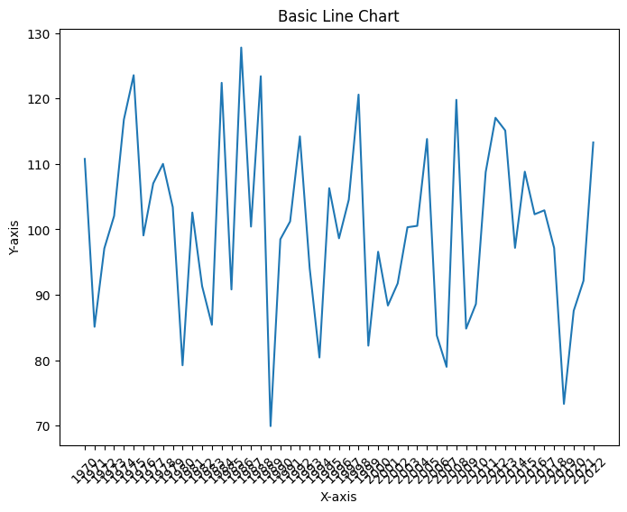
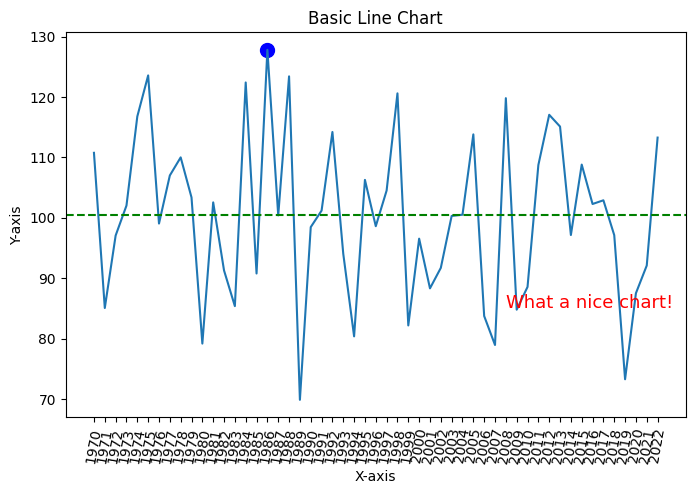

## About line charts

### Principles

A [line chart](https://python-graph-gallery.com/line-chart/) is a type of visual representation that uses a series of points connected by lines to show how data changes over time. It's like connecting the dots on a graph to reveal **trends and patterns**. [Line charts](https://python-graph-gallery.com/line-chart/) are useful for tracking things that happen over a period, such as temperature changes, stock prices, or your savings in a piggy bank. They help us **quickly see** if something goes up, down, or stays steady as time passes, making it easier to understand **how things are changing** and make informed decisions.

### Annotations

Annotations are an essential tool for **enhancing the clarity and insight** of line charts. They allow you to highlight specific data points, events, or trends on the chart. In this tutorial, we will walk through the process of creating **line charts with annotations** using the [Matplotlib](https://python-graph-gallery.com/matplotlib/) library in Python.

## Libraries

First, you need to install the following librairies:
- [matplotlib](https://python-graph-gallery.com/matplotlib/) is used for plot creating the charts
- `numpy` is used to generate some data
- `pandas` is used to put the data into a dataframe

```python
# Libraries
import matplotlib.pyplot as plt
import numpy as np
import pandas as pd
```

## Dataset

[Line chart](https://python-graph-gallery.com/line-chart/) are generally used to represent **variations over time**, but they don't have to be. For example, you can look at [connected scatter plots](https://python-graph-gallery.com/connected-scatter-plot/). 

In our case, however, we will generate dates. To do this, we will simply use a `for` loop and generate annual data, *from 1970 to 2022*. 

Then we generate random values using `np.random.normal()` function from `numpy`.

```python
# Init an empty list that will stores the dates
dates = []

# Iterates over our range and add the value to the list
for date in range(1970,2023):
    dates.append(str(date))
    
# Generate a random variable
sample_size = 2023-1970
variable = np.random.normal(100, # mean
                            15, # standard deviation
                            sample_size, # sample size
                           )

df = pd.DataFrame({'date': dates,
                   'value': variable})
```

## Basic line chart

The following code displays a **simple line chart**, with a title and an axis name, thanks to the `plot()` function.

```python
# Set the fig size
plt.figure(figsize=(8, 6))

# Create the line chart
plt.plot(df['date'],
         df['value'])

# Add labels and a title
plt.xlabel('X-axis')
plt.ylabel('Y-axis')
plt.title('Basic Line Chart')

# Rotate x-axis labels by 45 degrees for better visibility
plt.xticks(rotation=45)

# Display the chart
plt.show()
```

:::output

:::

## Line chart with annotations

In the following code, we will add 3 different annotations:
- A reference line: the **median** (calculated thanks to the `median()` method from `pandas`)
- A circle: the **highest value** (calculated thanks to `idxmax()` method from `pandas` that returns us the index of the highest value)
- A text: just a **fun comment**

The `iloc()` function is a powerful tool in the `pandas` library that allows you to access data in a DataFrame using integer-based indexing. It stands for *"integer location"* and provides a way to **select specific rows and columns** based on their numerical positions, rather than labels.

```python
import matplotlib.pyplot as plt

# Set the fig size
plt.figure(figsize=(8, 5))

# Create the line chart
plt.plot(df['date'],
         df['value'])

# Add labels and a title
plt.xlabel('X-axis')
plt.ylabel('Y-axis')
plt.title('Basic Line Chart')

# Rotate x-axis labels by 45 degrees for better visibility
plt.xticks(rotation=80)

# Add a text annotation
plt.text(df['date'].iloc[38], # x-axis position
         df['value'].iloc[1], # y-axis position
         'What a nice chart!', # text displayed
         fontsize=13,
         color='red')

# Find the index of the highest value
highest_index = df['value'].idxmax()

# Add a circle annotation at the highest value
plt.scatter(df['date'].iloc[highest_index],
            df['value'].iloc[highest_index],
            color='blue',
            marker='o', # Specify that we want a circle
            s=100, # Size
           )

# Calculate the median value
median_value = df['value'].median()

# Add a reference line at the median value
plt.axhline(y=median_value, color='green', linestyle='--', label='Reference Line (Median)')

# Display the chart
plt.show()
```

:::output

:::

## Going further

This article explains how to create a line chart with annotation with [Matplotlib](https://python-graph-gallery.com/matplotlib/).

For more examples of **how to create or customize** your line charts with Python, see the [line chart section](https://python-graph-gallery.com/line-chart/). You may also be interested in [adding an image/logo](https://python-graph-gallery.com/513-add-logo-matplotlib/) to your charts.
