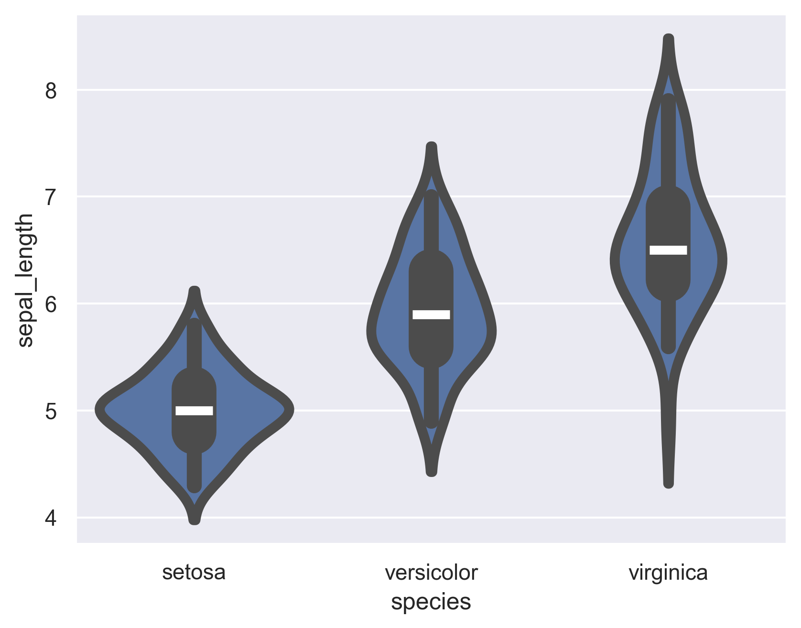
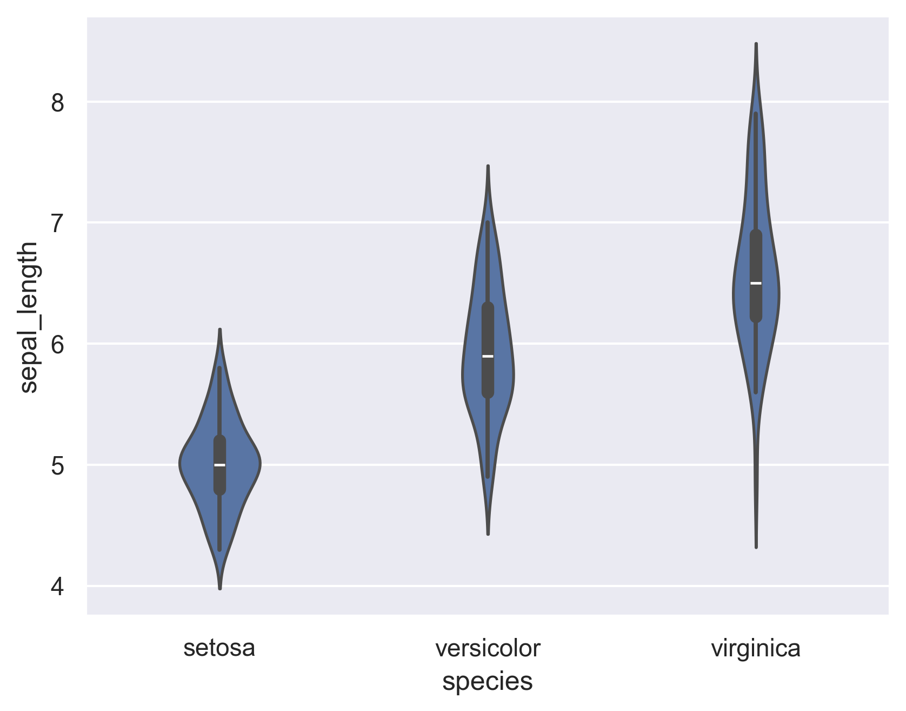
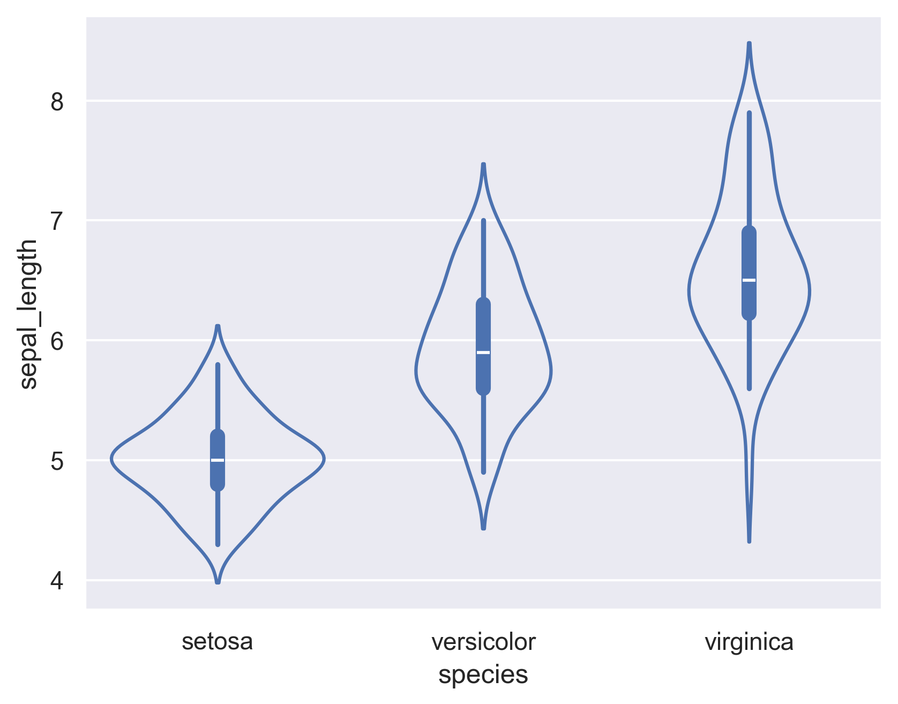
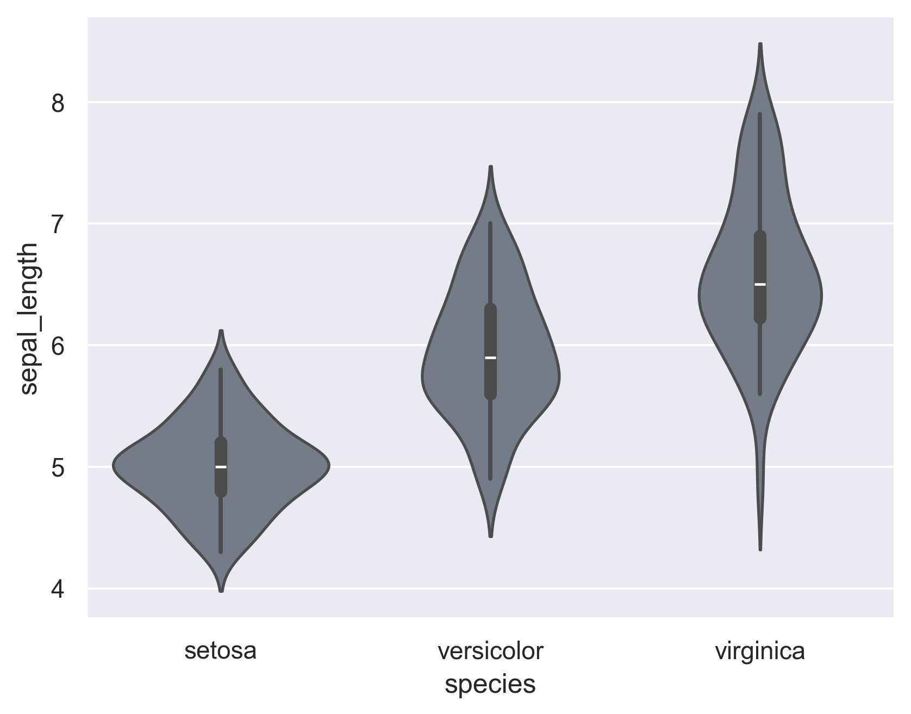

## Change line width

Depending on visual preferences, you may want to accentuate the distribution contour. This can be performed by setting the value of the `linewidth` parameter.

```python

# libraries & dataset
import seaborn as sns
import matplotlib.pyplot as plt
plt.rcParams['figure.dpi'] = 300
  
sns.set_theme(style="darkgrid")
df = sns.load_dataset('iris')
 
# Change line width
sns.violinplot(x=df["species"], y=df["sepal_length"], linewidth=5)
plt.show()
```

:::output

:::

## Change the general width

In the case where you have multiple distributions to display on the same graph and you want to be sure that they do not overlap, you can also change the `width` parameter.

```python
# libraries & dataset
import seaborn as sns
import matplotlib.pyplot as plt
  
sns.set_theme(style="darkgrid")
df = sns.load_dataset('iris')

# Change width
sns.violinplot(x=df["species"], y=df["sepal_length"], width=0.3)
plt.show()
```

:::output

:::

## Empty violins

Thanks to the `fill` argument, we can easily remove the background of the violins:

```python
# libraries & dataset
import seaborn as sns
import matplotlib.pyplot as plt
  
sns.set_theme(style="darkgrid")
df = sns.load_dataset('iris')

# Change width
sns.violinplot(x=df["species"], y=df["sepal_length"], fill=False)
plt.show()
```

:::output

:::

## Saturation

A simple way to improve the style of a violin is to lower the saturation level (default 1):

```python
# libraries & dataset
import seaborn as sns
import matplotlib.pyplot as plt
  
sns.set_theme(style="darkgrid")
df = sns.load_dataset('iris')

# Change width
sns.violinplot(x=df["species"], y=df["sepal_length"], saturation=0.2)
plt.show()
```

:::output

:::

## Going further

- more about [violin plot](/violin-plot)
- combine [violin plot with statistics](/web-ggbetweenstats-with-matplotlib)
- [violin plot with matplotlib](/557-anova-visualization-with-matplotlib)
