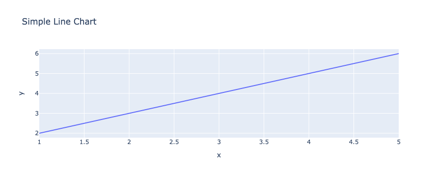
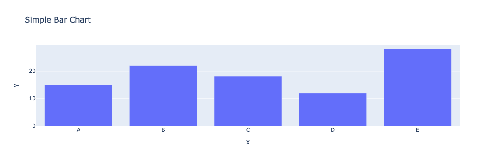

## ⏱ Quick start

Plotly has 2 distinct ways of creating graphs: `plotly express` and `plotly graph objects`, which we'll discuss below. The simplest way to build an **interactive graph** is to use the express API. 

Once you've installed plotly using the `pip install plotly` command, you can create your first interactive graph.

```python
import plotly.express as px

# Sample data
x_values = [1, 2, 3, 4, 5]
y_values = [2, 3, 4, 5, 6]

# Create a line chart using Plotly Express
fig = px.line(x=x_values, y=y_values, title="Simple Line Chart")

# Show the plot
fig.show()
```

:::output

:::

## Two distinct APIs

Important: In the gallery, we'll mainly be using the `plolty.graph_objects` API, as it's the one that allows the most customization.  However, here we'll review the **main differences** between the 2 APIs available. 

`Plotly Express:`

Plotly Express, a **user-friendly** high-level API, taps into Plotly's graphical capabilities to facilitate the swift creation of a diverse array of interactive visualizations. Its streamlined approach empowers users to generate a variety of chart types **with minimal code**. This abstraction shields users from intricate technical details, making it an ideal choice for those seeking an efficient visualization solution without compromising on sophistication.

In the following code, just **2 lines of code** are needed to create an interactive bar chart, using the function `px.bar()`.

```python
import plotly.express as px

# Sample data
categories = ['A', 'B', 'C', 'D', 'E']
values = [15, 22, 18, 12, 28]

# Create a bar chart using Plotly Express
fig = px.bar(x=categories, y=values, title="Simple Bar Chart")

# Show the plot
fig.show()
```

:::output

:::

`Plotly Graph Objects:`

In contrast, the Plotly Graph Objects API presents a **finer level of control** and customization within the Plotly framework. It encompasses essential objects like `Figure`, layout, and data, serving as the bedrock for constructing visualizations. The Figure, which can be represented as a dictionary or instances of `plotly.graph_objects.Figure`, undergoes JSON serialization before being handed off to `plotly.js`.

In the following code, compared to the Express API, we need to initiate a figure object (with a slightly **more complex** syntax) using the function `go.Figure` and then change the layout of this figure using the function `fig.update_layout()`.

```python
import plotly.graph_objects as go

# Sample data
categories = ['A', 'B', 'C', 'D', 'E']
values = [15, 22, 18, 12, 28]

# Create a bar chart using the Graph Object API
fig = go.Figure(data=[go.Bar(x=categories, y=values)])

# Update layout
fig.update_layout(title="Simple Bar Chart", xaxis_title="Categories", yaxis_title="Values")

# Show the plot
fig.show()
```

:::output

:::

Importantly, the `plotly.express` module leverages `plotly.graph_objects` internally, enabling the **creation of entire Figures in one go**. This seamless integration underscores Plotly's versatility, bridging the gap between simplified creation and intricate customization for diverse visualization needs.

## Customizing titles with Plotly

Customizing titles in `Plotly` graph objects **is a straightforward way** to enhance the visual appeal and clarity of your data visualizations. With Plotly, you have the flexibility to modify various aspects of the title, such as its `text`, `font`, `color`, `alignment`, and `positioning`. Here's a brief guide on how to customize titles using Plotly graph objects:

```python
%%capture 

# Add and change title style
fig.update_layout(
    title='Custom Title',
    title_font=dict(size=24,
                    color='blue',
                    family='Arial'),
    title_x=0.5,  # Title positioned at the center horizontally
    title_y=0.9,  # Title positioned near the top vertically
)
```

## Annotation

Annotation is a key part of a **great visualization**. It transforms a simple chart in a whole **piece of story telling**. Before you share your graph with anyone, make sure the key insight are highlighted with `labels`, `shapes` or `color`.

With plotly, we will mainly need to use the `add_annotation()` function.

```python
%%capture

# Add annotation to a specific point
fig.add_annotation(
    x=2, y=11, # postion
    text="Annotated Point", # text
    showarrow=True,
    arrowhead=2,
    arrowsize=1,
    arrowwidth=2,
    arrowcolor="red"
)
```

## ⏱ Saving a plotly chart

Once you've created a `plotly` chart you probably want to save it as a standalone `html` file in order to share it or embed it in another webpage.

This is the code allowing to save a `plotly` chart. You can read the full process here for instance.

```python
fig.write_html("the/path/to/chart-name.html")
```

## ⏱ Embeding a plotly chart

Once the chart has been saved, you can embed it in a html document using:

```python
<iframe
  src="the/path/to/chart-name.html"
  width="800"
  height="600"
  title="chart name"
  style="border:none">
</iframe>
```

## Plotly graph gallery

Here is a glimpse of the plotly charts showcased in the gallery:
