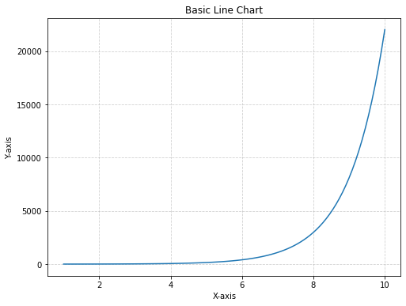
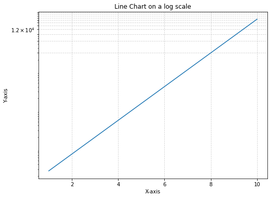

## About line charts

### Principles

A [line chart](https://python-graph-gallery.com/line-chart/) is a type of visual representation that uses a series of points connected by lines to show how data changes over time. It's like connecting the dots on a graph to reveal **trends and patterns**. [Line charts](https://python-graph-gallery.com/line-chart/) are useful for tracking things that happen over a period, such as temperature changes, stock prices, or your savings in a piggy bank. They help us **quickly see** if something goes up, down, or stays steady as time passes, making it easier to understand **how things are changing** and make informed decisions.

### Log transform

In some cases, the data you're working with might span a **wide range of values**, making it difficult to visualize on a traditional linear scale. This is where a `log transformation` can come in handy. A log transformation involves **taking the logarithm of the data values**, which can help compress the range of values and reveal patterns that might be otherwise obscured. This is particularly useful when you have data with **exponential growth or decay**, as the `log transformation` can linearize such relationships.

## Libraries

First, you need to install the following librairies:
- [matplotlib](https://python-graph-gallery.com/matplotlib/) is used for plot creating the charts (and the `MultipleLocator` for showing the log scale)
- `numpy` is used to generate some data
- `pandas` is used to put the data into a dataframe

```python
# Libraries
import matplotlib.pyplot as plt
from matplotlib.ticker import MultipleLocator
import numpy as np
import pandas as pd
```

## Dataset

[Line chart](https://python-graph-gallery.com/line-chart/) are generally used to represent **variations over time**, but they don't have to be. For example, you can take a look at [connected scatter plots](https://python-graph-gallery.com/connected-scatter-plot/). 

In our case, we will generate values using `np.linespace()` and `np.exp()` functions from `numpy`.

```python
# Generate a variable
x = np.linspace(1, 10, 100)  # Create 100 points from 1 to 10
y = np.exp(x)                # Exponential growth

# Create the dataframe
df = pd.DataFrame({'x': x,
                   'y': y})
```

## Line chart without log transformation

The following code displays a **simple line chart**, with a title and an axis name, using the `plot()` function. We don't apply a logarithmic transformation, which makes the graph difficult to read.

For example, we are **unable to say whether** or not the **y-axis has increased** in the first (*more or less*) 14 values.

```python
# Create a figure and axis
fig, ax = plt.subplots(figsize=(8, 6))

# Create the line chart using the axis
ax.plot(df['x'],
        df['y'])

# Add labels and a title
ax.set_xlabel('X-axis')
ax.set_ylabel('Y-axis')
ax.set_title('Basic Line Chart')

# Add a light grid
ax.grid(True, linestyle='--', alpha=0.6)

# Display the chart
plt.show()
```

:::output

:::

## Line chart with log transformation

With [matplotlib](https://python-graph-gallery.com/matplotlib/), it's easy enough to set up a **logarithmic scale**: just add `ax.set_yscale('log')` to our code. The grid in the background is added using the `MultipleLocator()` function from [matplotlib](https://python-graph-gallery.com/matplotlib/), where we add **one line every 3000 steps**.

Now we can **clearly see** that our y value is clearly **increasing exponentially** with our x value, thanks to our `log scale`!

```python
# Create a figure and axis
fig, ax = plt.subplots(figsize=(8, 6))

# Create the line chart using the axis
ax.plot(df['x'],
        df['y'])

# Set the y-axis to a log scale
ax.set_yscale('log')

# Add labels and a title
ax.set_xlabel('X-axis')
ax.set_ylabel('Y-axis')
ax.set_title('Line Chart on a log scale')

# Add the grid for the log scale
y_major_locator = MultipleLocator(3000)  # Set the grid interval to 3000
ax.yaxis.set_major_locator(y_major_locator)

# Add a grid with a log scale
ax.grid(True, linestyle='--', alpha=0.6)

# Display the chart
plt.show()
```

:::output

:::

## Going further

This article explains how to create a line chart with logarithmic scale with [Matplotlib](https://python-graph-gallery.com/matplotlib/).

For more examples of **how to create or customize** your line charts with Python, see the [line chart section](https://python-graph-gallery.com/line-chart/). You may also be interested in creating a [line chart with multiple groups](https://python-graph-gallery.com/122-multiple-lines-chart/) to your chart.
