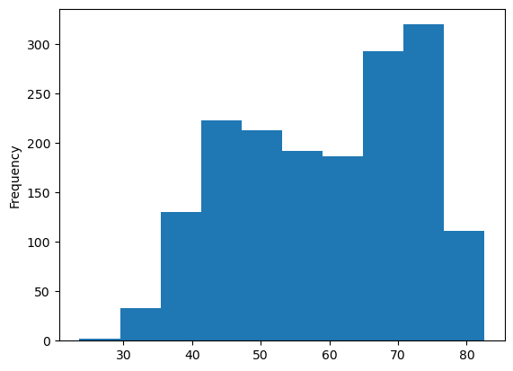

## Libraries

[Pandas](https://python-graph-gallery.com/pandas/) is a popular open-source Python library used for data manipulation and analysis. It provides data structures and functions that make working with structured data, such as tabular data (like `Excel` spreadsheets or `SQL` tables), easy and intuitive.

To install [Pandas](https://python-graph-gallery.com/pandas/), you can use the **following command** in your command-line interface (such as `Terminal` or `Command Prompt`):

`pip install pandas`

[Matplotlib](https://python-graph-gallery.com/matplotlib/) functionalities have been **integrated into the pandas** library, facilitating their use with `dataframes` and `series`. For this reason, you might also need to **import the [matplotlib](https://python-graph-gallery.com/matplotlib/) library** when building charts with [Pandas](https://python-graph-gallery.com/pandas/).

This also means that they use the **same functions**, and if you already know [Matplotlib](https://python-graph-gallery.com/matplotlib/), you'll have no trouble learning plots with [Pandas](https://python-graph-gallery.com/pandas/).

```python
import pandas as pd
import matplotlib.pyplot as plt
```

## Dataset

In order to create graphics with [Pandas](https://python-graph-gallery.com/pandas/), we need to use **pandas objects**: `Dataframes` and `Series`. A dataframe can be seen as an `Excel` table, and a series as a `column` in that table. This means that we must **systematically** convert our data into a format used by pandas.

Since [histograms](https://python-graph-gallery.com/histogram/) need quantitative variables, we will get the Gap Minder dataset using the `read_csv()` function. The data can be accessed using the **url below**.

```python
url = 'https://raw.githubusercontent.com/holtzy/The-Python-Graph-Gallery/master/static/data/gapminderData.csv'
df = pd.read_csv(url)
```

## Histogram with the hist() function

Once we've opened our dataset, we'll now **create the graph**. The following displays the **distribution** of the life expectancy using the `hist()` function. This is probably one of the **shortest ways** to display a [histogram](https://python-graph-gallery.com/histogram/) in Python.

```python
df["lifeExp"].hist()
plt.show()
```

:::output

:::

## Histogram with the plot() function

We'll now look at how to create a [histogram](https://python-graph-gallery.com/histogram/) using the `plot()` function. This function is **very general** and therefore requires **more arguments** to be specified when it is called.

The main argument is `kind`. This specifies the type of chart we want (in our case it's `'hist'`). For example, we could have put `'line'` for a [line chart](https://python-graph-gallery.com/line-chart/) but **not** `'scatter'` since we need 2 variables for a [scatter plot](https://python-graph-gallery.com/scatter-plot/) (this will **trigger an error**).

```python
df["lifeExp"].plot(kind='hist')
plt.show()
```

:::output

:::

## Histogram with the plot.hist() function

And now we'll look at how to create a [histogram](https://python-graph-gallery.com/histogram/) using the `plot.hist()` function. This function is a **combination of the previous 2**, but is *no more* complicated.

```python
df["lifeExp"].plot.hist()
plt.show()
```

:::output

:::

## Going further

This post explains how to create a simple histogram with [pandas](https://python-graph-gallery.com/pandas/) in 3 different ways.

For more examples of **how to create or customize** your plots with Pandas, see the [pandas section](https://python-graph-gallery.com/pandas/). You may also be interested in how to customize your histograms with [Matplotlib and Seaborn](https://python-graph-gallery.com/histogram/).
