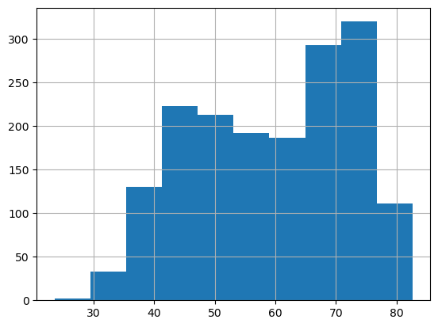
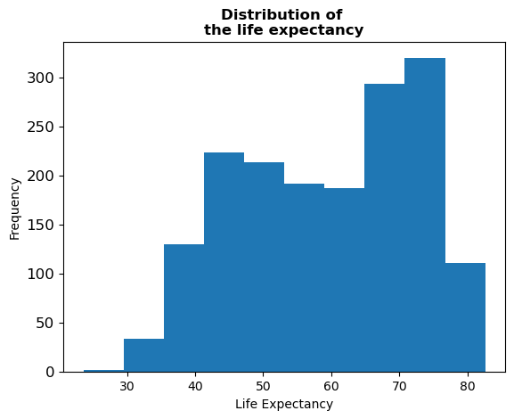
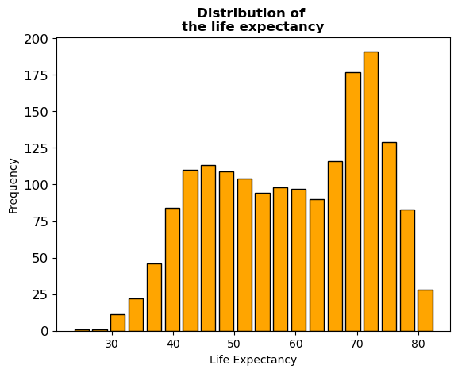

## Libraries

[Pandas](https://python-graph-gallery.com/pandas/) is a popular open-source Python library used for data manipulation and analysis. It provides data structures and functions that make working with structured data, such as tabular data (like `Excel` spreadsheets or `SQL` tables), easy and intuitive.

To install [Pandas](https://python-graph-gallery.com/pandas/), you can use the **following command** in your command-line interface (such as `Terminal` or `Command Prompt`):

`pip install pandas`

[Matplotlib](https://python-graph-gallery.com/matplotlib/) functionalities have been **integrated into the pandas** library, facilitating their use with `dataframes` and `series`. For this reason, you might also need to **import the [matplotlib](https://python-graph-gallery.com/matplotlib/) library** when building charts with [Pandas](https://python-graph-gallery.com/pandas/).

This also means that they use the **same functions**, and if you already know [Matplotlib](https://python-graph-gallery.com/matplotlib/), you'll have no trouble learning plots with [Pandas](https://python-graph-gallery.com/pandas/).

```python
import pandas as pd
import matplotlib.pyplot as plt
```

## Dataset

In order to create graphics with [Pandas](https://python-graph-gallery.com/pandas/), we need to use **pandas objects**: `Dataframes` and `Series`. A dataframe can be seen as an `Excel` table, and a series as a `column` in that table. This means that we must **systematically** convert our data into a format used by pandas.

Since [histograms](https://python-graph-gallery.com/histogram/) need quantitative variables, we will get the Gap Minder dataset using the `read_csv()` function. The data can be accessed using the **url below**.

```python
url = 'https://raw.githubusercontent.com/holtzy/The-Python-Graph-Gallery/master/static/data/gapminderData.csv'
df = pd.read_csv(url)
```

## Basic histogram

Once we've opened our dataset, we'll now **create a simple histogram**. The following displays the **distribution** of the life expectancy using the `hist()` function. This is probably one of the **shortest ways** to display a [histogram](https://python-graph-gallery.com/histogram/) in Python.

```python
df["lifeExp"].hist()
plt.show()
```

:::output

:::

## Format background

Here we'll see how to remove the **background grid** and add a **reference line**. The main difference with the previous code chunk is that we **save the object** used to create the graph in `ax` and **use it to add** the reference line.

- remove grid: we just add the `grid=False` argument
- reference line: we use the `axhline()` function (for horizontal line, `axvline()` otherwise), specify the position, the color and the style of the line

```python
# Plot the histogram with a reference line
ax = df["lifeExp"].hist(grid=False)
ax.axhline(y=100, color='black', linestyle='--')

# Show the plot
plt.show()
```

:::output

:::

## Custom axis and title

Adding titles and names to axes with [Pandas](https://python-graph-gallery.com/pandas/) requires a **syntax very similar** to that of [matplotlib](https://python-graph-gallery.com/matplotlib/). 

Here we use the `set_title()` and `set_xlabel()` (and `set_ylabel()`) functions to add them. We add the `weight='bold'` argument so that the title really **looks like a title**.

```python
ax = df["lifeExp"].hist(grid=False, # Remove grid
                        xlabelsize=10, # Change size of labels on the x-axis
                        ylabelsize=12, # Change size of labels on the y-axis
                       )

# Add a bold title ('\n' allow us to jump rows)
ax.set_title('Distribution of \nthe life expectancy',
             weight='bold') 

# Add label names
ax.set_xlabel('Life Expectancy')
ax.set_ylabel('Frequency')

# Show the plot
plt.show()
```

:::output

:::

## Control bars (or bins)

An important part of [histogram](https://python-graph-gallery.com/histogram/) customization concerns **the bars** (or bins). We can decide to modify their **number**, **color**, **border color**, etc. [Learn more about bins](https://www.data-to-viz.com/graph/histogram.html) in histograms. We'll see how to add **space between bins**.

With [Pandas](https://python-graph-gallery.com/pandas/), it's actually **easy to change** these parameters. In the `hist()` function we just have to add the `bins=20` (*number of bins*), `rwidth=0.8` (*keep only 80% of the space between bins, instead of 100% by default*) `edgecolor='black'` (*border color*) and `color='orange'` (*color of the bins*) arguments.

Our chart is now getting pretty cool!

```python
ax = df["lifeExp"].hist(grid=False, # Remove grid
                        xlabelsize=10, # Change size of labels on the x-axis
                        ylabelsize=12, # Change size of labels on the y-axis
                        bins=20, # Number of bins
                        edgecolor='black', # Color of the border
                        color='orange', # Color of the bins
                        rwidth=0.8 # Space between bins
                       )

# Add a bold title ('\n' allow us to jump rows)
ax.set_title('Distribution of \nthe life expectancy',
             weight='bold') 

# Add label names
ax.set_xlabel('Life Expectancy')
ax.set_ylabel('Frequency')

# Show the plot
plt.show()
```

:::output

:::

## Going further

This post explains how to customize title, axis and bins of a histogram built with [pandas](https://python-graph-gallery.com/pandas/).

For more examples of **how to create or customize** your plots with Pandas, see the [pandas section](https://python-graph-gallery.com/pandas/). You may also be interested in how to customize your histograms with [Matplotlib and Seaborn](https://python-graph-gallery.com/histogram/).
