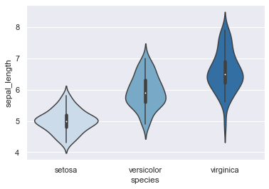
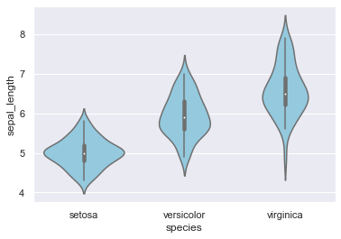
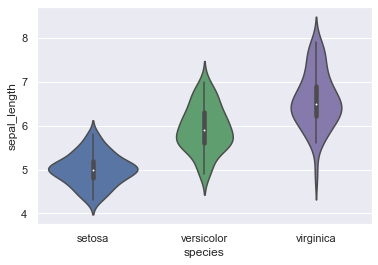
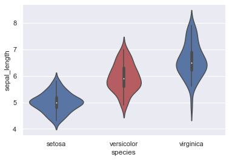

## Using a color palette

Simply set the 'palette' parameter in the violinplot function. Doing so can add information on the groups order for example. Thus, keep in mind that adding a color palette to your graph can orientate the way readers will interpret it.

```python
# libraries & dataset
import seaborn as sns
import matplotlib.pyplot as plt

sns.set_theme(style="darkgrid")
df = sns.load_dataset('iris')

# Use a color palette
sns.violinplot(x=df["species"], y=df["sepal_length"], palette="Blues")
plt.show()
```

:::output

:::

## Uniform color

Setting a unique value for the 'color' parameter will fill all distribution areas with the same color.

```python
# libraries & dataset
import seaborn as sns
import matplotlib.pyplot as plt

sns.set_theme(style="darkgrid")
df = sns.load_dataset('iris')

# plot
sns.violinplot(x=df["species"], y=df["sepal_length"], color="skyblue")
plt.show()
```

:::output

:::

## Specify a color for each distribution

Rather than using a generic palette color, you can also instantiate a dictionary (here named my_pal) and set the 'palette' parameter to such dictionary.

```python
# libraries & dataset
import seaborn as sns
import matplotlib.pyplot as plt

sns.set_theme(style="darkgrid")
df = sns.load_dataset('iris')

# creating a dictionary with one specific color per group:
my_pal = {"versicolor": "g", "setosa": "b", "virginica": "m"}

# plot it
sns.violinplot(x=df["species"], y=df["sepal_length"], palette=my_pal)
plt.show()
```

:::output

:::

## Highlight a group

Whenever one group is to be differentiated from the others, you can build the custom palette dictionary so that this group's color is unique.

```python
# libraries & dataset
import seaborn as sns
import matplotlib.pyplot as plt

sns.set_theme(style="darkgrid")
df = sns.load_dataset('iris')

# creating a dictionary composed of species as keys and colors as values: red for the interesting group, blue for others
my_pal = {species: "r" if species ==
          "versicolor" else "b" for species in df["species"].unique()}

# make the plot
sns.violinplot(x=df["species"], y=df["sepal_length"], palette=my_pal)
plt.show()
```

:::output

:::

## Going further

This post explains how to build a [violinplot](/violin-plot) with [seaborn](/seaborn).

You might be interested in how to create a [violin plot with boxplots on top of it](/web-ggbetweenstats-with-matplotlib) and how to [add a beeswarm plot](/502-violinplot-and-swarmplot).
