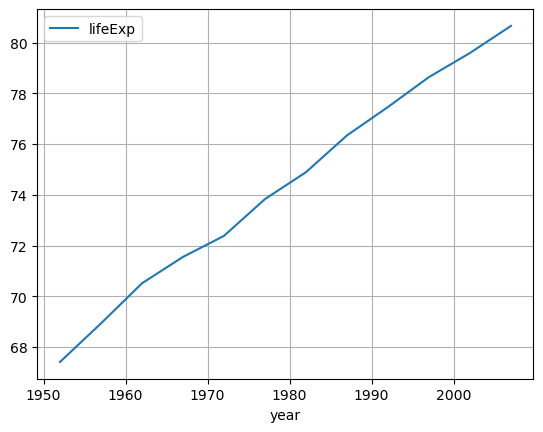
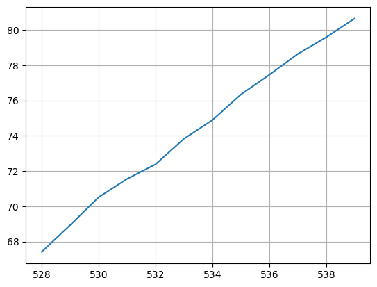

## Libraries

[Pandas](https://python-graph-gallery.com/pandas/) is a popular open-source Python library used for data manipulation and analysis. It provides data structures and functions that make working with structured data, such as tabular data (like `Excel` spreadsheets or `SQL` tables), easy and intuitive.

To install [Pandas](https://python-graph-gallery.com/pandas/), you can use the **following command** in your command-line interface (such as `Terminal` or `Command Prompt`):

`pip install pandas`

[Matplotlib](https://python-graph-gallery.com/matplotlib/) functionalities have been **integrated into the pandas** library, facilitating their use with `dataframes` and `series`. For this reason, you might also need to **import the [matplotlib](https://python-graph-gallery.com/matplotlib/) library** when building charts with [Pandas](https://python-graph-gallery.com/pandas/).

This also means that they use the **same functions**, and if you already know [Matplotlib](https://python-graph-gallery.com/matplotlib/), you'll have no trouble learning plots with [Pandas](https://python-graph-gallery.com/pandas/).

```python
import pandas as pd
import matplotlib.pyplot as plt
```

## Dataset

In order to create graphics with [Pandas](https://python-graph-gallery.com/pandas/), we need to use **pandas objects**: `Dataframes` and `Series`. A dataframe can be seen as an `Excel` table, and a series as a `column` in that table. This means that we must **systematically** convert our data into a format used by pandas.

Since [histograms](https://python-graph-gallery.com/histogram/) need quantitative variables, we will get the Gap Minder dataset using the `read_csv()` function. The data can be accessed using the **url below**. 

To have just one line, we create a **subset of our data frame** to select only the rows for France.

```python
url = 'https://raw.githubusercontent.com/holtzy/The-Python-Graph-Gallery/master/static/data/gapminderData.csv'
df = pd.read_csv(url)

# Subset rows for France only
df = df[df['country']=='France']
```

## Basic line chart with a Dataframe

Once we've opened our dataset, we'll now **create the graph**. The following displays the **evolution** of the life expectancy using the `plot()` function. Also, keep in mind that the `kind='line'` argument is **facultative** (you can remove it!) since it's the default value when calling the `plot()` function

```python
# Create and display the linechart
df.plot(x='year',
               y='lifeExp',
               kind='line', # (facultative) Default argument
               grid=True, # Add a grid in the background
              )
plt.show()
```

:::output

:::

## Basic line chart with a Series

We can create the (*almost*) same chart **using only the column** of `'lifeExp'` (called a **Series**) of the dataframe. In this case, we do not have to specify which value will be on the `x` or `y` axis, **but** the x-axis will be filled with the index of the rows **instead of the years**.

Also, the **legend will not be displayed by default** (we have to put it manually if we want it)

```python
# Create and display the linechart
df['lifeExp'].plot(grid=True)
plt.show()
```

:::output

:::

## Going further

This post explains how to create a simple line chart with [pandas](https://python-graph-gallery.com/pandas/) in **2 different ways** (using a DataFrame and a Series).

For more examples of **how to create or customize** your line charts with Pandas, see the [line charts section](https://python-graph-gallery.com/line-chart/). You may also be interested in how to customize your line charts with [Matplotlib and Seaborn](https://python-graph-gallery.com/histogram/).
