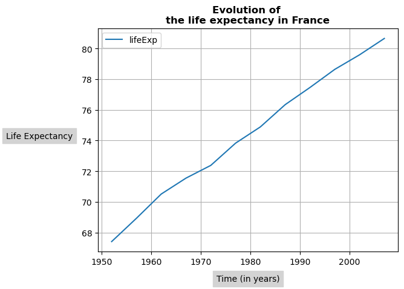
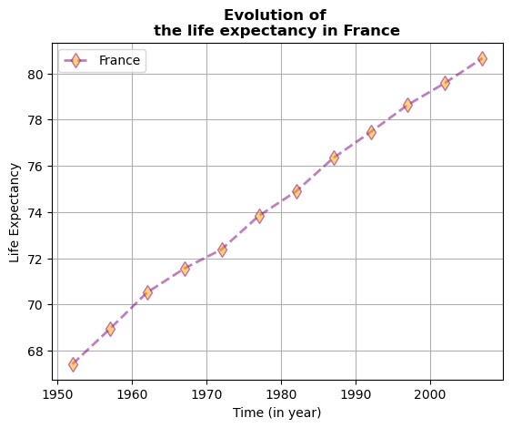

## Libraries

[Pandas](https://python-graph-gallery.com/pandas/) is a popular open-source Python library used for data manipulation and analysis. It provides data structures and functions that make working with structured data, such as tabular data (like `Excel` spreadsheets or `SQL` tables), easy and intuitive.

To install [Pandas](https://python-graph-gallery.com/pandas/), you can use the **following command** in your command-line interface (such as `Terminal` or `Command Prompt`):

`pip install pandas`

[Matplotlib](https://python-graph-gallery.com/matplotlib/) functionalities have been **integrated into the pandas** library, facilitating their use with `dataframes` and `series`. For this reason, you might also need to **import the [matplotlib](https://python-graph-gallery.com/matplotlib/) library** when building charts with [Pandas](https://python-graph-gallery.com/pandas/).

This also means that they use the **same functions**, and if you already know [Matplotlib](https://python-graph-gallery.com/matplotlib/), you'll have no trouble learning plots with [Pandas](https://python-graph-gallery.com/pandas/).

```python
import pandas as pd
import matplotlib.pyplot as plt
```

## Dataset

In order to create graphics with [Pandas](https://python-graph-gallery.com/pandas/), we need to use **pandas objects**: `Dataframes` and `Series`. A dataframe can be seen as an `Excel` table, and a series as a `column` in that table. This means that we must **systematically** convert our data into a format used by pandas.

Since [histograms](https://python-graph-gallery.com/histogram/) need quantitative variables, we will get the Gap Minder dataset using the `read_csv()` function. The data can be accessed using the **url below**. 

To have just one line, we create a **subset of our data frame** to select only the rows for France.

```python
url = 'https://raw.githubusercontent.com/holtzy/The-Python-Graph-Gallery/master/static/data/gapminderData.csv'
df = pd.read_csv(url)

# Subset rows for France only
df_france = df[df['country']=='France']
```

## Basic line chart

Once we've opened our dataset, we'll now **create the graph**. The following displays the **evolution** of the life expectancy using the `plot()` function. Also, keep in mind that the `kind='line'` argument is **facultative** (you can remove it!) since it's the default value when calling the `plot()` function.

```python
# Create and display the linechart
df_france.plot(x='year',
               y='lifeExp',
               kind='line', # (facultative) Default argument
               grid=True, # Add a grid in the background
              )
plt.show()
```

:::output

:::

## Custom axis and title

Adding titles and names to axes with [Pandas](https://python-graph-gallery.com/pandas/) requires a **syntax very similar** to that of [matplotlib](https://python-graph-gallery.com/matplotlib/). 

Here we use the `set_title()` and `set_xlabel()` (and `set_ylabel()`) functions to add them. We add the `weight='bold'` argument so that the title really **looks like a title**. I give you example of customizations but but you can **change them** the way you want!

```python
ax = df_france.plot(x='year',
                    y='lifeExp',
                    grid=True)

# Add a bold title ('\n' allow us to jump rows)
ax.set_title('Evolution of \nthe life expectancy in France',
             weight='bold') 

# Add label names
ax.set_ylabel('Life Expectancy',
              rotation=0, # Rotate it (default to 90)
              labelpad=50, # Shift it
              backgroundcolor='lightgray' # Background color
             )
ax.set_xlabel('Time (in years)',
              labelpad=10, # Shift it
              backgroundcolor='lightgray' # Background color
             )


# Show the plot
plt.show()
```

:::output

:::

## Change line style

The line is highly customizable:
- `color` argument for the **color of the line**
- `linewidth` argument for the **width of the line**
- `alpha` argument for the **opacity of the line**: between 0 (lowest) and 1 (highest)
- `label` argument for the **text in the legend**
- **add markers** at each point and change their style

Example of properties of the markers:
- **shape** with the `marker` argument (**lots of possibilities** here: `'.'`, `','`, `'o'`, `'v'`, `'^'`, `'<'`, `'>'`, `'s'`, `'p'`, `'*'`, `'+'`, `'x'`, `'D'`, `'d'`, `'h'`, `'H'`, `'1'`, `'2'`, `'3'`, `'4'`)
- **size** wither the `markersize` argument
- **color** with the `makerfacecolor` argument)

```python
# Customize the line style, color, and width
ax = df_france.plot(x='year',
                    y='lifeExp',
                    grid=True,
                    linestyle='--',
                    alpha=0.5, # Opacity
                    color='purple',
                    linewidth=2.0, # Width
                    marker='d',  # Markers shape
                    markersize=8,  # Markers size
                    markerfacecolor='orange', # Markers color
                    label='France'
                   )

# Add a bold title ('\n' allow us to jump rows)
ax.set_title('Evolution of \nthe life expectancy in France',
             weight='bold') 

# Add label names
ax.set_ylabel('Life Expectancy')
ax.set_xlabel('Time (in year)')

# Show the plot
plt.show()
```

:::output

:::

## Going further

This post explains how to customize a line chart built with [pandas](https://python-graph-gallery.com/pandas/).

For more examples of **how to create or customize** your line charts, see the [line charts section](https://python-graph-gallery.com/line-chart/). You may also be interested in how to created an [area chart](https://python-graph-gallery.com/area-plot/).
