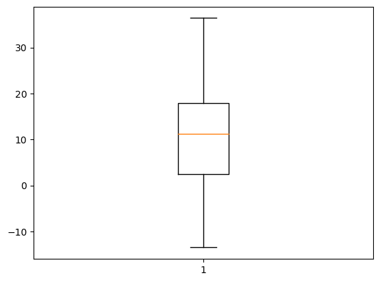
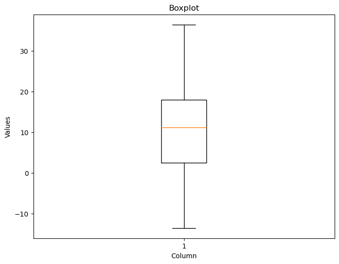
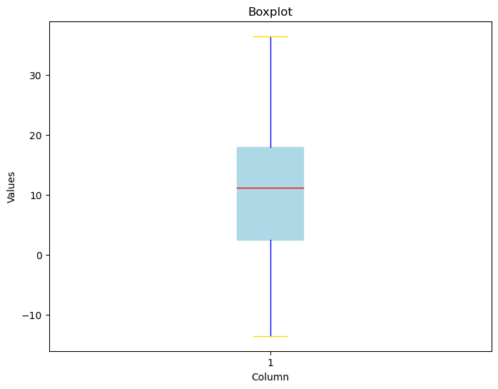

## Libraries

First, you need to install the following librairies:
- [matplotlib](https://python-graph-gallery.com/matplotlib/) is used for creating the plot
- `pandas` for data manipulation

```python
import matplotlib.pyplot as plt
import pandas as pd
```

## Dataset

We will use a dataset about **temperature variation** in Trentino (Italy), that you can easily access using the `url` below.

```python
url = 'https://raw.githubusercontent.com/holtzy/The-Python-Graph-Gallery/master/static/data/trentino_temperature.csv'
df = pd.read_csv(url)

# Drop rows (5 in total) with NaN values
df = df.dropna()
```

## Basic boxplot

Once we've opened our dataset, we'll now **create the graph**. The following displays the **distribution** of the temperature variation using the `boxplot()` function.

```python
# Create a figure and axis
fig, ax = plt.subplots()

# Create a boxplot for the desired column
ax.boxplot(df['temp'])

# Show the plot
plt.show()
```

:::output

:::

## Add title and label

To clarify things for the reader, it's a good idea to **add a title and a name to the axes**. And to do this with [matplotlib](https://python-graph-gallery.com/matplotlib/), nothing could be simpler: we simply use the `set_xlabel()` (or `set_ylabel()`) and `set_title()` functions

```python
# Create a figure and axis
fig, ax = plt.subplots(figsize=(8,6))

# Create a boxplot for the desired column with custom colors
boxplot = ax.boxplot(df['temp'])

# Set labels and title
ax.set_xlabel('Column')
ax.set_ylabel('Values')
ax.set_title('Boxplot')

# Show the plot
plt.show()
```

:::output

:::

## Color customization features

With [matplotlib](https://python-graph-gallery.com/matplotlib/), you can change the **color of each element** in our box plot.

We just have to define what color we want for each element and then **add it** to our plot using `setp()` function. Here's an example of how:

```python
# Create a figure and axis
fig, ax = plt.subplots(figsize=(8,6))

# Create a boxplot for the desired column with custom colors
boxplot = ax.boxplot(df['temp'], patch_artist=True)

# Set custom colors
box_color = 'lightblue'
whisker_color = 'blue'
cap_color = 'gold'
flier_color = 'red'
median_color = 'red'

# Add the right color for each part of the box
plt.setp(boxplot['boxes'], color=box_color)
plt.setp(boxplot['whiskers'], color=whisker_color)
plt.setp(boxplot['caps'], color=cap_color)
plt.setp(boxplot['fliers'], markerfacecolor=flier_color)
plt.setp(boxplot['medians'], color=median_color)

# Set labels and title
ax.set_xlabel('Column')
ax.set_ylabel('Values')
ax.set_title('Boxplot')

# Show the plot
plt.show()
```

:::output

:::

## Going further

This post explains how to create a simple boxplot with [matplotlib](https://python-graph-gallery.com/matplotlib/).

For more examples of **how to create or customize** your boxplots, see the [boxplot section](https://python-graph-gallery.com/boxplot/). You may also be interested in how to created an [boxplot with multiple groups](https://python-graph-gallery.com/30-basic-boxplot-with-seaborn/).
