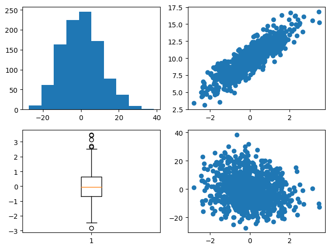
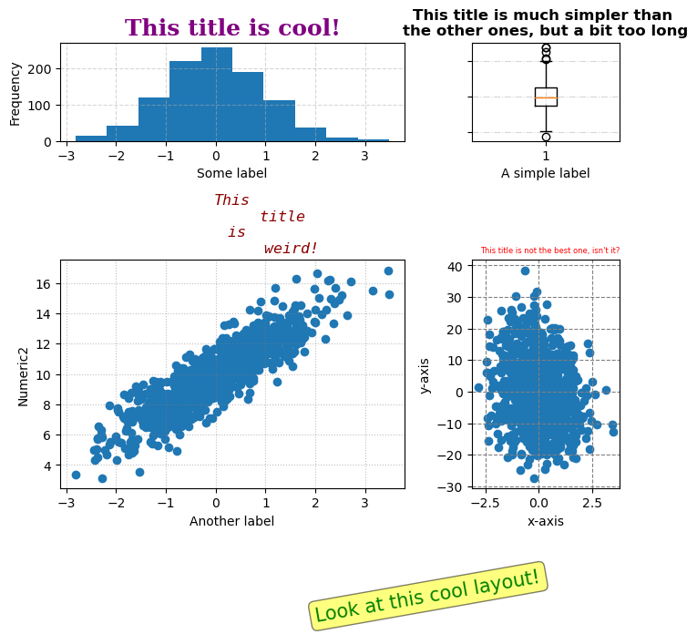

## Libraries

First, you need to install the following librairies:
- [matplotlib](https://python-graph-gallery.com/matplotlib/) is used for plot creating the charts
- `numpy` is used to generate some data
- `pandas` is used to put the data into a dataframe

```python
import matplotlib.pyplot as plt
import pandas as pd
import numpy as np
```

## Dataset

In order to be as exhaustive as possible, we need to create a dataset with enought variety.

- `Numeric1` and `Numeric2` are positively correlated variables, with `Numeric2` being calculated as **Numeric1 plus some random noise**.
- `Numeric3` is a **negatively correlated** variable to `Numeric1`.

We use the `random.normal()` function from `numpy` in order to create randomly distributed variables.

```python
# Generate data for three numeric columns
sample_size = 1000

# Positively correlated variables
variable1 = np.random.normal(0, 1, sample_size)
variable2 = 2 * variable1 + np.random.normal(10, 1, sample_size)

# Negatively correlated variables
variable3 = -2 * variable1 + np.random.normal(0, 10, sample_size)

# Create a DataFrame
df = pd.DataFrame({
    'Numeric1': variable1,
    'Numeric2': variable2,
    'Numeric3': variable3
})
```

## Initial graph 

Here's the chart we're going to customize. It consists of a **2x2 frame** with different types of graphics, but **without any customization** (all default argument).

```python
# Create a 2x2 subplot layout
fig, axes = plt.subplots(nrows=2,
                         ncols=2,
                         figsize=(8, 6))

axes[0, 0].hist(df['Numeric3']) # Histogram in the upper left
axes[0, 1].scatter(df['Numeric1'], df['Numeric2']) # Scatter plot in the upper right
axes[1, 0].boxplot(df['Numeric1']) # Boxplot in the lower left
axes[1, 1].scatter(df['Numeric1'], df['Numeric3']) # Scatter plot in the lower right

# Show the plots
plt.show()
```

:::output

:::

## Customize the layout of the chart

Here are all the customization elements we are going to add:
- change the **division of each subgraph** on the global graph using the `add_gridspec()` function
- create a wide **variety of titles**: size, color, font, position, etc
- add different **grids** for each sub-graph using the `grid()` function
- add an **annotation** that says how cool our chart is using the `text()` function only

```python
# Create a 2x2 subplot layout
fig = plt.figure(figsize=(7, 6))

# Define the grid layout
gs = fig.add_gridspec(2, 2,
                 width_ratios=[7, 3],
                 height_ratios=[3, 7])

# Add annotation to the right
fig.text(0.5, -0.1, 'Look at this cool layout!',
         fontsize=15, color='green', rotation=10,
         verticalalignment='center',
         bbox=dict(boxstyle='round',
                   facecolor='yellow',
                   alpha=0.5))


# Plot 1: Histogram in the upper left
ax1 = fig.add_subplot(gs[0, 0])
ax1.hist(df['Numeric1'])
ax1.set_title('This title is cool!',
              fontsize=18, fontweight='bold',
              color='purple', fontfamily='serif')
ax1.grid(True, linestyle='--', alpha=0.5)


# Plot 2: Scatter plot in the lower left
ax2 = fig.add_subplot(gs[1, 0])
ax2.scatter(df['Numeric1'], df['Numeric2'])
ax2.set_title('This\n           title\n is\n             weird!',
              fontsize=12, fontstyle='italic',
              color='darkred', fontfamily='monospace')
ax2.grid(True, linestyle=':', color='gray', alpha=0.5)


# Plot 3: Boxplot in the upper right
ax3 = fig.add_subplot(gs[0, 1])
ax3.boxplot(df['Numeric1'])
ax3.set_title('This title is much simpler than \nthe other ones, but a bit too long',
              fontsize=12, fontweight='bold',
              color='black', fontfamily='sans-serif')
ax3.grid(True, linestyle='-.', alpha=0.5)


# Plot 4: Scatter plot in the lower right
ax4 = fig.add_subplot(gs[1, 1])
ax4.scatter(df['Numeric1'], df['Numeric3'])
ax4.set_title("This title is not the best one, isn't it?",
              fontsize=6, color='red',
              loc='right')
ax4.grid(True, linestyle='--', color='gray', alpha=1)


# Add labels and ticks
ax1.set_xlabel('Some label')
ax1.set_ylabel('Frequency')
ax2.set_xlabel('Another label')
ax2.set_ylabel('Numeric2')
ax3.set_xlabel('A simple label')
ax3.set_yticklabels([])
ax4.set_xlabel('x-axis')
ax4.set_ylabel('y-axis')

# Adjust layout
plt.tight_layout()

# Show the plots
plt.show()
```

:::output

:::

## Going further

This post explains how to create a very customized layout in [matplotlib](https://python-graph-gallery.com/matplotlib/).

For more examples of **how to create or customize** your plots with matplotlib, see the [matplotlib section](https://python-graph-gallery.com/matplotlib/). You may also be interested in how to [custom your fonts](https://python-graph-gallery.com/custom-fonts-in-matplotlib/) with matplotlib.
