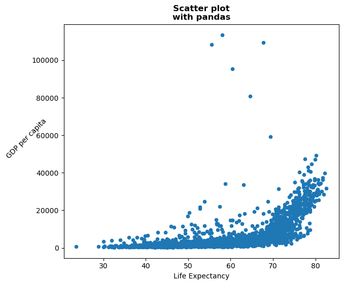
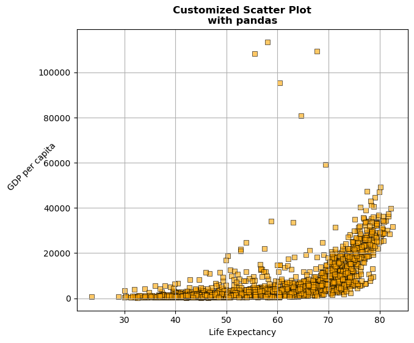

## Libraries

[Pandas](https://python-graph-gallery.com/pandas/) is a popular open-source Python library used for data manipulation and analysis. It provides data structures and functions that make working with structured data, such as tabular data (like `Excel` spreadsheets or `SQL` tables), easy and intuitive.

To install [Pandas](https://python-graph-gallery.com/pandas/), you can use the **following command** in your command-line interface (such as `Terminal` or `Command Prompt`):

`pip install pandas`

[Matplotlib](https://python-graph-gallery.com/matplotlib/) functionalities have been **integrated into the pandas** library, facilitating their use with `dataframes` and `series`. For this reason, you might also need to **import the [matplotlib](https://python-graph-gallery.com/matplotlib/) library** when building charts with [Pandas](https://python-graph-gallery.com/pandas/).

This also means that they use the **same functions**, and if you already know [Matplotlib](https://python-graph-gallery.com/matplotlib/), you'll have no trouble learning plots with [Pandas](https://python-graph-gallery.com/pandas/).

```python
import pandas as pd
import matplotlib.pyplot as plt
```

## Dataset

In order to create graphics with [Pandas](https://python-graph-gallery.com/pandas/), we need to use **pandas objects**: `Dataframes` and `Series`. A dataframe can be seen as an `Excel` table, and a series as a `column` in that table. This means that we must **systematically** convert our data into a format used by pandas.

Since [scatter plots](https://python-graph-gallery.com/histogram/) need quantitative variables, we will get the Gap Minder dataset using the `read_csv()` function. The data can be accessed using the **url below**.

```python
url = 'https://raw.githubusercontent.com/holtzy/The-Python-Graph-Gallery/master/static/data/gapminderData.csv'
df = pd.read_csv(url)
```

## Basic scatter plot

Once we've opened our dataset, we'll now **create the graph**. The following displays the **relation** between the life expectancy and the gdp/capita using the `scatter()` function. This is probably one of the **shortest ways** to display a [scatter plot](https://python-graph-gallery.com/scatter-plot/) in Python.

```python
df.plot.scatter('lifeExp', # x-axis
                'gdpPercap', # y-axis
                grid=True, # Add a grid in the background
               )
plt.show()
```

:::output

:::

## Format layout

Here we'll see how to remove the **background grid**, add some **labels** and the change the **size of the figure**. The main difference with the previous code chunk is that we **save the object** used to create the graph in `ax` and **use it** to add elements (like title) to the chart.

- **remove grid**: we just have to remove the `grid=True` argument
- **add labels**: `set_title()` and `set_xlabel()` functions
- change the **figure size**: add the `figsize(width,height)` argument when using the `scatter()` function

```python
ax = df.plot.scatter('lifeExp', # x-axis
                     'gdpPercap', # y-axis
                     figsize=(7,6)
                    )

# Add title and labels ('\n' allow us to jump rows)
ax.set_title('Scatter plot\nwith pandas',
             weight='bold')
ax.set_xlabel('Life Expectancy')
ax.set_ylabel('GDP per capita',
              rotation=45) # rotate 45°

# Show the plot
plt.show()
```

:::output

:::

## Custom markers

The main component of a [scatter plot](https://python-graph-gallery.com/scatter-plot/) is the **markers**, or the points. You can customize them a lot with Pandas. Here's what we'll do:
- **type**: `marker` argument (must be in the following list: `o`, `s`, `d`, `^`, `v`, `<`, `>`, `p`, `*`, `+`, `x`, `h`, `1`, `2`, `3`, `4`)
- **color**: `color` argument
- **color of the edges**: `edgecolor` argument
- **size**: `s` argument
- **opacity**: `alpha` argument
- **width of the edge**: `linewidth` argument

```python
# Create the scatter plot with custom markers
ax = df.plot.scatter('lifeExp', # x-axis
                     'gdpPercap', # y-axis
                     figsize=(7,6),
                     marker=',',  # Use circles as markers
                     color='orange',  # Marker color
                     edgecolor='black',  # Marker edge color
                     s=40,  # Marker size
                     alpha=0.6,  # Marker transparency
                     linewidth=0.7, # Width of the edges
                     grid=True
                    )

# Add title and labels ('\n' allows us to jump rows)
ax.set_title('Customized Scatter Plot\nwith pandas', weight='bold')
ax.set_xlabel('Life Expectancy')
ax.set_ylabel('GDP per capita', rotation=45)

# Show the plot
plt.show()
```

:::output

:::

## Going further

This post explains how to customize title, axis and markers of a scatter plot built with [pandas](https://python-graph-gallery.com/pandas/).

For more examples of **how to create or customize** your plots with Pandas, see the [pandas section](https://python-graph-gallery.com/pandas/). You may also be interested in how to customize your scatter plots with [Matplotlib and Seaborn](https://python-graph-gallery.com/scatter-plot/).
