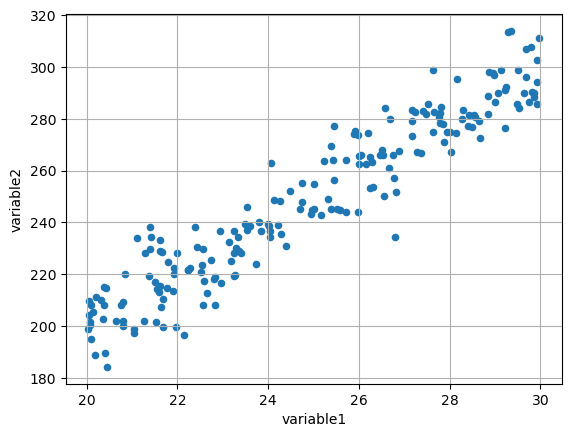
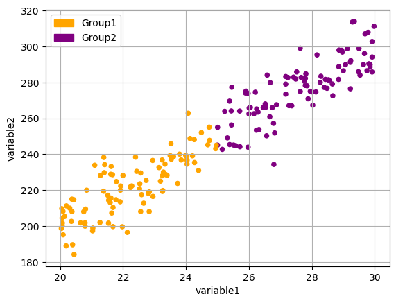
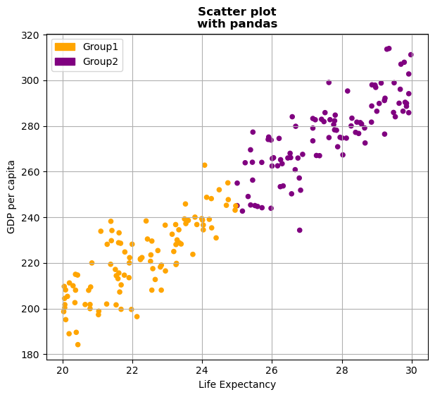

## Libraries

[Pandas](https://python-graph-gallery.com/pandas/) is a popular open-source Python library used for data manipulation and analysis. It provides data structures and functions that make working with structured data, such as tabular data (like `Excel` spreadsheets or `SQL` tables), easy and intuitive.

To install [Pandas](https://python-graph-gallery.com/pandas/), you can use the **following command** in your command-line interface (such as `Terminal` or `Command Prompt`):

`pip install pandas`

[Matplotlib](https://python-graph-gallery.com/matplotlib/) functionalities have been **integrated into the pandas** library, facilitating their use with `dataframes` and `series`. For this reason, you might also need to **import the [matplotlib](https://python-graph-gallery.com/matplotlib/) library** when building charts with [Pandas](https://python-graph-gallery.com/pandas/).

This also means that they use the **same functions**, and if you already know [Matplotlib](https://python-graph-gallery.com/matplotlib/), you'll have no trouble learning plots with [Pandas](https://python-graph-gallery.com/pandas/).

```python
import pandas as pd
import numpy as np # data generation
import matplotlib.pyplot as plt
```

## Dataset

In order to create graphics with [Pandas](https://python-graph-gallery.com/pandas/), we need to use **pandas objects**: `Dataframes` and `Series`. A dataframe can be seen as an `Excel` table, and a series as a `column` in that table. This means that we must **systematically** convert our data into a format used by pandas.

We generate 3 variables: 2 quantitative using `np.random.uniform()` and `np.random.normal()` functions and one qualitative, whose values **depend** on the values of the first qualitative variable.

```python
# Generate a sample of 100 observations
sample_size = 200
first_variable = np.random.uniform(30, 20, sample_size)
second_variable = first_variable * 10 + np.random.normal(0, 10, sample_size)
categorical_variable = ['Group1' if i < 25 else 'Group2' for i in first_variable]

# Put the data into a pandas df
df = pd.DataFrame({'variable1': first_variable,
                   'variable2': second_variable,
                   'categorical_variable': categorical_variable}
                 )
```

## Basic scatter plot

Once we've opened our dataset, we'll now **create the graph**. The following displays the **relation** between the life expectancy and the gdp/capita using the `scatter()` function. This is probably one of the **shortest ways** to display a [scatter plot](https://python-graph-gallery.com/scatter-plot/) in Python.

```python
df.plot.scatter('variable1', # x-axis
                'variable2', # y-axis
                grid=True, # Add a grid in the background
               )
plt.show()
```

:::output

:::

## Scatter plot with grouping

From a list comprehension, we create a **list of colors** according to the group of in the variable `categorical_variable`. Once this list is created, we just have to **add** the `c=colors` argument when calling the `scatter()` function. 

To display the **legend** with the associated colors for each group in your [scatter plot](https://python-graph-gallery.com/scatter-plot/), you can create a legend with the **handles** and **labels** for each group. You can do this by manually creating a legend with `Patch` objects from `matplotlib.patches`.

```python
# Get color for each data point
colors = {'Group1': 'orange', 'Group2': 'purple'}
color_list = [colors[group] for group in df['categorical_variable']]

# Create a scatter plot with color-coding based on 'categorical_variable'
ax = df.plot.scatter('variable1',
                'variable2',
                c=color_list,
                grid=True)

# Create legend handles, labels for each group and add legend to the plot
import matplotlib.patches as mpatches
legend_handles = [
    mpatches.Patch(color=colors['Group1'], label='Group1'),
    mpatches.Patch(color=colors['Group2'], label='Group2'), # add as many as needed
]
ax.legend(handles=legend_handles,
          loc='upper left')

plt.show()
```

:::output

:::

## Format layout

Here we'll see how to add some **labels** and the change the **size of the figure**.

- **add labels**: `set_title()` and `set_xlabel()` functions
- change the **figure size**: add the `figsize(width,height)` argument when using the `scatter()` function

```python
# Get color for each data point
colors = {'Group1': 'orange', 'Group2': 'purple'}
color_list = [colors[group] for group in df['categorical_variable']]

# Create a scatter plot with color-coding based on 'categorical_variable'
ax = df.plot.scatter('variable1',
                'variable2',
                c=color_list,
                grid=True,
                figsize=(7,6))

# Create legend handles, labels for each group and add legend to the plot
import matplotlib.patches as mpatches
legend_handles = [
    mpatches.Patch(color=colors['Group1'], label='Group1'),
    mpatches.Patch(color=colors['Group2'], label='Group2'), # add as many as needed
]
ax.legend(handles=legend_handles,
          loc='upper left')

# Add title and labels ('\n' allow us to jump rows)
ax.set_title('Scatter plot\nwith pandas',
             weight='bold')
ax.set_xlabel('Life Expectancy')
ax.set_ylabel('GDP per capita')

plt.show()
```

:::output

:::

## Going further

This post explains how to create a scatter plot with grouping built with [pandas](https://python-graph-gallery.com/pandas/).

For more examples of **how to create or customize** your plots with Pandas, see the [pandas section](https://python-graph-gallery.com/pandas/). You may also be interested in how to [customize your scatter plot](https://python-graph-gallery.com/536-customizing-scatter-plots-with-pandas/).
