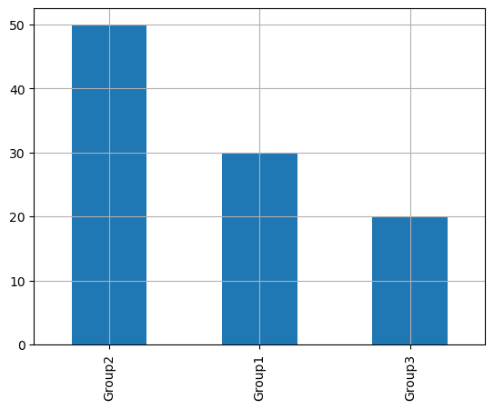

## Libraries

[Pandas](https://python-graph-gallery.com/pandas/) is a popular open-source Python library used for data manipulation and analysis. It provides data structures and functions that make working with structured data, such as tabular data (like `Excel` spreadsheets or `SQL` tables), easy and intuitive.

To install [Pandas](https://python-graph-gallery.com/pandas/), you can use the **following command** in your command-line interface (such as `Terminal` or `Command Prompt`):

`pip install pandas`

[Matplotlib](https://python-graph-gallery.com/matplotlib/) functionalities have been **integrated into the pandas** library, facilitating their use with `dataframes` and `series`. For this reason, you might also need to **import the [matplotlib](https://python-graph-gallery.com/matplotlib/) library** when building charts with [Pandas](https://python-graph-gallery.com/pandas/).

This also means that they use the **same functions**, and if you already know [Matplotlib](https://python-graph-gallery.com/matplotlib/), you'll have no trouble learning plots with [Pandas](https://python-graph-gallery.com/pandas/).

```python
import pandas as pd
import matplotlib.pyplot as plt
```

## Dataset

In order to create graphics with [Pandas](https://python-graph-gallery.com/pandas/), we need to use **pandas objects**: `Dataframes` and `Series`. A dataframe can be seen as an `Excel` table, and a series as a `column` in that table. This means that we must **systematically** convert our data into a format used by pandas.

Since [barplots](https://python-graph-gallery.com/barplot/) need qualitative variables, we will create a dataset with a categorical variable.

```python
# Create a list with 3 different categories
category = ['Group1']*30 + ['Group2']*50 + ['Group3']*20

# Store the data into a dataframe
df = pd.DataFrame({'category': category})
```

## Barplot with the bar() function

Once we've opened our dataset, we'll now **create the graph**. An important feature of [barplots](https://python-graph-gallery.com/barplot/) in Python is that you **can't simply** give them a column name as an argument. 

Instead, we have to calculate the **counts for each category** ourselves and give them as input to the function. To do this, we simply use the pandas `value_counts()` function.

```python
# Get the repartition of each category
values = df['category'].value_counts()

# Create the plot
values.plot.bar(grid=True) # Add a grid in the background
plt.show()
```

:::output

:::

## Barplot with the plot() function

We'll now look at how to create a [barplot](https://python-graph-gallery.com/barplot/) using the `plot()` function. This function is **very general** and therefore requires **more arguments** to be specified when it is called.

The main argument is `kind`. This specifies the type of chart we want (in our case it's `'bar'`). For example, we could have put `'line'` for a [line chart](https://python-graph-gallery.com/line-chart/).

```python
# Get the repartition of each category
values = df['category'].value_counts()

# Create the plot
values.plot(kind='bar', # type of chart
            grid=True # Add a grid in the background
           )
plt.show()
```

:::output

:::

## Going further

This post explains how to create a simple barplot with [pandas](https://python-graph-gallery.com/pandas/) in 2 different ways.

For more examples of **how to create or customize** your plots with Pandas, see the [pandas section](https://python-graph-gallery.com/pandas/). You may also be interested in how to customize your barplots with [Matplotlib and Seaborn](https://python-graph-gallery.com/barplot/).
