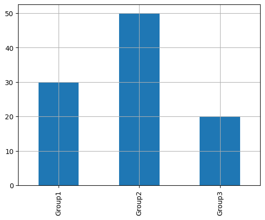
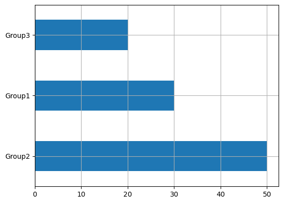
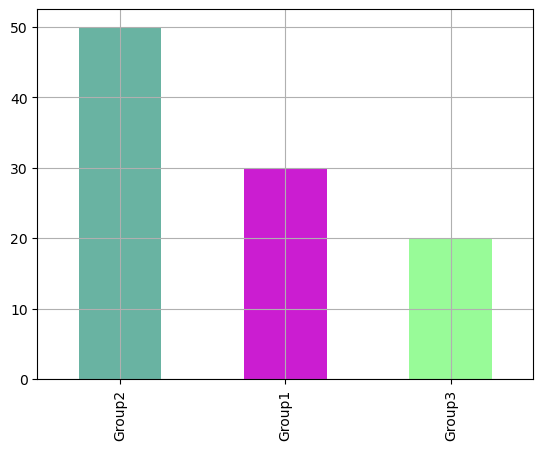
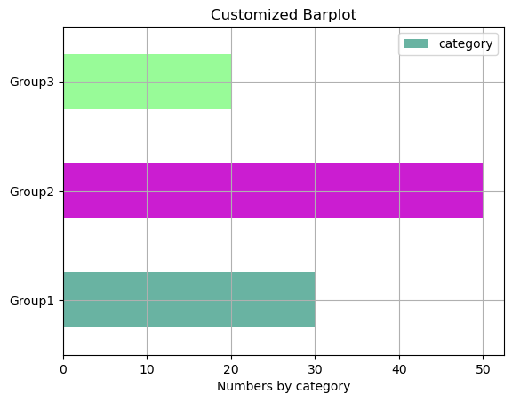

## Libraries

[Pandas](https://python-graph-gallery.com/pandas/) is a popular open-source Python library used for data manipulation and analysis. It provides data structures and functions that make working with structured data, such as tabular data (like `Excel` spreadsheets or `SQL` tables), easy and intuitive.

To install [Pandas](https://python-graph-gallery.com/pandas/), you can use the **following command** in your command-line interface (such as `Terminal` or `Command Prompt`):

`pip install pandas`

[Matplotlib](https://python-graph-gallery.com/matplotlib/) functionalities have been **integrated into the pandas** library, facilitating their use with `dataframes` and `series`. For this reason, you might also need to **import the [matplotlib](https://python-graph-gallery.com/matplotlib/) library** when building charts with [Pandas](https://python-graph-gallery.com/pandas/).

This also means that they use the **same functions**, and if you already know [Matplotlib](https://python-graph-gallery.com/matplotlib/), you'll have no trouble learning plots with [Pandas](https://python-graph-gallery.com/pandas/).

```python
import pandas as pd
import matplotlib.pyplot as plt
```

## Dataset

In order to create graphics with [Pandas](https://python-graph-gallery.com/pandas/), we need to use **pandas objects**: `Dataframes` and `Series`. A dataframe can be seen as an `Excel` table, and a series as a `column` in that table. This means that we must **systematically** convert our data into a format used by pandas.

Since [barplots](https://python-graph-gallery.com/barplot/) need qualitative variables, we will create a dataset with a categorical variable.

```python
# Create a list with 3 different categories
category = ['Group1']*30 + ['Group2']*50 + ['Group3']*20

# Store the data into a dataframe
df = pd.DataFrame({'category': category})
```

## Basic barplot

Once we've opened our dataset, we'll now **create the graph**. An important feature of [barplots](https://python-graph-gallery.com/barplot/) in Python is that you **can't simply** give them a column name as an argument. 

Instead, we have to calculate the **counts for each category** ourselves and give them as input to the function. To do this, we simply use the pandas `value_counts()` function.

```python
# Get the repartition of each category
values = df['category'].value_counts()

# Create the plot
values.plot.bar(grid=True) # Add a grid in the background
plt.show()
```

:::output

:::

## Change bar order

To change the **order of the bars**, we need to do 2 simple things:
- set the **desired order** in a list
- use the `reindex()` function to **apply this order** to `values`

```python
# Get the repartition of each category
values = df['category'].value_counts()

# Define the desired order of categories
desired_order = ['Group1', 'Group2', 'Group3']  # Change this order as needed
values = values.reindex(desired_order) # Reindex the values in the desired order

# Create the plot
values.plot.bar(grid=True) # Add a grid in the background
plt.show()
```

:::output

:::

## Change axis

If you want to **change the axis of the bars**, simply use the `barh()` function with the exact same arguments!

```python
# Get the repartition of each category
values = df['category'].value_counts()

# Create the plot as a horizontal bar plot
values.plot.barh(grid=True)  # Use barh for a horizontal bar plot
plt.show()
```

:::output

:::

## Custom color

In the `color` argument, you can put either **one color** (like `'red'`) or a **list of colors** (check below). The list must have the **same length** as the number of different categories

```python
# Get the repartition of each category
values = df['category'].value_counts()

# Define colors to use
colors = ['#69b3a2', '#cb1dd1', 'palegreen']

# Create the plot as a horizontal bar plot
values.plot.bar(color=colors,
                grid=True)  # Use barh for a horizontal bar plot
plt.show()
```

:::output

:::

## All together with a custom layout

If we put everything together, we can have a **nice [barplot](https://python-graph-gallery.com/barplot/)** built with [Pandas](https://python-graph-gallery.com/pandas/)

```python
# Get the repartition of each category
values = df['category'].value_counts()

# Define the desired order of categories
desired_order = ['Group1', 'Group2', 'Group3']  # Change this order as needed
values = values.reindex(desired_order) # Reindex the values in the desired order

# Define colors to use
colors = ['#69b3a2', '#cb1dd1', 'palegreen']

# Create the plot as a horizontal bar plot
ax = values.plot.barh(color=colors,
                grid=True, 
                )  

# Add title and label
ax.set_title('Customized Barplot')
ax.set_xlabel('Numbers by category')

plt.legend()
plt.show()
```

:::output

:::

## Going further

This post explains how to customize title, axis and markers of a barplot built with [pandas](https://python-graph-gallery.com/pandas/).

For more examples of **how to create or customize** your plots with Pandas, see the [pandas section](https://python-graph-gallery.com/pandas/). You may also be interested in how to customize your barplots with [Matplotlib and Seaborn](https://python-graph-gallery.com/barplot/).
