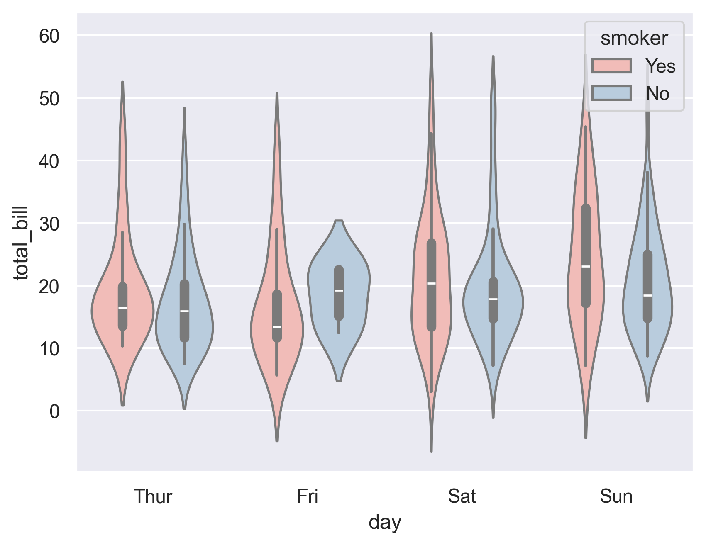
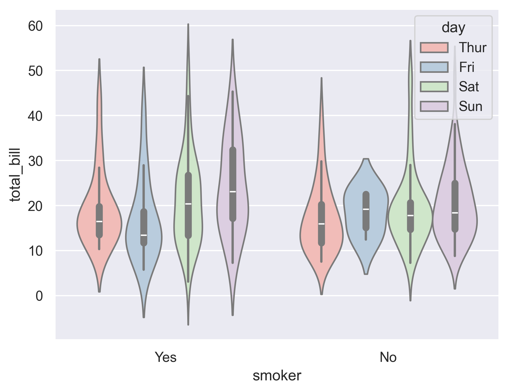
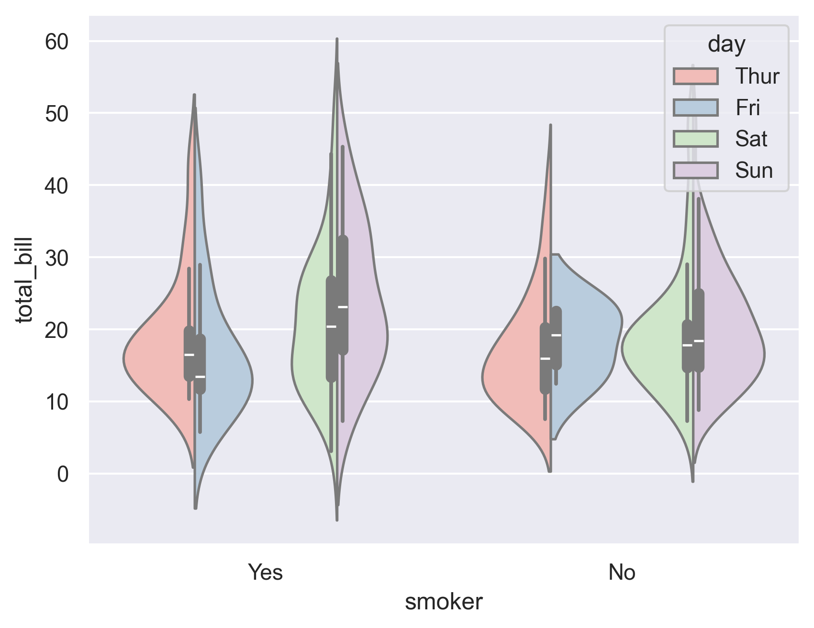

## Libraries

First, you need to install the following librairies:

- [seaborn](https://python-graph-gallery.com/seaborn/) is used for creating the chart
- [matplotlib](https://python-graph-gallery.com/matplotlib/) is used for customization

```python
# libraries
import seaborn as sns
import matplotlib.pyplot as plt

plt.rcParams['figure.dpi'] = 300
```

## Dataset

The dataset we will use is the **tips** dataset, which we can easily download with [seaborn](https://python-graph-gallery.com/seaborn/):

In this dataset each row is a tip. For each tip we know the amount of the bill (`total_bill`) and several information like the day of the week (`day`) and if the customer was a smoker or not (`smoker`)

```python
df = sns.load_dataset('tips')
```

## Grouped violin plot

In order to create a violin plot with [seaborn](https://python-graph-gallery.com/seaborn/), we need to add to the `hue` argument the **name of the categorical variable** that will separate our **subgroups**.

```python
  
sns.set_theme(style="darkgrid")
 
# Grouped violinplot
sns.violinplot(x="day", y="total_bill", hue="smoker", data=df, palette="Pastel1")
plt.show()
```

:::output

:::

## Inverting categorical variables

A potentially relevant thing to do is to **invert** the categorical variable on the x-axis and the one in the `hue` argument. The output graph will be **quite different**, and may make it **easier to understand** the distribution of the underlying variables.

```python
  
sns.set_theme(style="darkgrid")
 
# Grouped violinplot
sns.violinplot(x="smoker", y="total_bill", hue="day", data=df, palette="Pastel1")
plt.show()
```

:::output

:::

## The `split` parameter

When using a hue variable, this determines whether the violins for different hue levels should be plotted on opposite sides of the main categorical axis.

```python
# Grouped violinplot
sns.violinplot(x="smoker", y="total_bill", hue="day", data=df, palette="Pastel1", split=True)
plt.show()
```

:::output

:::

## Going further

This post explains how to create a grouped violin plot with [seaborn](https://python-graph-gallery.com/seaborn/).

For more examples of **how to create or customize** your violin plots, check the [violin plot section](https://python-graph-gallery.com/violin-plot/). You may also be interested in how to [customize a violin plot](https://python-graph-gallery.com/52-custom-seaborn-violinplot/).
