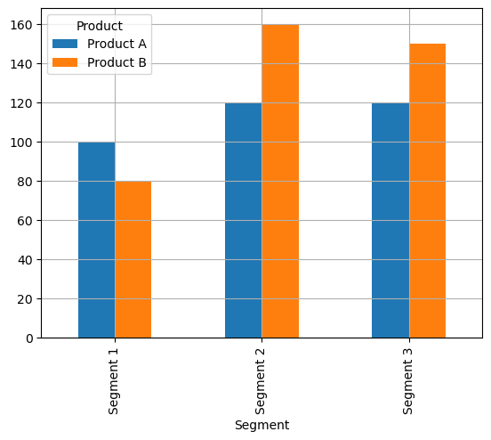
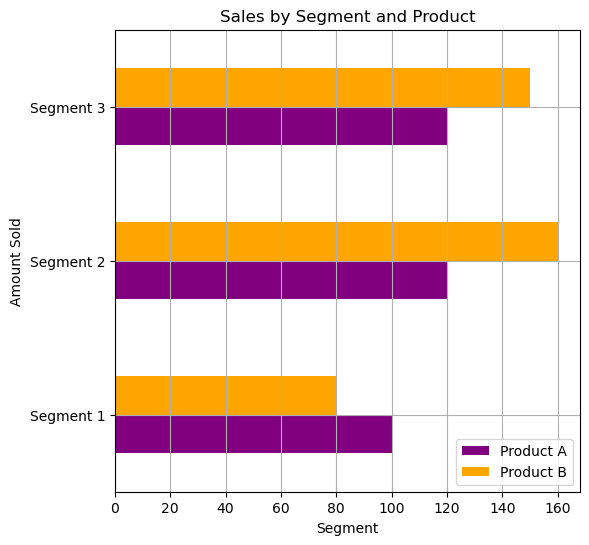

## Libraries

[Pandas](https://python-graph-gallery.com/pandas/) is a popular open-source Python library used for data manipulation and analysis. It provides data structures and functions that make working with structured data, such as tabular data (like `Excel` spreadsheets or `SQL` tables), easy and intuitive.

To install [Pandas](https://python-graph-gallery.com/pandas/), you can use the **following command** in your command-line interface (such as `Terminal` or `Command Prompt`):

`pip install pandas`

[Matplotlib](https://python-graph-gallery.com/matplotlib/) functionalities have been **integrated into the pandas** library, facilitating their use with `dataframes` and `series`. For this reason, you might also need to **import the [matplotlib](https://python-graph-gallery.com/matplotlib/) library** when building charts with [Pandas](https://python-graph-gallery.com/pandas/).

This also means that they use the **same functions**, and if you already know [Matplotlib](https://python-graph-gallery.com/matplotlib/), you'll have no trouble learning plots with [Pandas](https://python-graph-gallery.com/pandas/).

```python
import pandas as pd
import matplotlib.pyplot as plt
```

## Dataset

In order to create graphics with [Pandas](https://python-graph-gallery.com/pandas/), we need to use **pandas objects**: `Dataframes` and `Series`. A dataframe can be seen as an `Excel` table, and a series as a `column` in that table. This means that we must **systematically** convert our data into a format used by pandas.

We generate 3 variables: 2 quantitative using `np.random.uniform()` and `np.random.normal()` functions and one qualitative, whose values **depend** on the values of the first qualitative variable.

```python
data = {
    "Product": ["Product A", "Product A", "Product A", "Product B", "Product B", "Product B"],
    "Segment": ["Segment 1", "Segment 2", "Segment 3", "Segment 1", "Segment 2", "Segment 3"],
    "Amount_sold": [100, 120, 120, 80, 160, 150]
}

df = pd.DataFrame(data)
```

## Basic grouped barplot

Once we've opened our dataset, we'll now **create the graph**. 

This dataset represents sales data for different products (`Product A` and `Product B`) across various segments (`Segment 1`, `Segment 2`, and `Segment `3). The `"Amount_sold"` column represents the **quantity of each product sold** within each segment.

The `pivot()` function is used in this context to **reshape the original DataFrame** into a format suitable for creating a grouped [barplot](https://python-graph-gallery.com/barplot/). In a grouped [barplot](https://python-graph-gallery.com/barplot/), you typically want each category (in this case, each `product`) to have its own set of bars grouped by another categorical variable (in this case, the `segments`).

```python
# Pivot the data to have 'Product' as columns and 'Segment' as the index
pivot_df = df.pivot(index='Segment',
                    columns='Product',
                    values='Amount_sold')

# Create a grouped barplot
pivot_df.plot.bar(grid=True)

plt.show()
```

:::output

:::

## Custom grouped barplot

In this customized version, we will change :
- **colors**
- the **axis**
- add **label** and **title**

```python
# Pivot the data to have 'Product' as columns and 'Segment' as the index
pivot_df = df.pivot(index='Segment',
                    columns='Product',
                    values='Amount_sold')

# Create a grouped barplot
colors = ['purple', 'orange']
ax = pivot_df.plot.barh(grid=True,
                       color=colors,
                       figsize=(6,6))

# Add legend
plt.legend(loc='lower right')

#Add title and label
ax.set_xlabel('Segment')
ax.set_ylabel('Amount Sold')
ax.set_title('Sales by Segment and Product')

plt.show()
```

:::output

:::

## Going further

This post explains how to create a barplot with grouping built with [pandas](https://python-graph-gallery.com/pandas/).

For more examples of **how to create or customize** your plots with Pandas, see the [pandas section](https://python-graph-gallery.com/pandas/). You may also be interested in how to [customize your barplot](https://python-graph-gallery.com/539-customizing-barplot-with-pandas/).
