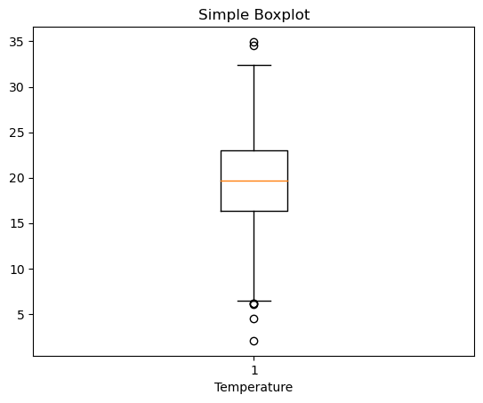
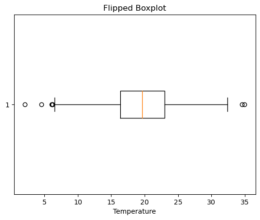
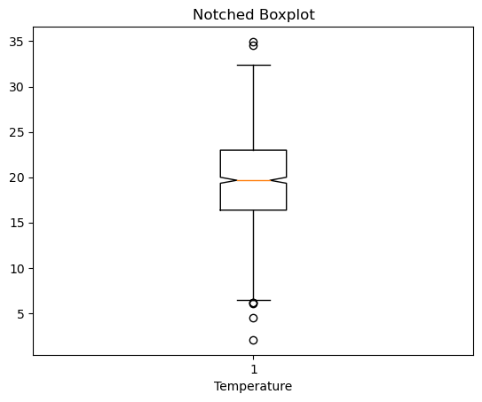
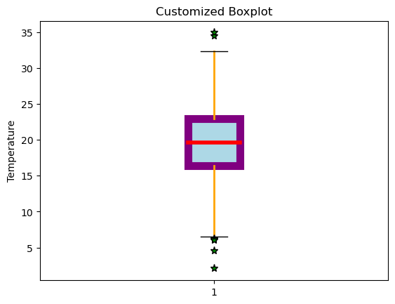
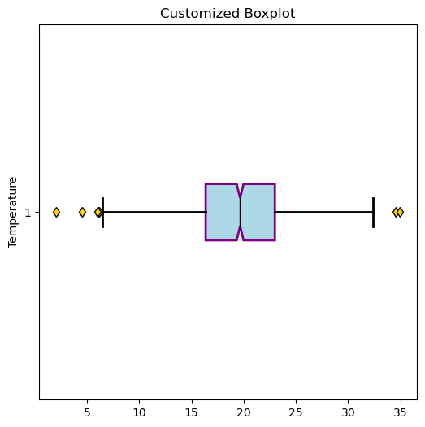

## Libraries

First, you need to install the following librairies:
- [matplotlib](https://python-graph-gallery.com/matplotlib/) is used for creating the plot
- `pandas` for data manipulation
- `numpy` for data generation

```python
import matplotlib.pyplot as plt
import pandas as pd
import numpy as np
```

## Dataset

We will use a data about **temperature**, randomly distributed with a `mean of 20` and a `standard deviationof 5`.

```python
sample_size = 1000
df = pd.DataFrame({'temp': np.random.normal(20, 5, sample_size)})
```

## Basic boxplot

Once we've opened our dataset, we'll now **create the graph**. The following displays the **distribution** of the temperature variation using the `boxplot()` function.

```python
# Create a figure and axis
fig, ax = plt.subplots()

# Create a boxplot for the desired column
ax.boxplot(df['temp'])

# Set labels and title
ax.set_xlabel('Temperature')
ax.set_title('Simple Boxplot')

# Show the plot
plt.show()
```

:::output

:::

## Flip the box

Flipping the box can be a way to improve the visualizations of your [boxplots](https://python-graph-gallery.com/boxplot/). With [matplotlib](https://python-graph-gallery.com/matplotlib/), we just have to add the `vert=False` when using the `boxplot()` function.

```python
# Create a figure and axis
fig, ax = plt.subplots()

# Create a boxplot for the desired column
ax.boxplot(df['temp'],
           vert=False,
          )

# Set labels and title
ax.set_xlabel('Temperature')
ax.set_title('Flipped Boxplot')

# Show the plot
plt.show()
```

:::output

:::

## Notched boxplot

A *"notched"* [boxplot](https://python-graph-gallery.com/boxplot/) is simply a boxplot where the part of the box where the median is located is **indented slightly inwards**. With [matplotlib](https://python-graph-gallery.com/matplotlib/), simply add the `notch=True` argument to the `boxplot()` function.

```python
# Create a figure and axis
fig, ax = plt.subplots()

# Create a boxplot for the desired column
ax.boxplot(df['temp'],
           notch=True,
          )

# Set labels and title
ax.set_xlabel('Temperature')
ax.set_title('Notched Boxplot')

# Show the plot
plt.show()
```

:::output

:::

## Color and property customization features

With [matplotlib](https://python-graph-gallery.com/matplotlib/), you can change the **color of *each element*** in our boxplot.

The **easiest and cleanest** way to do so is to create a dictionnary of dictionnaries with the **properties** we want for each element. Also, we have to add the `patch_artist=True` argument when using this technique since otherwise it will **raise an error**. 

The advantage of this method is that it can be used to **add other properties** to the [boxplot](https://python-graph-gallery.com/boxplot/), such as bar size or outlier size/type (`flierprops` dictionnary).

```python
# Create a figure and axis
fig, ax = plt.subplots()

# Define the properties we want
boxplot_style = {
    'whiskerprops': {'linewidth': 2, 'color': 'orange'},
    'medianprops': {'linewidth': 4, 'color': 'red'},
    'flierprops': {'marker': '*', 'markerfacecolor': 'green', 'markersize': 8},
    'boxprops': {'facecolor': 'lightblue', 'edgecolor': 'purple', 'linewidth': 8},
    'capprops': {'color': 'black', 'linewidth': 1}
}

# Apply the style to the boxplot
ax.boxplot(df['temp'],
           patch_artist=True,
           **boxplot_style,
          )

# Set labels and title
ax.set_ylabel('Temperature')
ax.set_title('Customized Boxplot')

# Show the plot
plt.show()
```

:::output

:::

## All in once

Now, let's combine everything we've seen above to see what a [boxplot](https://python-graph-gallery.com/boxplot/) with **several customization** features might look like.

```python
# Create a figure and axis
fig, ax = plt.subplots(figsize=(6,6))

# Define the properties we want
boxplot_style = {
    'whiskerprops': {'linewidth': 2, 'color': 'black'},
    'medianprops': {'linewidth': 1, 'color': 'black'},
    'flierprops': {'marker': 'd', 'markerfacecolor': 'gold', 'markersize': 6},
    'boxprops': {'facecolor': 'lightblue', 'edgecolor': 'purple', 'linewidth': 2},
    'capprops': {'color': 'black', 'linewidth': 2}
}

# Apply the style to the boxplot
ax.boxplot(df['temp'],
           notch=True,
           vert=False,
           patch_artist=True,
           **boxplot_style,
          )

# Set labels and title
ax.set_ylabel('Temperature')
ax.set_title('Customized Boxplot')

# Show the plot
plt.show()
```

:::output

:::

## Going further

This post explains how to customize a boxplot with [matplotlib](https://python-graph-gallery.com/matplotlib/).

For more examples of **how to create or customize** your boxplots, see the [boxplot section](https://python-graph-gallery.com/boxplot/). You may also be interested in how to created an [boxplot with multiple groups](https://python-graph-gallery.com/30-basic-boxplot-with-seaborn/).
