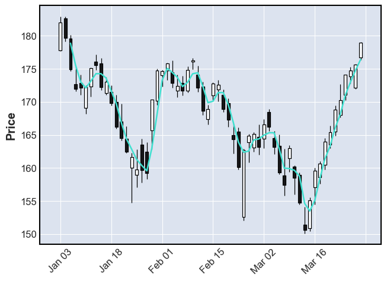
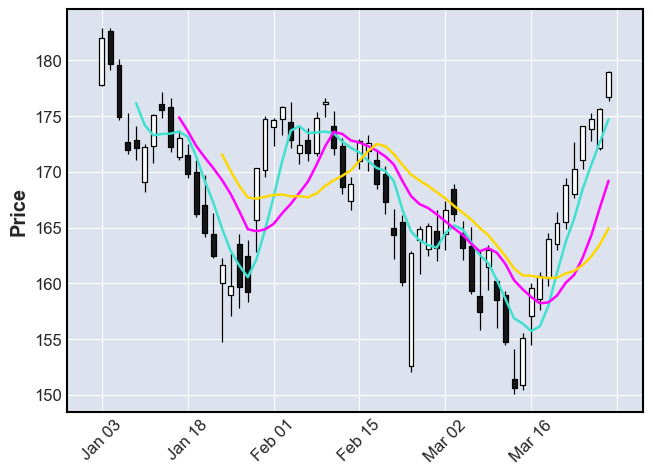

## Libraries

Creating [Candlestick charts](https://python-graph-gallery.com/timeseries/) with matplotlib requires a library called `mplfinance`, built by [matplotlib](https://python-graph-gallery.com/matplotlib/).

To install `mplfinance`, you can use the **following command** in your command-line interface (such as `Terminal` or `Command Prompt`):

`pip install mplfinance`

And since we'll load **data from yahoo finance**, we need the `yfinance` library:

`pip install yfinance`

```python
import mplfinance as mpf
import yfinance as yf
```

## Dataset

[Candlestick charts](https://python-graph-gallery.com/timeseries/) are mainly used to represent **financial data**, especially stock prices.

In this post, we'll load Apple's share price data, directly from our **Python** code via the `yfinance` library. All we need to do is define the desired **start** and **end** data (`yyyy-mm-dd` format), and the **ticker** or symbol associated with this company (in this case `"AAPL"`).

Our dataset must have the **characteristics** needed to produce our graph easily:
- be a pandas dataframe
- a date index
- an Open column
- a High column
- a Low column
- a Close column

The **tickers** can be found on easily on [yahoo finance](https://finance.yahoo.com).

According to the documentation of [mplfinance](https://github.com/matplotlib/mplfinance): *"Non-trading days are simply not shown"*, by default.

```python
# Define the stock symbol and date range
stock_symbol = "AAPL"  # Example: Apple Inc.
start_date = "2022-01-01"
end_date = "2022-03-30"

# Load historical data
stock_data = yf.download(stock_symbol,
                         start=start_date, end=end_date)
```

:::output
```text
[*********************100%***********************]  1 of 1 completed
```
:::

## Candlestick with a moving average

Once we've opened our dataset, we'll now **create the graph**.

Finally, if our dataset has the **properties listed above**, we simply call mplfinance's `plot()` function.

Then, we just have to
- add `type='candle'` in order to display candles
- add `mav=3` (with 3 the **moving average** you want: the higher it is, the **smoother** the curve will be).

```python
mpf.plot(stock_data,
         type='candle',
         mav=3)
```

:::output

:::

## Candlestick with several moving averages

In order to represent **several moving averages** at the same time, simply set a **list of integer** values as the argument to `mav`.

```python
# Define the moving averages you want
moving_averages = [5,10,15]

# Create and display the plot
mpf.plot(stock_data,
         type='candle',
         mav=moving_averages)
```

:::output

:::

## Going further

This post explains how to create a [candlestick chart](https://python-graph-gallery.com/timeseries/) with **moving averages** on top.

For more examples of **how to create or customize** your time series plots, see the [time series section](https://python-graph-gallery.com/timeseries/). You may also be interested in how to [display multiple lines at the same time](https://python-graph-gallery.com/122-multiple-lines-chart/).
