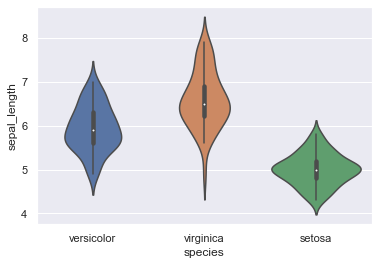
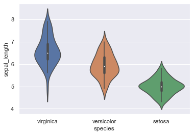

## Directly specyfing a list 
Thanks to the `order` parameter of the violinplot function, you can set the order in which you expect the distributions to appear on the figure.

```python
# libraries & dataset
import seaborn as sns
import matplotlib.pyplot as plt
  
sns.set_theme(style="darkgrid")
df = sns.load_dataset('iris')

# specifying the group list as 'order' parameter and plotting
sns.violinplot(x='species', y='sepal_length', data=df, order=[ "versicolor", "virginica", "setosa"])
plt.show()
```

:::output

:::

## Ordering by decreasing median 
Instead of creating the list 'by hand' with various categories, you can also use the power of pandas operations (groupby, median or mean) in order to create a ranked list, which we stored in `my_order` variable in the following example.

```python
# libraries & dataset
import seaborn as sns
import matplotlib.pyplot as plt
  
sns.set_theme(style="darkgrid")
df = sns.load_dataset('iris')
 
# Using pandas methods and slicing to determine the order by decreasing median
my_order = df.groupby(by=["species"])["sepal_length"].median().sort_values().iloc[::-1].index
 
# Specifying the 'order' parameter with my_order and plotting
sns.violinplot(x='species', y='sepal_length', data=df, order=my_order)
plt.show()
```

:::output

:::
