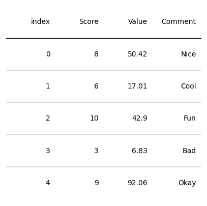
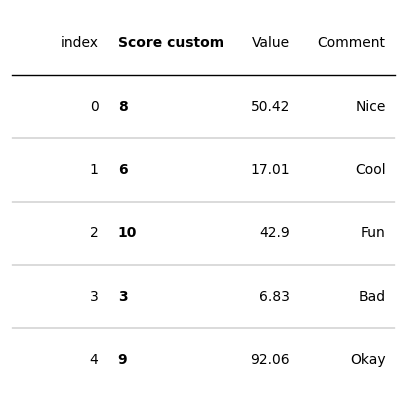
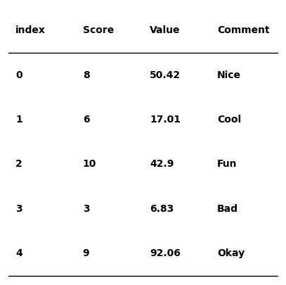
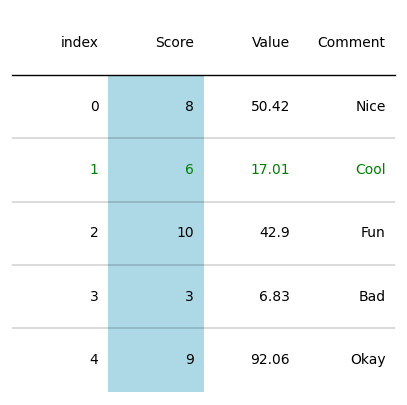

## Libraries

First, you need to install `plottable` with the following command: `pip install plottable`. Plottable is almost the **single python library** made especially for creating nice output tables. According to the main author, it's inspired from the **R** packages `gt` and `reactable`.

We'll also need the following libraries:
- [pandas](https://python-graph-gallery.com/pandas/) for creating a dataframe with our data
- [matplotlib](https://python-graph-gallery.com/matplotlib/) for customizing the table and display it

```python
import matplotlib.pyplot as plt
import pandas as pd
from plottable import Table
```

## Dataset

Tables are often built from a **`pandas` dataframe**. Let's create one using the `DataFrame()` function.

This table is our starting point of the tutorial. Let's make it look good!

```python
data = {'Score': [8, 6, 10, 3, 9],
        'Value': [50.42, 17.01, 42.90, 6.83, 92.06],
        'Comment': ['Nice', 'Cool', 'Fun', 'Bad', 'Okay']}
df = pd.DataFrame(data)
```

## Most simple plottable output

Now let's see how to create the **default plottable output**. The syntax is quite similar to [matplotlib](https://python-graph-gallery.com), since we need to initiate a figure, create a `Table()` and display the result with `show()`.

```python
# Init a figure 
fig, ax = plt.subplots(figsize=(5, 5))

# Create the Table() object
tab = Table(df)

# Display the output
plt.show()
```

:::output

:::

## First method: column definition

This method consists in changing the properties of interest for a **given column**. By specifying the name of the column to be changed, we can specify a number of parameters. 

We'll also need to import **another Class** from plottable: `ColumnDefinition`

In this case, we'll:
- **change the title** of the `Score` column
- **change position and weight** of the texts

```python
from plottable import ColumnDefinition

# Init a figure 
fig, ax = plt.subplots(figsize=(5, 5))

# Define the things to change
column_definitions = [ColumnDefinition(name='Score', # name of the column to change
                                       title='Score custom', # new title for the column
                                       textprops={"ha": "left", "weight": "bold"}, # properties to apply
                                      )]

# Create the table object with the column definitions parameter
tab = Table(df, column_definitions=column_definitions)

# Display the output
plt.show()
```

:::output

:::

## Second method: keywords

If you want to apply **exactly the same changes** to each column, the **keyword method** may be just what you're looking for.

In a similar way to the previous method, we give which properties we want to change, but this time we put them **directly** in the `Table()` argument, and they will **automatically** apply to all columns. 

In this case, we'll:
- change some **text properties**
- add a **footer line**
- remove **lines between rows**

```python
# Init a figure 
fig, ax = plt.subplots(figsize=(5, 5))

# Create the table object with the column definitions parameter
tab = Table(df, textprops={"ha": "left", "weight": "bold"}, # text properties
            row_dividers=False, # remove lines between rows
            footer_divider=True, # add a reference line at the end
    )

# Display the output
plt.show()
```

:::output

:::

## Third method: accessing rows and cols

In this method, we **first define the `Table()`**, then apply any modifications we wish to the rows and columns.

```python
# Init a figure 
fig, ax = plt.subplots(figsize=(5, 5))

# Create the table object with the column definitions parameter
tab = Table(df)

# Apply modifications to the Score col and the second (idx=1) row
tab.columns["Score"].set_facecolor('lightblue')
tab.rows[1].set_fontcolor('green')

# Display the output
plt.show()
```

:::output

:::

## Going further 

This post explains the **basic features** in the `plottable` library.

You might be interested in:
- [How to customize colors in plottable](https://python-graph-gallery.com/561-control-colors-in-plottable)
- [How to add an image in plottable](https://python-graph-gallery.com/562-add-images-in-plottable)
