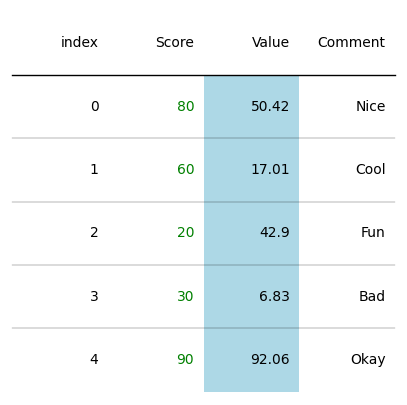
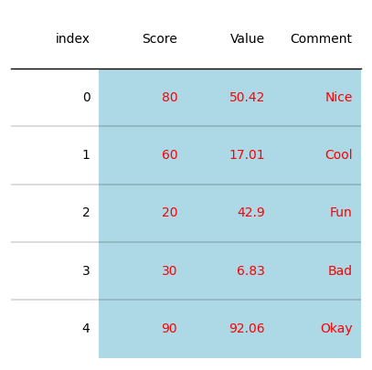
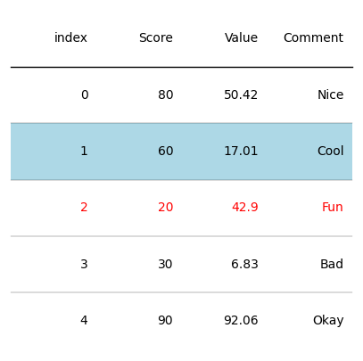
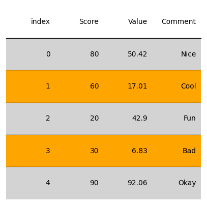
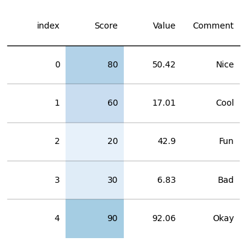

## Libraries

First, you need to install `plottable` with the following command:
`pip install plottable`

We'll also need the following libraries:
- [pandas](https://python-graph-gallery.com/pandas/) for creating a dataframe with our data
- [matplotlib](https://python-graph-gallery.com/matplotlib/) for customizing the table and display it

```python
import matplotlib.pyplot as plt
import pandas as pd
from plottable import Table
```

## Dataset

Since most of the time, when we want to display a beautiful table, it comes from a **pandas dataframe**, we'll create a (simple) pandas df and use it as the **starting point** we want to make nice.

```python
data = {'Score': [80, 60, 20, 30, 90],
        'Value': [50.42, 17.01, 42.90, 6.83, 92.06],
        'Comment': ['Nice', 'Cool', 'Fun', 'Bad', 'Okay']}
df = pd.DataFrame(data)
```

## Change color of one column

In order to access one specific column, we use the `columns` attribute from the `Table()` and then use:
- `set_facecolor()` function for the **background color**
- `set_fontcolor()` function for the **text color**

In our case, we change the background color of the *'Value'* column and the text color of the *'Score'* column

```python
# Init a figure 
fig, ax = plt.subplots(figsize=(5, 5))

# Create the Table() object
tab = Table(df)

# Change the color
tab.columns['Value'].set_facecolor("lightblue")
tab.columns['Score'].set_fontcolor("green")

# Display the output
plt.show()
```

:::output

:::

## Change color of all columns

If we want to apply the same color for every cell, the easiest way is to iterate over all our columns and use the `set_facecolor()` or `set_fontcolor()` at each iteration.

```python
# Init a figure 
fig, ax = plt.subplots(figsize=(5, 5))

# Create the Table() object
tab = Table(df)

# Change the color
for col in df.columns:
    tab.columns[col].set_facecolor("lightblue")
    tab.columns[col].set_fontcolor("red")

# Display the output
plt.show()
```

:::output

:::

Keep in mind that the index of our table is **not in our columns**. However, in a similar way as the columns, you can **access** it with `tab.columns['index']`

## Change color of one row

You can access rows with the `rows` attribute from the `Table()` and use the `set_facecolor()` or `set_fontcolor()`, depending on what you want to change.

```python
# Init a figure 
fig, ax = plt.subplots(figsize=(5, 5))

# Create the Table() object
tab = Table(df)

# Change the color
tab.rows[1].set_facecolor("lightblue")
tab.rows[2].set_fontcolor("red")

# Display the output
plt.show()
```

:::output

:::

## Change color of all rows

`Plottable` has a nice feature that allows us to change color only of **even** or **odd** rows. You can use the `even_row_color` and `odd_row_color` when creating the `Table` object.

```python
# Init a figure 
fig, ax = plt.subplots(figsize=(5, 5))

# Create the Table() object
tab = Table(df,
            even_row_color='lightgrey',
            odd_row_color='orange')

# Display the output
plt.show()
```

:::output

:::

## Use a gradient of colors

We need to **import new elements** from both `plottable` and `matplotlib`:
- a colormap from matplotlib: in our case we'll use a **gradient of blues**
- `ColumnDefinition` in order to **specify the cmap we want** for which column

The main interest of this is that the **color is proportionaly** *stronger* according to values in the cell.

```python
from matplotlib.cm import Blues
from plottable import ColumnDefinition

# Init a figure 
fig, ax = plt.subplots(figsize=(5, 5))

# Create the Table() object
tab = Table(df,
            column_definitions=[ColumnDefinition(name="Score", cmap=Blues)])

# Display the output
plt.show()
```

:::output

:::

## Going further 

This post explains the **how to change colors** with the `plottable` library.

You might be interested in:
- [Introduction to plottable](https://python-graph-gallery.com/560-introduction-plottable)
- [How to add an image in plottable](https://python-graph-gallery.com/562-add-images-in-plottable)
