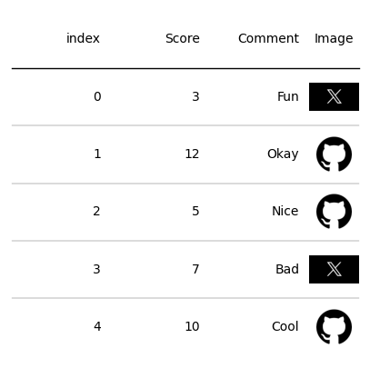
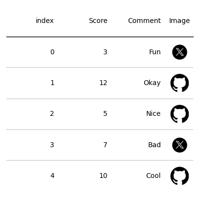

## Libraries

First, you need to install `plottable` with the following command:

`pip install plottable`

We'll also need the following libraries:
- [pandas](https://python-graph-gallery.com/pandas/) for creating a dataframe with our data
- [matplotlib](https://python-graph-gallery.com/matplotlib/) for customizing the table and display it

```python
import matplotlib.pyplot as plt
import pandas as pd

from plottable import Table
from plottable.plots import image, circled_image
from plottable import ColumnDefinition
```

## Dataset

Since most of the time, when we want to display a beautiful table, it comes from a **pandas dataframe**, we'll create a (simple) pandas df and use it as the **starting point** we want to make nice.

```python
data = {'Score': [3, 12, 5, 7, 10],
        'Comment': ['Fun', 'Okay', 'Nice', 'Bad', 'Cool'],
        'Image': ['twitter', 'github', 'github', 'twitter', 'github']}
df = pd.DataFrame(data)
```

## Image

The main thing to do is to have a column where **each cell is a name of a file** stored on your computer. Each file name will have the corresponding image at the end. 

In our case, we **don't have the file extension** at the end of each cell in the *'Image'* column. To cover this case, we'll use the following code:
- we add a **`.png` extension** if the cell has not one, for all value in the column

*Important: In your personal case, remember that you have to have **locally stored** the files on your computer! Fortunately, you can have them in a **different directory**. For example, if they are one directory 'above' your current directory you can juste add a `../` as a **prefix** in the cell.*

```python
# Add a .png extension to each cell in the Image column
df['Image'] = df['Image'].apply(lambda x: x+'.png' if '.png' not in x else x)

# Add a ../../static/graph prefix to each cell in the Image column
df['Image'] = df['Image'].apply(lambda x: '../../static/graph/'+x if '../../static/graph/' not in x else x)
```

## Add an image

We use the `ColumnDefinition` method for adding the image in each cell:
- `name` specifies **which column** to use
- `width` specifies the **width of the images**
- `plot_fn` specifies that we want to use the **file name to plot the images**

```python
coldef = [ColumnDefinition(name="Image",
                           textprops={"ha": "center"},
                           width=0.5,
                           plot_fn=image)]

# Init a figure 
fig, ax = plt.subplots(figsize=(5, 5))

# Create the Table() object
tab = Table(df, column_definitions=coldef)

# Display the output
plt.show()
```

:::output

:::

## Circle the images

You can very easily circle the images by changing `plot_fn=image` to `plot_fn=circled_image`.

```python
coldef = [ColumnDefinition(name="Image",
                           textprops={"ha": "center"},
                           width=0.5,
                           plot_fn=circled_image)]

# Init a figure 
fig, ax = plt.subplots(figsize=(5, 5))

# Create the Table() object
tab = Table(df, column_definitions=coldef)

# Display the output
plt.show()
```

:::output

:::

## Going further 

This post explains the **how to add an image** in the `plottable` library.

You might be interested in:
- [Introduction to plottable](https://python-graph-gallery.com/560-introduction-plottable)
- [How to custom colors in plottable](https://python-graph-gallery.com/561-control-colors-in-plottable)
