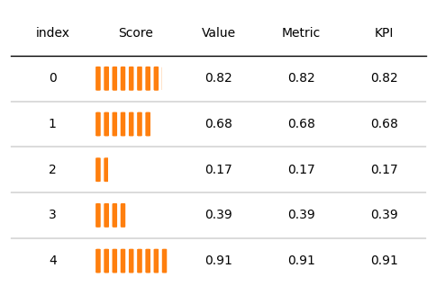
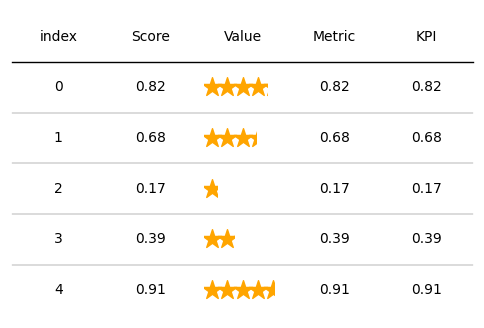
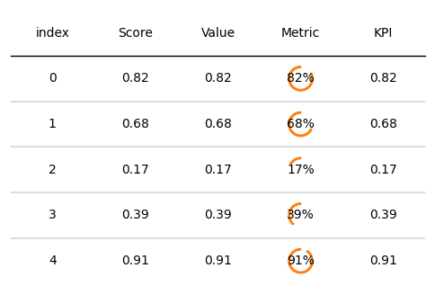
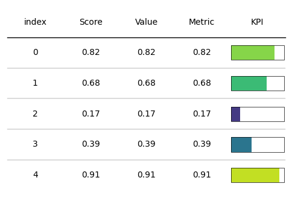
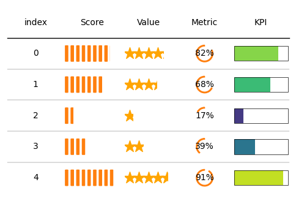

## Libraries

First, you need to install `plottable` with the following command:
`pip install plottable`

We'll also need the following libraries:
- [pandas](https://python-graph-gallery.com/pandas/) for creating a dataframe with our data
- [matplotlib](https://python-graph-gallery.com/matplotlib/) for customizing the table and display it

```python
import matplotlib.pyplot as plt
import pandas as pd

from plottable import Table, ColumnDefinition
from plottable.formatters import decimal_to_percent
from plottable.plots import bar, percentile_bars, percentile_stars, progress_donut
```

## Dataset

Since most of the time, when we want to display a beautiful table, it comes from a **pandas dataframe**, we'll create a (simple) pandas df and use it as the **starting point** we want to make nice. 

We set the **same values** in each column to show the various possible plots and **how they render** within the same value.

```python
data = {'Score': [82, 68, 17, 39, 91],
        'Value': [82, 68, 17, 39, 91],
        'Metric': [82, 68, 17, 39, 91],
        'KPI': [82, 68, 17, 39, 91]}
df = pd.DataFrame(data)

# put everything in percentage
df = df/100
```

## Bar

In the column definition argument, we specify `plot_fn=percentile_bars` for **percentile bars**.

We also have to add `"is_pct": True` in the `plot_kw` argument (*kw stands for keyword*). This means that our **values are in percentage**.

For more visibility, we **center the text** with `textprops={"ha": "center"}` when creating the `Table()`.

```python
# Init a figure 
fig, ax = plt.subplots(figsize=(6, 4))

# Create the Table() object
tab = Table(df,
            textprops={"ha": "center"},
            column_definitions=[ColumnDefinition("Score",
                                                 plot_fn=percentile_bars,
                                                 plot_kw={"is_pct": True})]
           )

# Display the output
plt.show()
```

:::output

:::

## Start review

In the column definition argument, we specify `plot_fn=percentile_stars` for a **start review**.

We also have to add `"is_pct": True` in the `plot_kw` argument (*kw stands for keyword*). This means that our **values are in percentage**.

For more visibility, we **center the text** with `textprops={"ha": "center"}` when creating the `Table()`.

```python
# Init a figure 
fig, ax = plt.subplots(figsize=(6, 4))

# Create the Table() object
tab = Table(df, cell_kw={"linewidth": 0,  "edgecolor": "k"},
            textprops={"ha": "center"},
            column_definitions=[ColumnDefinition("Value",
                                                 plot_fn=percentile_stars,
                                                 plot_kw={"is_pct": True})]
           )

# Display the output
plt.show()
```

:::output

:::

## Donut progress

In the column definition argument, we specify `plot_fn=progress_donut` for a **donut progress**.

We also have to add `"is_pct": True` in the `plot_kw` argument (*kw stands for keyword*). This means that our **values are in percentage**.

For more visibility, we **center the text** with `"ha": "center"` and `"formatter": "{:.0%}"` (**percentage formatting**) in the plot_kw argument when creating the `Table()`.

```python
# Init a figure 
fig, ax = plt.subplots(figsize=(6, 4))

# Create the Table() object
tab = Table(df, 
            textprops={"ha": "center"},
            column_definitions=[ColumnDefinition("Metric",
                                                 plot_fn=progress_donut,
                                                 plot_kw={"is_pct": True,
                                                          "formatter": "{:.0%}"})])

# Display the output
plt.show()
```

:::output

:::

## Progress bar

In the column definition argument, we specify `plot_fn=progress_donut` for a **donut progress**.

We also have to add `"is_pct": True` in the `plot_kw` argument (*kw stands for keyword*). This means that our **values are in percentage**.

For more visibility, we:
- **center the text** with `"ha": "center"`
- **define a cmap** with matplotlib: in our case it will be the `viridis` one
- **add edges around bars** with `"plot_bg_bar": True`
- **reduce edge width** with `"lw": 0.5` (default is 1)

```python
# Define a colormap from matplotlib
cmap = plt.get_cmap('viridis')

# Init a figure 
fig, ax = plt.subplots(figsize=(6, 4))

# Create the Table() object
tab = Table(df,
            textprops={"ha": "center"},
            column_definitions=[ColumnDefinition("KPI",
                                                 plot_fn=bar,
                                                 plot_kw={"cmap": cmap,
                                                          "plot_bg_bar": True,
                                                          "lw": 0.5})]
           )

# Display the output
plt.show()
```

:::output

:::

## All in once

Let's add all the **column definitions** we've created before to see what each col looks like:

```python
# Define a colormap from matplotlib
cmap = plt.get_cmap('viridis')

# Init a figure 
fig, ax = plt.subplots(figsize=(6, 4))

col_defs = [ColumnDefinition("Metric", plot_fn=progress_donut, plot_kw={"is_pct": True,
                                                                        "formatter": "{:.0%}"}),
               ColumnDefinition("Value", plot_fn=percentile_stars, plot_kw={"is_pct": True}),
               ColumnDefinition("Score", plot_fn=percentile_bars, plot_kw={"is_pct": True}),
               ColumnDefinition("KPI", plot_fn=bar, plot_kw={"cmap":cmap,
                                                             "plot_bg_bar": True,
                                                             "lw": 0.5})
           ]

# Create the Table() object
tab = Table(df, cell_kw={"linewidth": 0,  "edgecolor": "k"},
            textprops={"ha": "center"},
            column_definitions=col_defs)

# Display the output
plt.show()
```

:::output

:::

## Going further 

This post explains the **how add plots** like progress bar, star review, donut progress, percent bar with the `plottable` library.

You might be interested in:
- [Introduction to plottable](https://python-graph-gallery.com/560-introduction-plottable)
- [How to add an image in plottable](https://python-graph-gallery.com/562-add-images-in-plottable)
