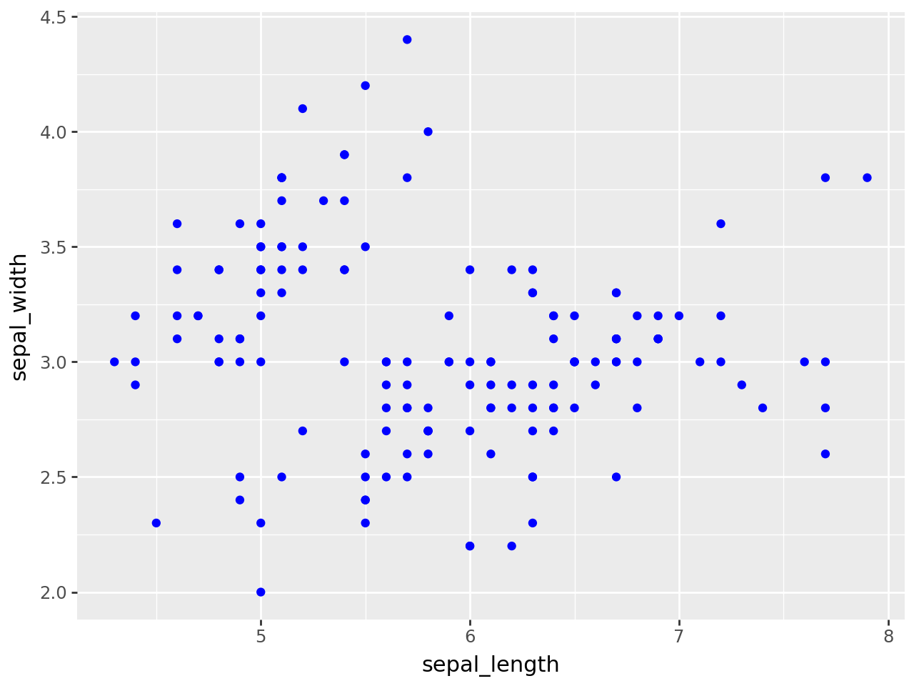
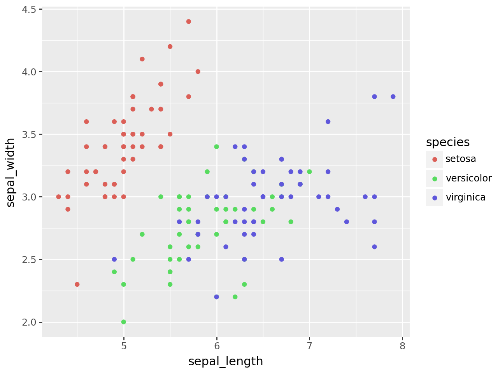

## Libraries

For creating this chart, we will need to load the following libraries:

- [pandas](https://python-graph-gallery.com) for data manipulation
- [plotnine](https://python-graph-gallery.com/plotnine/) for data visualization

```python
import pandas as pd
from plotnine import *
```

## Dataset

Since [scatter plot](https://python-graph-gallery.com/scatter-plot/) is a type of chart that displays values for **two numerical variables** for a set of data, we will load the `iris` dataset.

The `iris` dataset is a classic dataset that contains the sepal and petal length and width of 150 iris flowers of three different species: setosa, versicolor, and virginica. In our case, we can to plot the **sepal length on the x-axis** and the **sepal width on the y-axis**. You can learn more about scatter plots by reading this [section](https://python-graph-gallery.com/scatter-plot/) of the Python Graph Gallery.

```python
url = 'https://raw.githubusercontent.com/holtzy/The-Python-Graph-Gallery/master/static/data/iris.csv'
df = pd.read_csv(url)
```

## Most simple scatter plot

The only difference of `plotnine` compared to `ggplot2` is that you have to **wrap your code around parenthesis**. Here is the most simple scatter plot you can do with `plotnine`:

```python
(
ggplot(df, aes(x='sepal_length', y='sepal_width')) +
    geom_point()
)
```

:::output

:::

## Custom colors

If you add the `color` argument inside the `geom_point()` function, you can **change the default color** of the points:

```python
(
ggplot(df, aes(x='sepal_length', y='sepal_width')) +
    geom_point(color='blue')
)
```

:::output

:::

## Color by group

If you want to **color the points by a specific group**, you just have to add `color='species'` inside the `aes()` function:

```python
(
ggplot(df, aes(x='sepal_length', y='sepal_width', color='species')) +
    geom_point()
)
```

:::output

:::

## Going further

This article explains how to create a [scatter plot](https://python-graph-gallery.com/scatter-plot/) with [plotnine](https://python-graph-gallery.com/plotnine/).

If you want to go further, you can also learn how to [custom markers in a scatter plot](https://python-graph-gallery.com/574-custom-marker-scatter-plotnine) or how to [custom theme](https://python-graph-gallery.com/575-custom-theme-plotnine).
