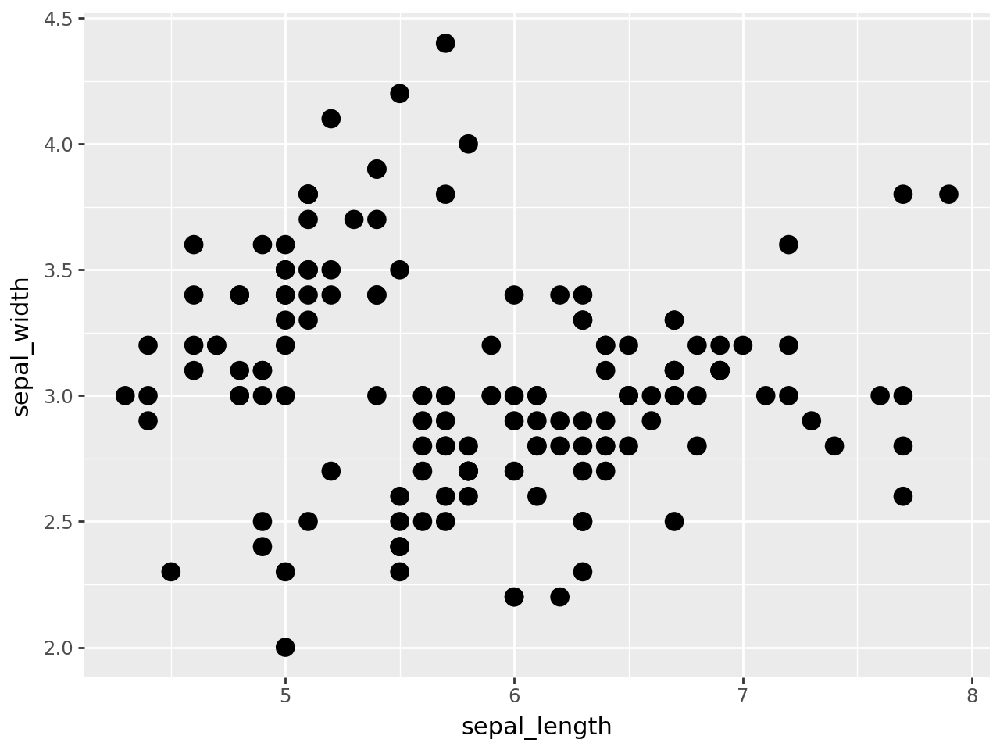
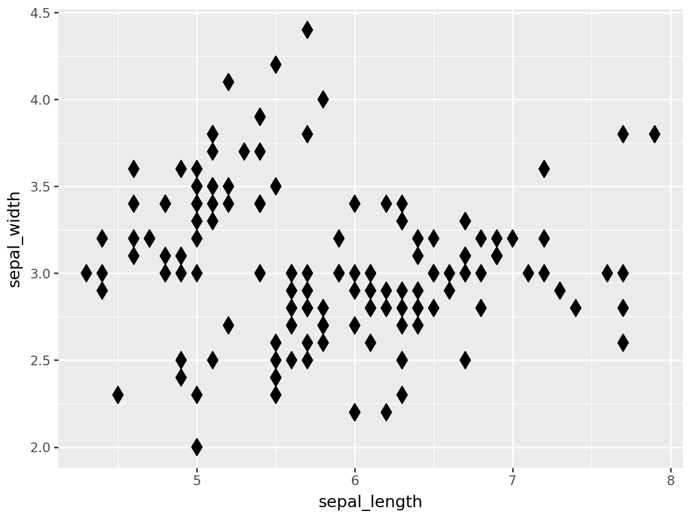
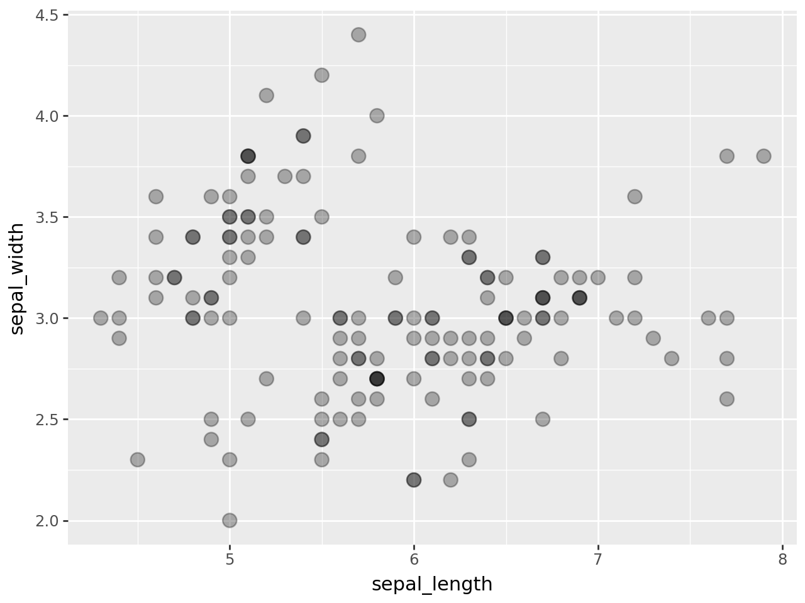
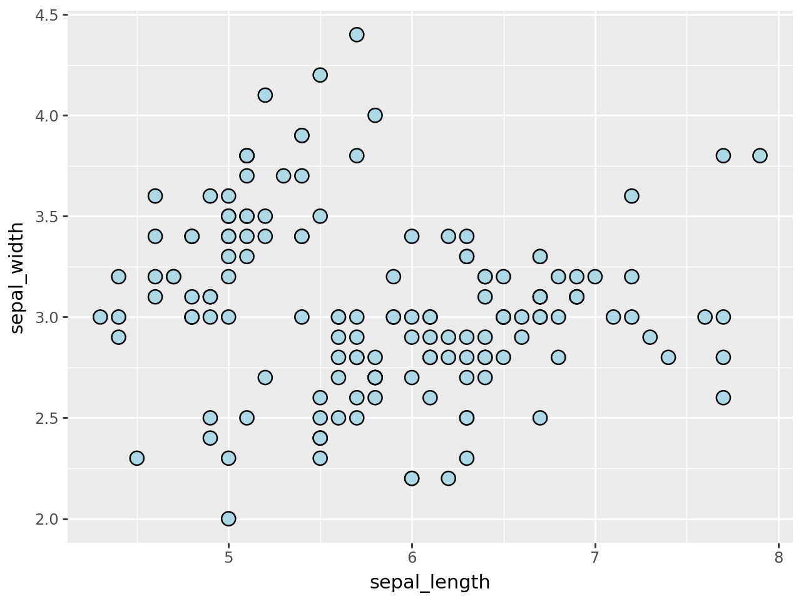

## Libraries

For creating this chart, we will need to load the following libraries:

- [pandas](https://python-graph-gallery.com) for data manipulation
- [plotnine](https://python-graph-gallery.com/plotnine/) for data visualization

```python
import pandas as pd
from plotnine import *
```

## Dataset

Since [scatter plot](https://python-graph-gallery.com/scatter-plot/) is a type of chart that displays values for **two numerical variables** for a set of data, we will load the `iris` dataset:

```python
url = 'https://raw.githubusercontent.com/holtzy/The-Python-Graph-Gallery/master/static/data/iris.csv'
df = pd.read_csv(url)
```

## Change size of points

In order to change the **size of the points** in a scatter plot, you just have to add the `size` argument to the `geom_point()` function:

```python
(
ggplot(df, aes(x='sepal_length', y='sepal_width')) +
    geom_point(size=4)
)
```

:::output

:::

## Change dots shape

In order to change the **shape of the points** in a scatter plot, you just have to add the `shape` argument to the `geom_point()` function.

There are **lots of available options**!

```python
(
ggplot(df, aes(x='sepal_length', y='sepal_width')) +
    geom_point(shape='d', size=4)
)
```

:::output

:::

## Transparency 

In order to change the **transparency of the points** in a scatter plot, you just have to add the `alpha` argument to the `geom_point()` function:

```python
(
ggplot(df, aes(x='sepal_length', y='sepal_width')) +
    geom_point(alpha=0.3, size=4)
)
```

:::output

:::

## Edge color

In order to change the **edge color of the points** in a scatter plot, you just have to use the `color` and `fill` arguments in the `geom_point()` function:

```python
(
ggplot(df, aes(x='sepal_length', y='sepal_width')) +
    geom_point(color='black', fill='lightblue', size=4)
)
```

:::output

:::

## Going further

This article explains how to custom markers in a [scatter plot](https://python-graph-gallery.com/scatter-plot/) with [plotnine](https://python-graph-gallery.com/plotnine/).

If you want to go further, you can also learn how to [colors according to a 3rd variable](https://python-graph-gallery.com/573-introduction-scatterplot-plotnine) or how to [custom theme](https://python-graph-gallery.com/575-custom-theme-plotnine).
