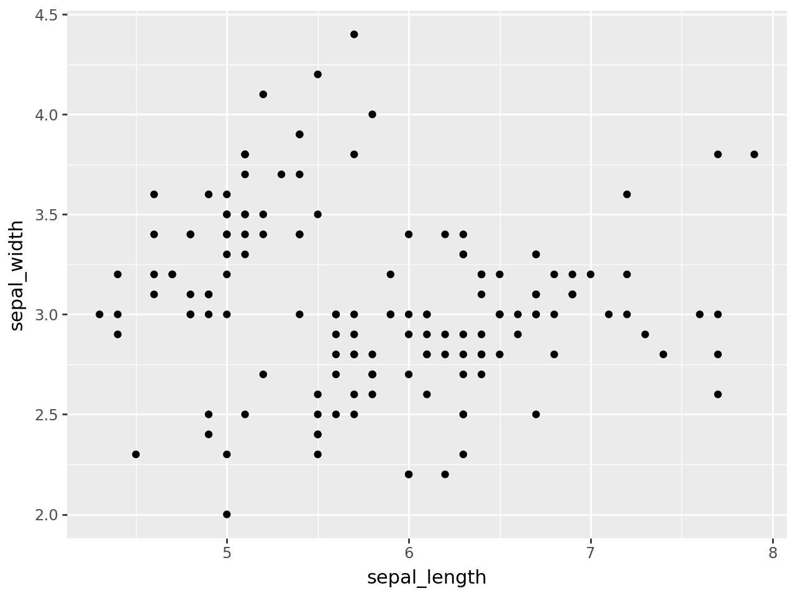
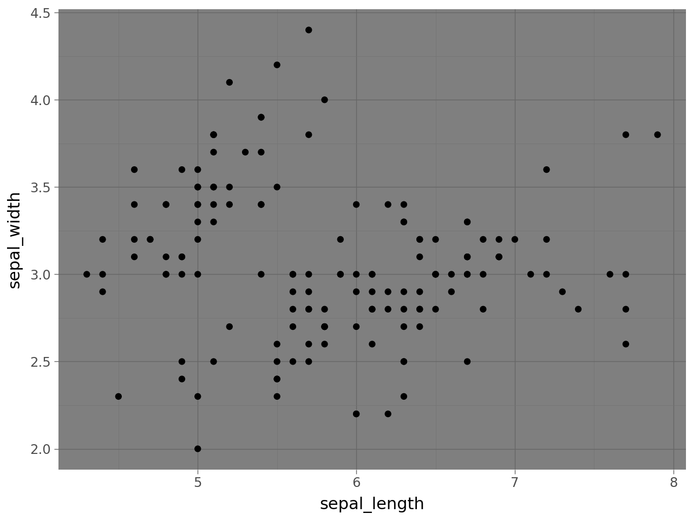
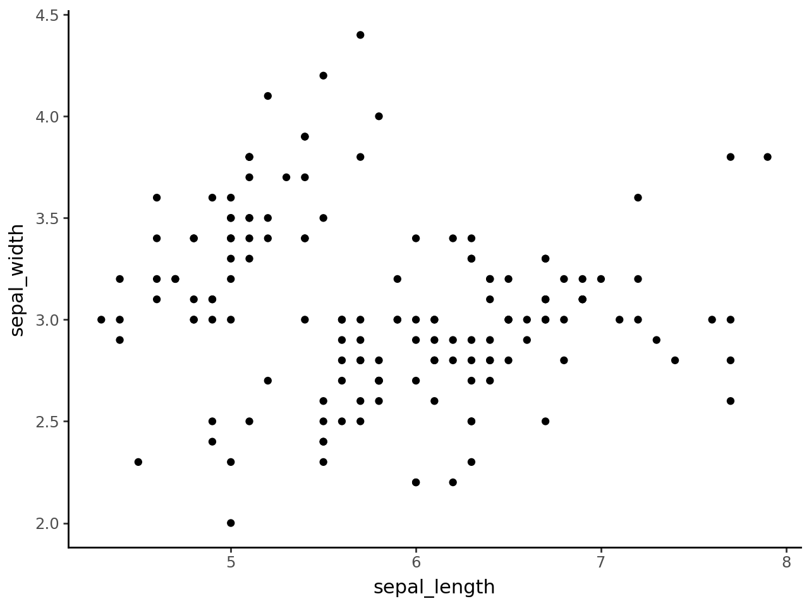
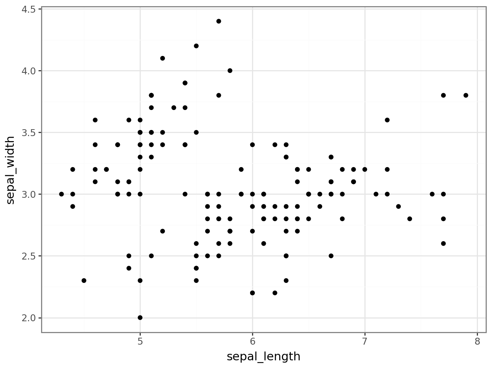

## Libraries

For creating this chart, we will need to load the following libraries:

- [pandas](https://python-graph-gallery.com) for data manipulation
- [plotnine](https://python-graph-gallery.com/plotnine/) for data visualization

```python
import pandas as pd
from plotnine import *
```

## Dataset

Since [scatter plot](https://python-graph-gallery.com/scatter-plot/) is a type of chart that displays values for **two numerical variables** for a set of data, we will load the `iris` dataset:

```python
url = 'https://raw.githubusercontent.com/holtzy/The-Python-Graph-Gallery/master/static/data/iris.csv'
df = pd.read_csv(url)
```

## Default theme

The `plotnine` default theme is the same as the `ggplot2` default theme in R:

```python
(
ggplot(df, aes(x='sepal_length', y='sepal_width')) +
    geom_point()
)
```

:::output

:::

## White background theme

There are various theme with **white background** in `plotnine`.

Here is an example of the `theme_minimal()` theme:

```python
(
ggplot(df, aes(x='sepal_length', y='sepal_width')) +
    geom_point() +
    theme_minimal()
)
```

:::output

:::

## Dark background theme

If you're looking for a **dark background** theme, you can use the `theme_dark()` theme:

```python
(
ggplot(df, aes(x='sepal_length', y='sepal_width')) +
    geom_point() +
    theme_dark()
)
```

:::output

:::

## Empty theme

If you want to remove all the elements of the theme, you can use the `theme_void()` theme:

```python
(
ggplot(df, aes(x='sepal_length', y='sepal_width')) +
    geom_point() +
    theme_void()
)
```

:::output

:::

## Themes with grid

If you want to add a **grid** to your plot, you can use the `theme_classic()` theme:

```python
(
ggplot(df, aes(x='sepal_length', y='sepal_width')) +
    geom_point() +
    theme_classic()
)
```

:::output

:::

## Theme with full grid

If you want to add a **full grid** to your plot, you can use the `theme_bw()` theme:

```python
(
ggplot(df, aes(x='sepal_length', y='sepal_width')) +
    geom_point() +
    theme_bw()
)
```

:::output

:::

## Going further

This article explains how to change theme in a plot made with [plotnine](https://python-graph-gallery.com/plotnine/).

If you want to go further, you can also check this [introduction to scatter plot with plotnine](https://python-graph-gallery.com/573-introduction-scatterplot-plotnine)
