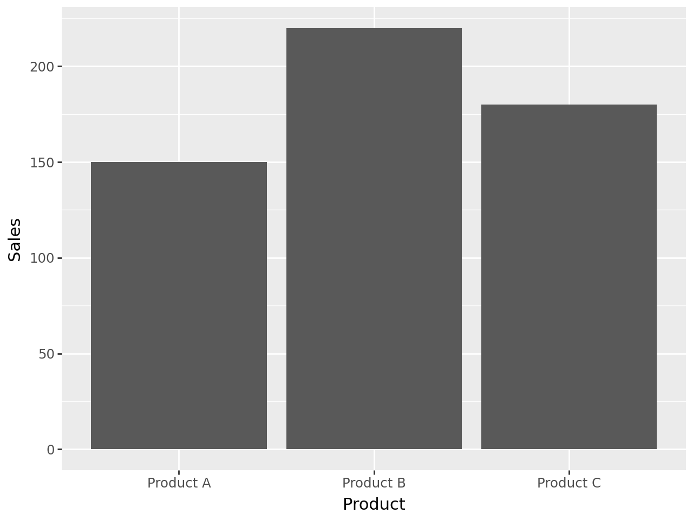
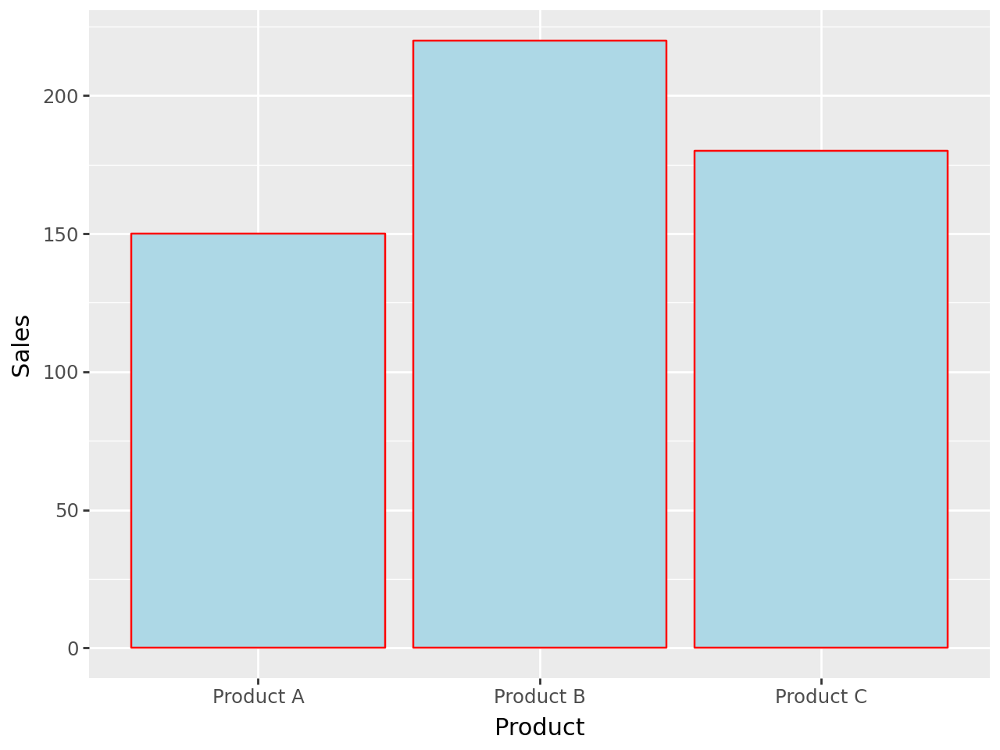
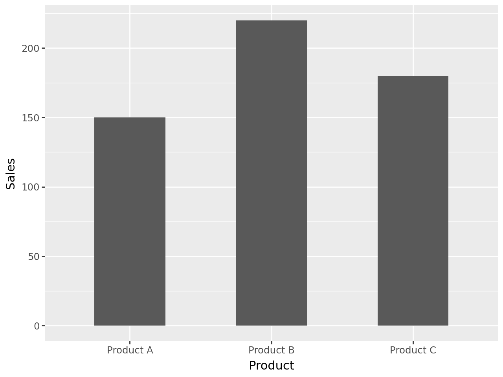
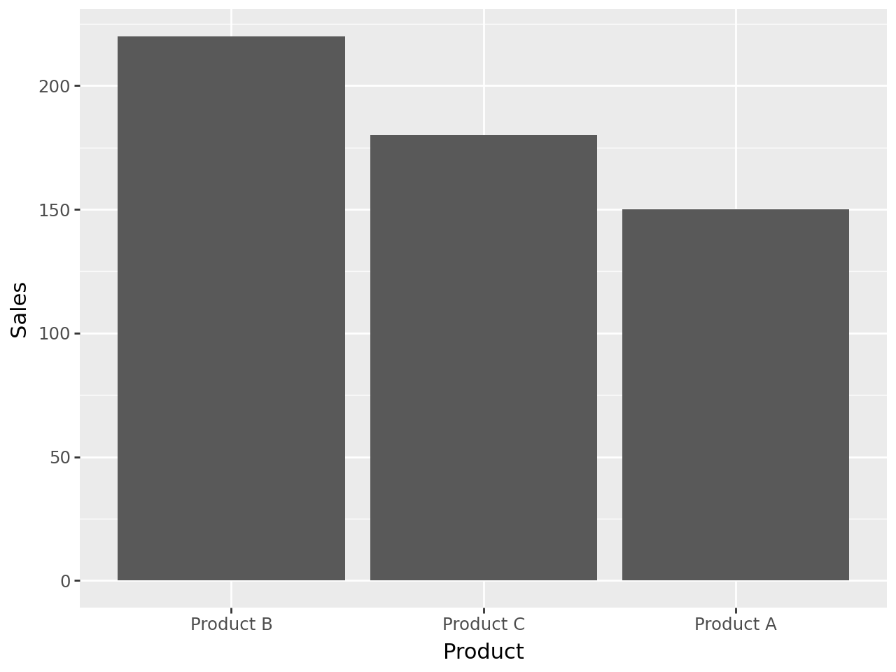

## Libraries

For creating this chart, we will need to load the following libraries:

- [pandas](https://python-graph-gallery.com) for data manipulation
- [plotnine](https://python-graph-gallery.com/plotnine/) for data visualization

```python
import pandas as pd
from plotnine import *
```

## Dataset

Since [bar plots](https://python-graph-gallery.com/barplot/) are a type of chart that displays the counts or values of different categories in a dataset, we will need a dataset that contains the categories we want to compare.

For instance, let's consider a dataset that contains the sales data for three different products: Product A, Product B, and Product C. In our case, we can plot the **names of the products on the x-axis** and their corresponding **sales figures on the y-axis**. You can learn more about bar plots by reading this [section](https://python-graph-gallery.com/barplot/) of the Python Graph Gallery.

```python
sales_data = {
    'Product': ['Product A', 'Product B', 'Product C'],
    'Sales': [150, 220, 180]
}

# Convert the dictionary to a pandas DataFrame
df = pd.DataFrame(sales_data)
```

## Most simple barplot

The `ggplot()` function works the following way: you start by **initializing a plot** with `ggplot()` and then you **add layers** to it using the `+` operator.

In this case, we will use the `geom_bar()` function to create the barplot. And since our dataframe is **already aggregated**, we need to specify the `stat=identity` argument to tell `ggplot()` that the data is already summarized.

```python
(
ggplot(df, aes(x='Product', y='Sales')) +
    geom_bar(stat='identity')
)
```

:::output

:::

## Change color

There are 2 colors we can change: the **border** and the **fill** color.

You can use the `color` and `fill` arguments to change them inside the `geom_bar()` function.

```python
(
ggplot(df, aes(x='Product', y='Sales')) +
    geom_bar(stat='identity', fill='lightblue', color='red')
)
```

:::output

:::

## Change width

You can use the `width` argument to **change the width** of the bars inside the `geom_bar()` function.

By default, the width is set to `0.9`. You can **increase or decrease this value** to make the bars **wider or narrower**.

```python
(
ggplot(df, aes(x='Product', y='Sales')) +
    geom_bar(stat='identity', width=0.5)
)
```

:::output

:::

## Change bar order

In order to change to change the order of the bars, we need to update our dataset before plotting it.

With pandas, we can use the `sort_values()` function and specify the column we want to sort by. In this case, it will be the `Sales` column.

```python
# Order dataframe according to `Sales`
df = df.sort_values(
    by='Sales',
    ascending=False # sort in descending order
)

# Then, set the order of the categories in the 'Product' column
df['Product'] = pd.Categorical(df['Product'], categories=df['Product'])

# Now, you can plot the ordered bar chart
(
ggplot(df, aes(x='Product', y='Sales')) +
    geom_bar(stat='identity')
)
```

:::output

:::

## Going further

This article explains how to create a [bar plot](https://python-graph-gallery.com/barplot/) with [plotnine](https://python-graph-gallery.com/plotnine/).

If you want to go further, you can also learn how to [custom a barplot with plotnine](/577-customize-barplot-plotnine) and have a look at the [bar plot section](https://python-graph-gallery.com/barplot/) of gallery.
