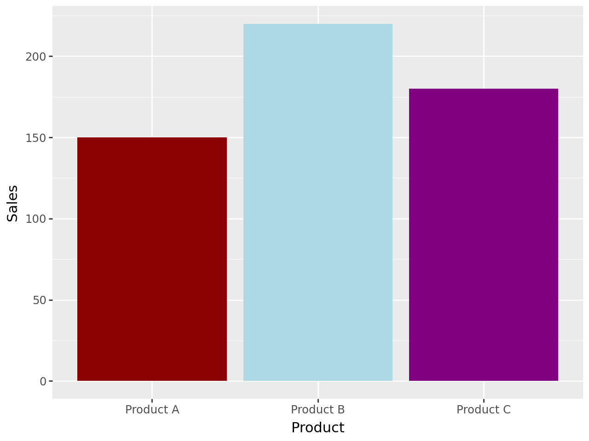
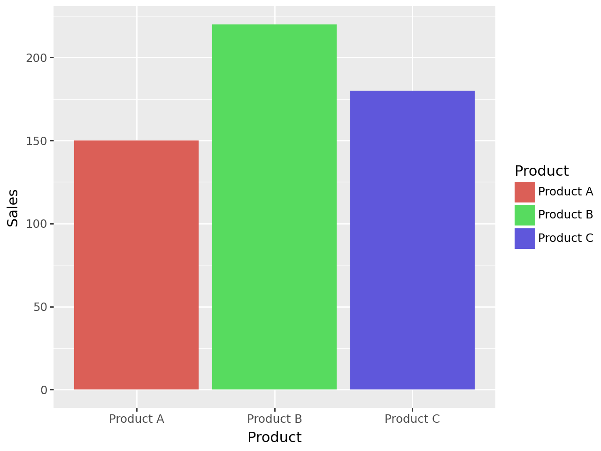
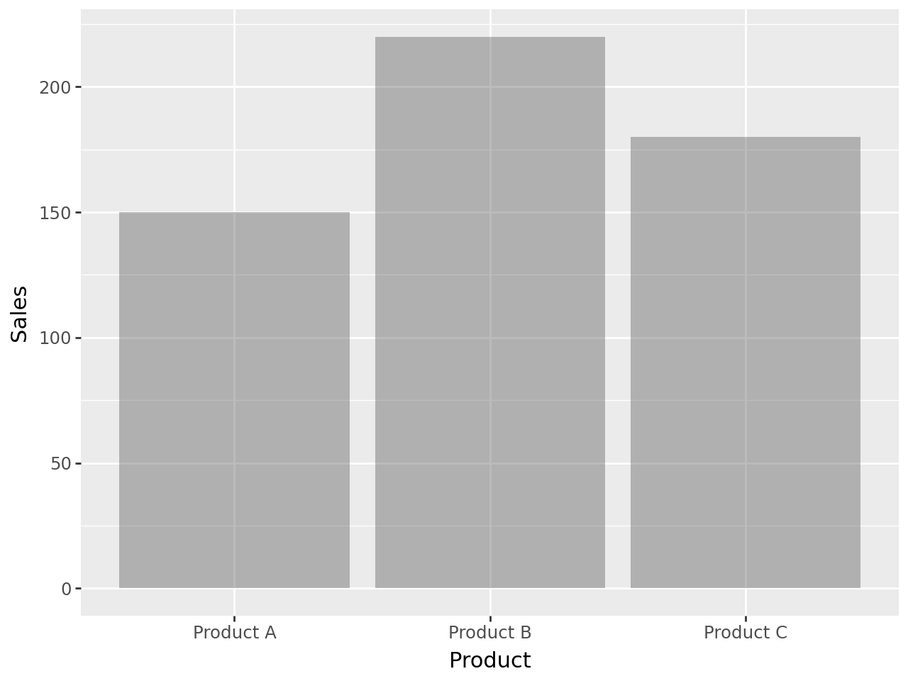
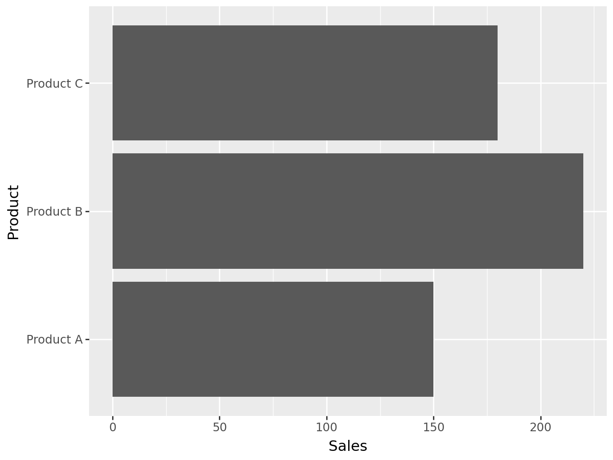

## Libraries

For creating this chart, we will need to load the following libraries:

- [pandas](https://python-graph-gallery.com) for data manipulation
- [plotnine](https://python-graph-gallery.com/plotnine/) for data visualization

```python
import pandas as pd
from plotnine import *
```

## Dataset

Since [bar plots](https://python-graph-gallery.com/barplot/) are a type of chart that displays the counts or values of different categories in a dataset, we will need a dataset that contains the categories we want to compare.

For instance, let's consider a dataset that contains the sales data for three different products: Product A, Product B, and Product C. In our case, we can plot the **names of the products on the x-axis** and their corresponding **sales figures on the y-axis**. You can learn more about bar plots by reading this [section](https://python-graph-gallery.com/barplot/) of the Python Graph Gallery.

```python
sales_data = {
    'Product': ['Product A', 'Product B', 'Product C'],
    'Sales': [150, 220, 180]
}

# Convert the dictionary to a pandas DataFrame
df = pd.DataFrame(sales_data)
```

## One color per bar

If we manually set the color of each bar, we can add the `fill` argument and give it a **list of colors** of the **same length** as the number of bars. This way, each bar will have a **different color**.

```python
colors = ['darkred', 'lightblue', 'purple']

(
ggplot(df, aes(x='Product', y='Sales')) +
    geom_bar(stat='identity', fill=colors)
)
```

:::output

:::

## Color according to a variable

If we want to color the bars **according to a variable**, we can use the `fill` argument and set it to the name of the variable.

Moreover, it will automatically create a **legend** that shows the **color scale** and the **corresponding values**.

```python
(
ggplot(df, aes(x='Product', y='Sales', fill='Product')) +
    geom_bar(stat='identity')
)
```

:::output

:::

## Change opacity

If we want to **change the opacity** of the bars, we can use the `alpha` argument and set it to a value between 0 and 1. This way, we can make the bars **more transparent**.

```python
(
ggplot(df, aes(x='Product', y='Sales')) +
    geom_bar(stat='identity', alpha=0.4)
)
```

:::output

:::

## Flip the bars

If we want to **flip the bars** so that the **categories are displayed horizontally**, we can use the `coord_flip()` function. This way, the **categories will be displayed on the y-axis** and the **values on the x-axis**.

```python
(
ggplot(df, aes(x='Product', y='Sales')) +
    geom_bar(stat='identity') +
    coord_flip()
)
```

:::output

:::

## Going further

This article explains how to create and customize a [bar plot](https://python-graph-gallery.com/barplot/) with [plotnine](https://python-graph-gallery.com/plotnine/).

You might be interested in [this post](/576-introduction-barplot-plotnine) where we explain how to **change width** of the bars and to **change the order** of the bars
