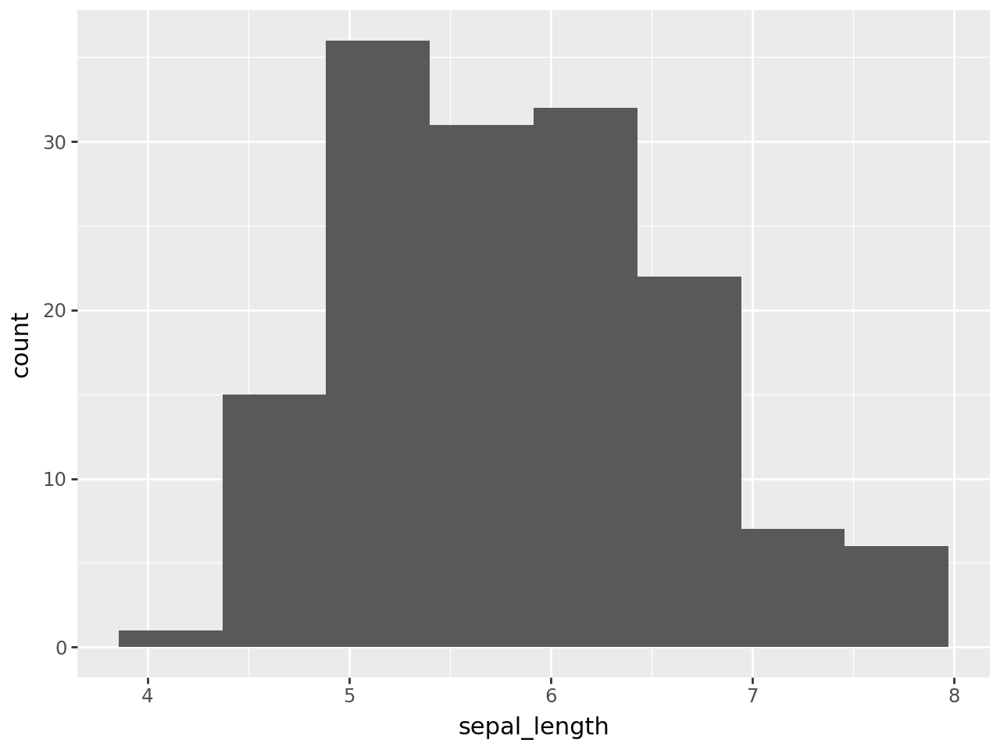
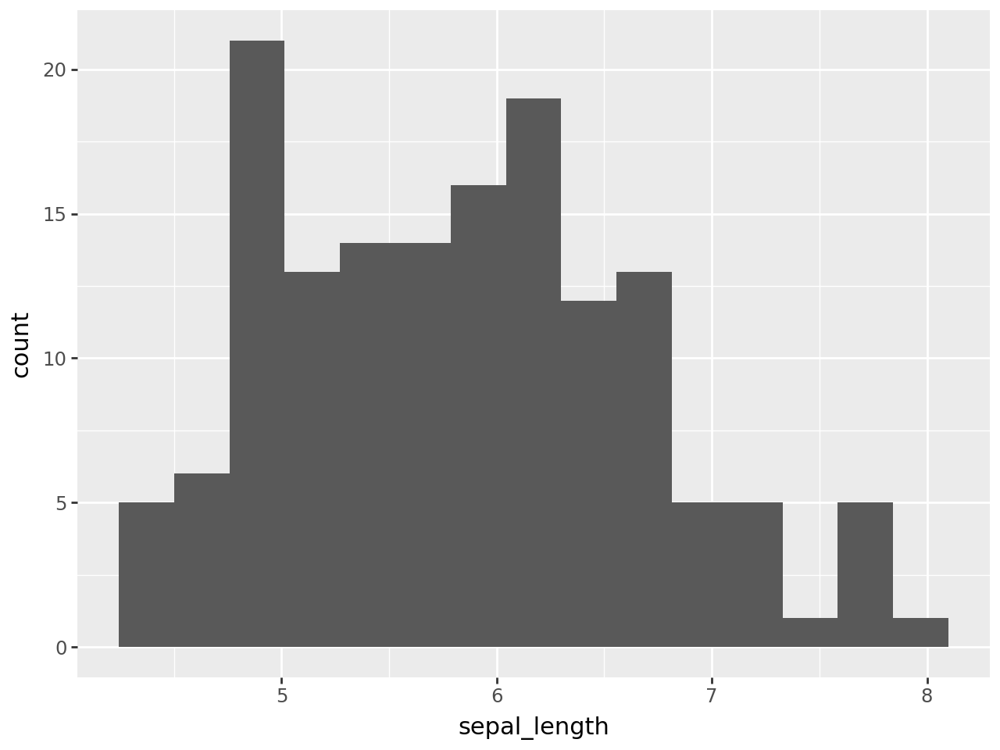
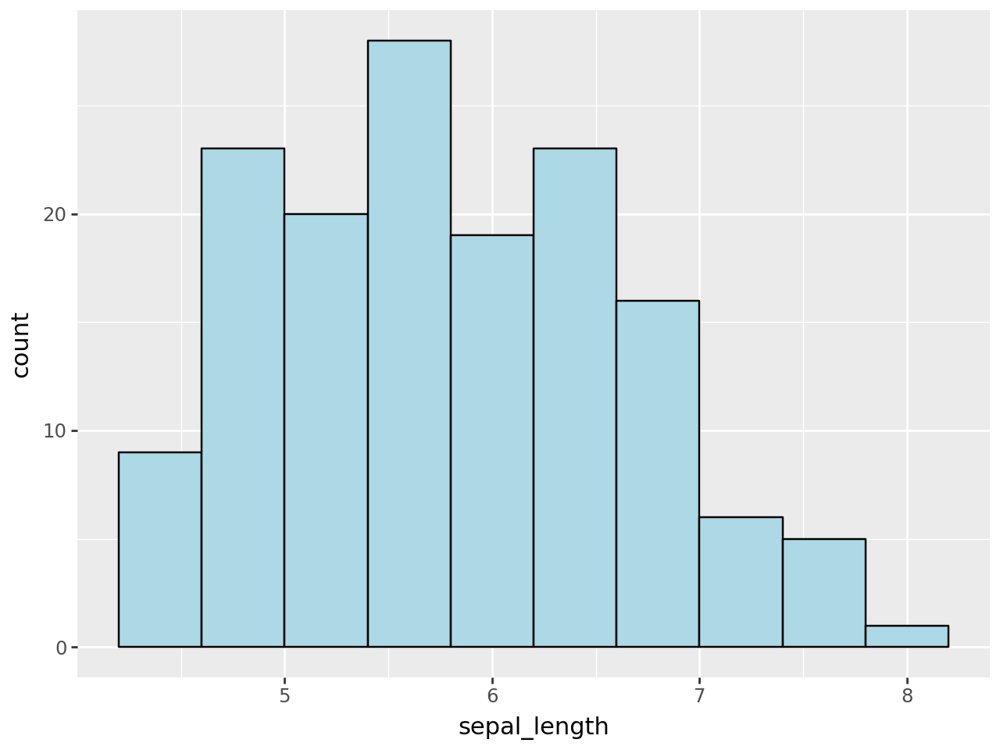
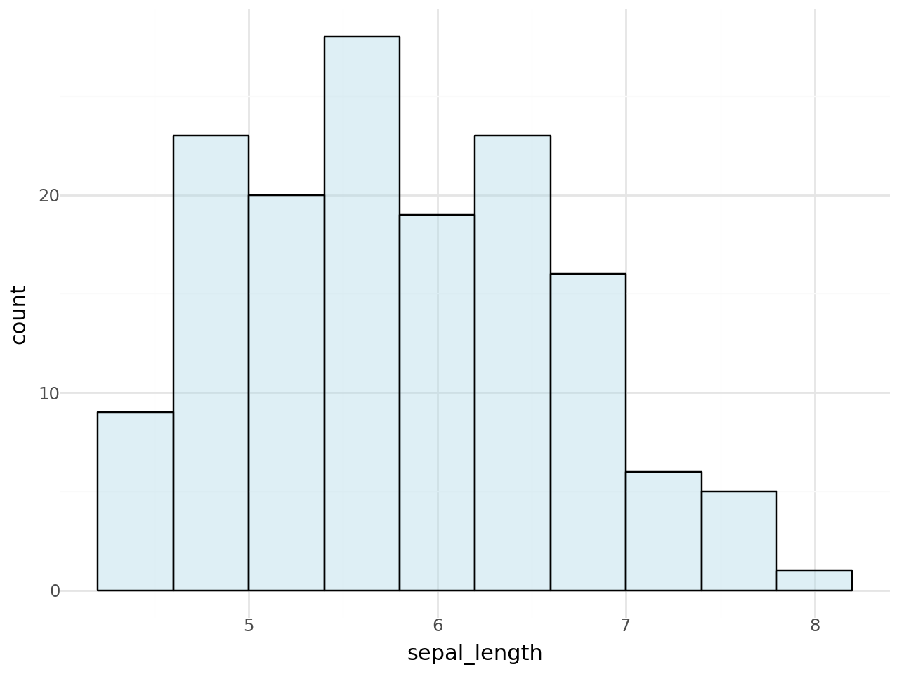

## Libraries

For creating this chart, we will need to load the following libraries:

- [pandas](https://python-graph-gallery.com) for data manipulation
- [plotnine](https://python-graph-gallery.com/plotnine/) for data visualization

```python
import pandas as pd
from plotnine import *
```

## Dataset

Since [histograms](https://python-graph-gallery.com/histogram/) are a type of chart that displays the **distribution of a numerical variable**, we need a dataset that contains this type of values.

For instance, we will use the `iris` dataset, which is a famous dataset used in data science. It contains 150 observations of iris flowers. There are four columns of **measurements of the flowers** in centimeters. The fifth column is the **species** of the flower observed.

We can easily load it using the following code:

```python
path = 'https://raw.githubusercontent.com/holtzy/The-Python-Graph-Gallery/master/static/data/iris.csv'
df = pd.read_csv(path)
df.head()
```

:::output
::output-html{src="./output-1.html"}
:::

## Most simple histogram

The `ggplot()` function works the following way: you start by **initializing a plot** with `ggplot()` and then you **add layers** to it using the `+` operator.

In this case, we will use the `geom_histogram()` function to **create a histogram**. We will map the `Sepal.Length` column to the x-axis.

```python
(
ggplot(df, aes(x='sepal_length')) +
    geom_histogram(bins=8)
)
```

:::output

:::

## Control number of bins

You can control the number of bins in a histogram by setting the `bins` argument inside the `geom_histogram()` function.

```python
(
ggplot(df, aes(x='sepal_length')) +
    geom_histogram(bins=15)
)
```

:::output

:::

## Change color and edge color

You can change the **color of the bars** by setting the `fill` argument inside the `geom_histogram()` function. You can also change the **color of the edges** by setting the `color` argument.

```python
(
ggplot(df, aes(x='sepal_length')) +
    geom_histogram(bins=10, fill='lightblue', color='black')
)
```

:::output

:::

## Change overall appearance

To improve the style of the chart, we can change the following arguments:

- `fill`: to change the color of the **bars**
- `color`: to change the color of the **borders** of the bars
- `alpha`: to change the **transparency** of the bars
- `bins`: to change the **number of bins**

```python
(
ggplot(df, aes(x='sepal_length')) +
    geom_histogram(bins=10, fill='lightblue', color='black', alpha=0.4) +
    theme_minimal()
)
```

:::output

:::

## Going further

This article explains how to create a [histogram](/histogram) with [plotnine](/plotnine).

If you want to go further, you can also learn how to [create a multiple histogram with plotnine](/579-multiple-histograms-plotnine) and have a look at the [histogram section](/histogram) of gallery.
