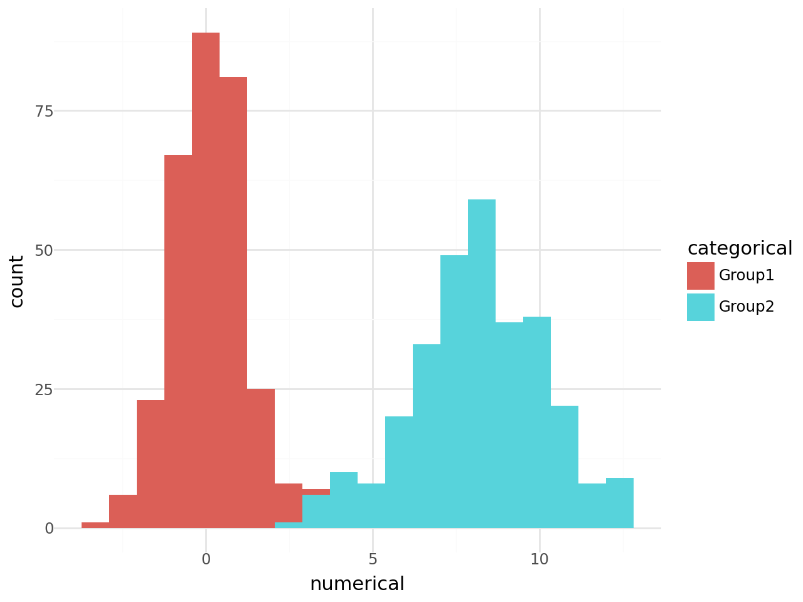
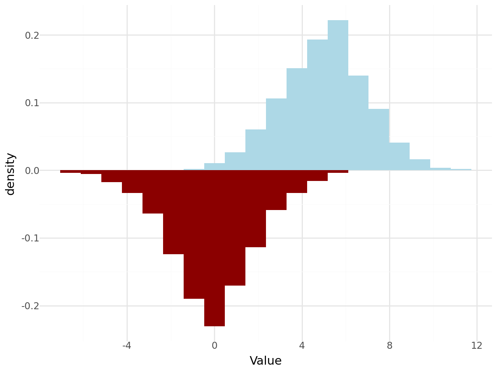

## Libraries

For creating this chart, we will need to load the following libraries:

- [pandas](https://python-graph-gallery.com) for data manipulation
- [plotnine](https://python-graph-gallery.com/plotnine/) for data visualization

```python
import pandas as pd
from plotnine import *
```

## Dataset

Since [histograms](https://python-graph-gallery.com/histogram/) are a type of chart that displays the **distribution of a numerical variable**, we need a dataset that contains this type of values.

For this, we will create a simple dataset with 2 variables: `value` and `category`. The `value` variable will contain the **numerical values** that we want to plot, and the `category` variable will contain the **categories** that we want to use to group the values.

```python
# Generate data
import numpy as np
group1_num = np.random.normal(loc=0, scale=1, size=300) 
group2_num = np.random.normal(loc=8, scale=2, size=300)
group1_cat = np.repeat('Group1', 300)
group2_cat = np.repeat('Group2', 300)

df = pd.DataFrame({
    'numerical': np.concatenate([group1_num, group2_num]),
    'categorical': np.concatenate([group1_cat, group2_cat])
})
df.head()
```

:::output
::output-html{src="./output-1.html"}
:::

## Double histogram

We use the `geom_histogram()` function to **create a histogram**, and in order to **display two histograms** on the same chart, we need to use the `fill` argument to differentiate them.

This argument must be the name of the variable that we want to use to **group the data**. In this case, we will use the `category` variable to group the data.

```python
(
ggplot(df, aes(x='numerical', fill='categorical')) +
    geom_histogram(bins=20) +
    theme_minimal()
)
```

:::output

:::

## Mirror histogram

To create a **mirror histogram**, we need to have to have 2 variables that we want to display.

For this we add 2 new columns to our dataset: `numerical_top` and `numerical_bottom`.

Then we call the `geom_histogram()` function twice, one for each variable, and we use the `y` argument to specify the **position** of the histogram.

```python
df['num_top'] = np.random.normal(loc=5, scale=2, size=600)
df['num_bottom'] = np.random.normal(loc=0, scale=2, size=600)

(
ggplot(df) +
    geom_histogram(aes(x='num_top', y='..density..'), bins=20, fill='lightblue') +
    geom_histogram(aes(x='num_bottom', y='-..density..'), bins=20, fill='darkred') +
    xlab('Value') +
    theme_minimal()
)
```

:::output

:::

## Going further

This article explains how to create a [histogram](/histogram) with [plotnine](/plotnine).

If you want to go further, you can check [how to custom colors in histogram](/578-introduction-histogram-plotnine) and have a look at the [histogram section](/histogram) of gallery.
