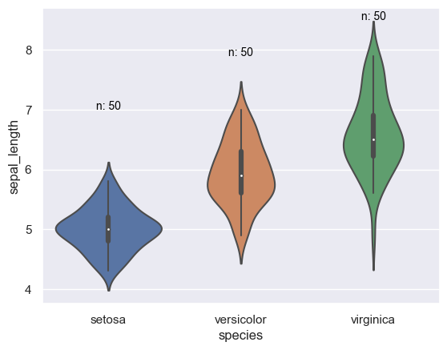

## Libraries

First, we need to load a few libraries:

- [matplotlib](https://python-graph-gallery.com/matplotlib/): for displaying the chart
- [seaborn](https://python-graph-gallery.com/seaborn/): for creating the chart
- `numpy`: for some calculations

```python
import seaborn as sns
import matplotlib.pyplot as plt
import numpy as np
```

## Dataset

Since [violin](https://python-graph-gallery.com/violin-plot/) is used to display the **distribution of a numerical variable**, we need a dataset that contains at least one numerical variable.

In this example, we will use the `iris` dataset that we can easily **load** with [seaborn](https://python-graph-gallery.com/seaborn/).

```python
df = sns.load_dataset('iris')
```

## Violin plot

In the following example, we start from a simple [violinplot](https://python-graph-gallery.com/violin-plot/) and add annotations to it.  

To do so we: 
- calculate the median `sepal_length` for each group and store them in a variable named `medians`
- we then create a `nobs` list which stores the **number of observations** for each group 
- eventually, we add labels to our figure.  

To add labels, keep in mind that seaborn is built on top of matplotlib, thus seaborn objects can be stored in matplotlib axes or figures (here we store the violinplot in a matplotlib axes object named ax). This enables us to use matplotlib axes .get_xticklabels() as well as .text() functions and its various parameters (horizontalalignment, size, color, weight) to add text to our figure.

```python
# calculate medians and number of observations
medians = df.groupby(['species'])['sepal_length'].median().values
nobs = df['species'].value_counts().values
nobs = [str(x) for x in nobs.tolist()]
nobs = ["n: " + i for i in nobs]
  
sns.set_theme(style="darkgrid")
ax = sns.violinplot(x="species", y="sepal_length", data=df)
 
# Add text to the figure
pos = range(len(nobs))
for tick, label in zip(pos, ax.get_xticklabels()):
   ax.text(pos[tick], medians[tick] + 2, nobs[tick],
            horizontalalignment='center',
            size='small',
            color='black')
plt.show()
```

:::output

:::

## Going further

This post explains how to create and customize a [violin plot](https://python-graph-gallery.com/violin-plot/) with the [seaborn](https://python-graph-gallery.com/seaborn/) library.

You might be interested in how adding [individual data points in violin plot](https://python-graph-gallery.com/502-violinplot-and-swarmplot/) and how to create a [raincloud plot](https://python-graph-gallery.com/raincloud-plot-with-matplotlib-and-ptitprince/) with the `ptitprince` library.
