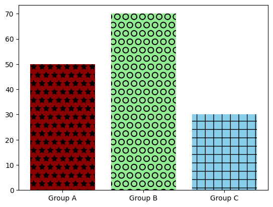
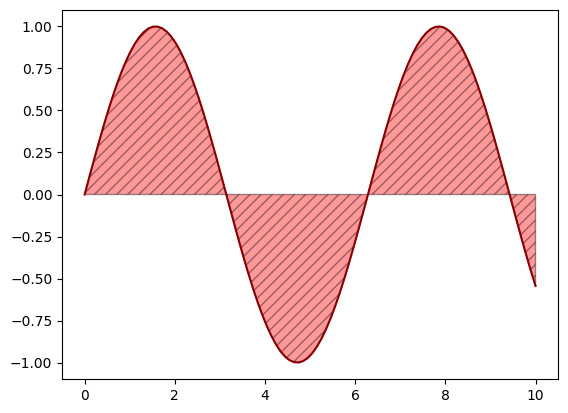
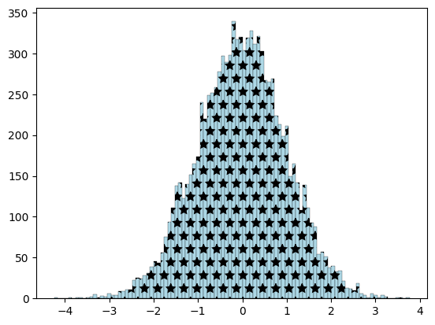
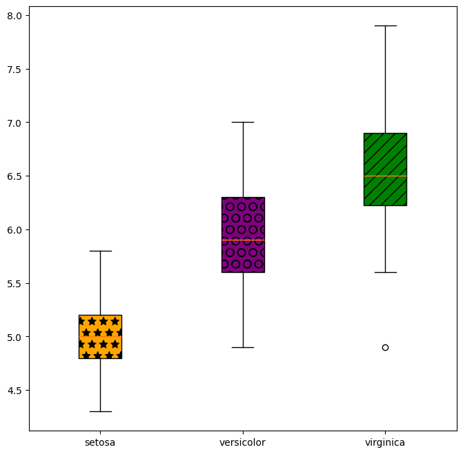

## Libraries

For creating this chart, we will need to load the following libraries:

- [pandas](https://python-graph-gallery.com) for data manipulation
- [matplotlib](https://python-graph-gallery.com) for creatin the chart
- `numpy` for smoothing the chart

```python
import pandas as pd
import numpy as np
import matplotlib.pyplot as plt
```

## Hatch in barplots

Hatchs, or patterns, are a way to **fill a chart** with a pattern instead of a simple color. It can be useful when you want to print the chart in **black and white**, or when you want to add a bit of **style** to your chart.

[Matplotlib](/matplotlib) offers a variety of patterns: `/`, `\\`, `|`, `-`, `+`, `x`, `o`, `O`, `.`, `*`

In order to use a different hatch for each bar, you can use the `hatch` parameter of the `bar()` function. It should be a **list of the same length** as the number of bars in your chart.

Here is how to use it with the `bar()` function:

```python
plt.bar(
   height=[50, 70, 30],
   x=['Group A', 'Group B', 'Group C'],
   hatch=['*', 'O', '+'],
   color=['darkred', 'lightgreen', 'skyblue']
)
plt.show()
```

:::output

:::

## Hatch in area chart

```python
x = np.linspace(0, 10, 100)
y = np.sin(x)

plt.plot(
   x, y,
   color='darkred',
)
plt.fill_between(
   x, y,
   color='red',
   hatch='///',
   alpha=0.4,
   edgecolor='black'
)
plt.show()
```

:::output

:::

## Hatch in histogram

```python
x = np.random.normal(0, 1, 10000)

plt.hist(
   x,
   bins=100,
   color='lightblue',
   edgecolor='black',
   hatch='*',
   linewidth=.2
)
plt.show()
```

:::output

:::

## Hatch in boxplots

```python
url = 'https://raw.githubusercontent.com/holtzy/The-Python-Graph-Gallery/master/static/data/iris.csv'
df = pd.read_csv(url)
grouped = df.groupby('species')['sepal_length']

# Init a figure and axes
fig, ax = plt.subplots(figsize=(8, 8))

# Create the plot with different colors for each group
boxplot = ax.boxplot(
    x=[group.values for name, group in grouped],
    labels=grouped.groups.keys(),
    patch_artist=True,
)

# Define colors for each group
colors = ['orange', 'purple', 'green']
hatchs = ['*', 'O', '//']

# Assign colors to each box in the boxplot
for box, color, hatch in zip(boxplot['boxes'], colors, hatchs):
    box.set_facecolor(color)
    box.set(hatch=hatch)

# Display it
plt.show()
```

:::output

:::

## Going further

This article explains how to add patterns to charts in [matplotlib](/matplotlib).

You might be interested in:

- how to [customize matplotlib charts](/matplotlib)
