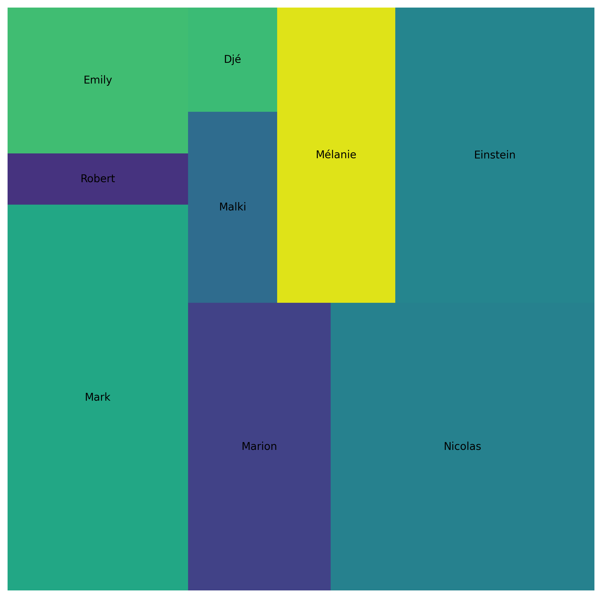
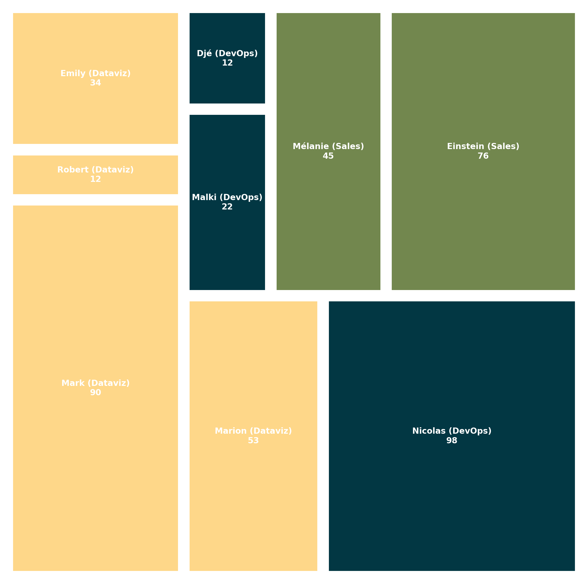
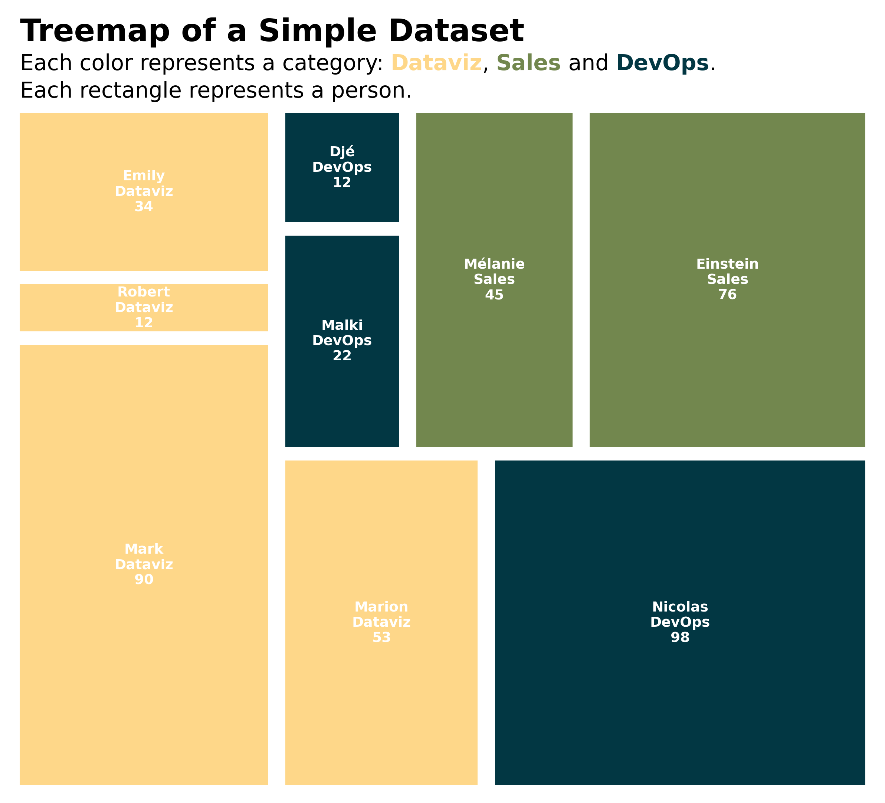

## Libraries & Dataset

For creating this chart, we will need to load the following libraries:

- [matplotlib](/matplotlib) for creatin the chart
- [pandas](/pandas) for loading the dataset
- [pypalettes](/color-palette-finder/) for the color palette
- [highlight_text](/advanced-custom-annotations-matplotlib) for custom annotations
- `squarify` for creating the treemap

```python
# load libraries
import squarify  # pip install squarify (algorithm for treemap)
import matplotlib.pyplot as plt
from pypalettes import load_cmap
import pandas as pd
from highlight_text import fig_text

# set a higher resolution
plt.rcParams["figure.dpi"] = 300

df = pd.read_csv(
    "https://raw.githubusercontent.com/holtzy/The-Python-Graph-Gallery/master/static/data/simple-treemap.csv"
)
df
```

:::output
::output-html{src="./output-1.html"}
:::

## Simple treemap

The `plot()` function from `squarify` works mainly with 3 arguments:

- `sizes`: a list of values that will be represented by the **area of the squares**
- `label`: a list of labels to display **on the squares**
- `ax`: the **matplotlib axes** where to plot the treemap

```python
# create a figure
fig, ax = plt.subplots(figsize=(10, 10))
ax.set_axis_off()

# add treemap
squarify.plot(sizes=df["value"], label=df["name"], ax=ax)

# display plot
plt.show()
```

:::output

:::

## Custom colors

Utilizing the convenient [pypalette](https://python-graph-gallery.com/color-palette-finder/) library, you can effortlessly discover a color palette that suits your requirements.

In this instance, we employ the `'Acadia'` palette and subsequently **associate** it with the `parent` column in the dataframe. This process generates a **collection of colors** that will be utilized to enhance the visual appeal of the squares.

Furthermore, we introduce some spacing between the rectangles with the help of `pad=True` and stipulate the preference for white text by using `text_kwargs={'color':'white'}`.

```python
# create a color palette
cmap = load_cmap("Acadia")
category_codes, unique_categories = pd.factorize(df["parent"])
colors = [cmap(code) for code in category_codes]

# create a treemap
fig, ax = plt.subplots(figsize=(10, 10))
ax.set_axis_off()
squarify.plot(
    sizes=df["value"],
    label=df["name"],
    color=colors,
    text_kwargs={"color": "white"},
    pad=True,
    ax=ax,
)
plt.show()
```

:::output

:::

## Custom labels

In place of providing only the column of labels to the `label` argument, we establish a new variable called `labels`. This variable will encompass the `name`, the `parent`, and the `value` of each individual rectangle.

By doing so, we can **present all these pertinent details** on the treemap, enhancing its overall comprehensiveness.

```python
# create a color palette
cmap = load_cmap("Acadia")
category_codes, unique_categories = pd.factorize(df["parent"])
colors = [cmap(code) for code in category_codes]

# customize the labels
labels = [
    f"{name} ({parent[5:]})\n{value}"
    for name, value, parent in zip(df["name"], df["value"], df["parent"])
]

# create a treemap
fig, ax = plt.subplots(figsize=(10, 10))
ax.set_axis_off()
squarify.plot(
    sizes=df["value"],
    label=labels,
    color=colors,
    text_kwargs={"color": "white", "fontsize": 8, "fontweight": "bold"},
    pad=True,
    ax=ax,
)
plt.show()
```

:::output

:::

## Legend with `highlight_text`

The [highlight_text](/advanced-custom-annotations-matplotlib/) library offers the capability to incorporate **various styles** within a single string in a matplotlib annotation.

In our particular scenario, we leverage this functionality to introduce a title that **associates colors** with specific categories and their corresponding labels, thereby enhancing the overall clarity and interpretability of the visualization.

```python
# create a color palette
cmap = load_cmap("Acadia")
category_codes, unique_categories = pd.factorize(df["parent"])
colors = [cmap(code) for code in category_codes]

# customize the labels
labels = [
    f"{name}\n{parent[5:]}\n{value}"
    for name, value, parent in zip(df["name"], df["value"], df["parent"])
]

# create a treemap
fig, ax = plt.subplots(figsize=(10, 8))
ax.set_axis_off()
squarify.plot(
    sizes=df["value"],
    label=labels,
    color=colors,
    text_kwargs={"color": "white", "fontsize": 9, "fontweight": "bold"},
    pad=True,
    ax=ax,
)

# add a title and legend
text = """<Treemap of a Simple Dataset>
Each color represents a category: <Dataviz>, <Sales> and <DevOps>.
Each rectangle represents a person.
"""
fig_text(
    x=0.133,
    y=0.98,
    s=text,
    color="black",
    highlight_textprops=[
        {"fontsize": 20, "fontweight": "bold"},
        {"color": cmap(0), "fontweight": "bold"},
        {"color": cmap(2), "fontweight": "bold"},
        {"color": cmap(1), "fontweight": "bold"},
    ],
    fontsize=14,
    ha="left",
)

plt.show()
```

:::output

:::

## Going further

You might be interested in:

- make the color of the [rectangle proportional to a value](/202-treemap-with-colors-mapped-on-values)
- create an [interactive treemap with plotly](/580-simple-interactive-treemap-plotly)
- the [treemap page](/treemap) of the gallery
