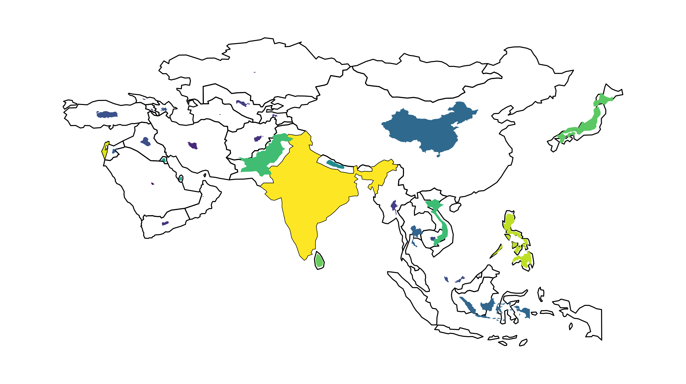
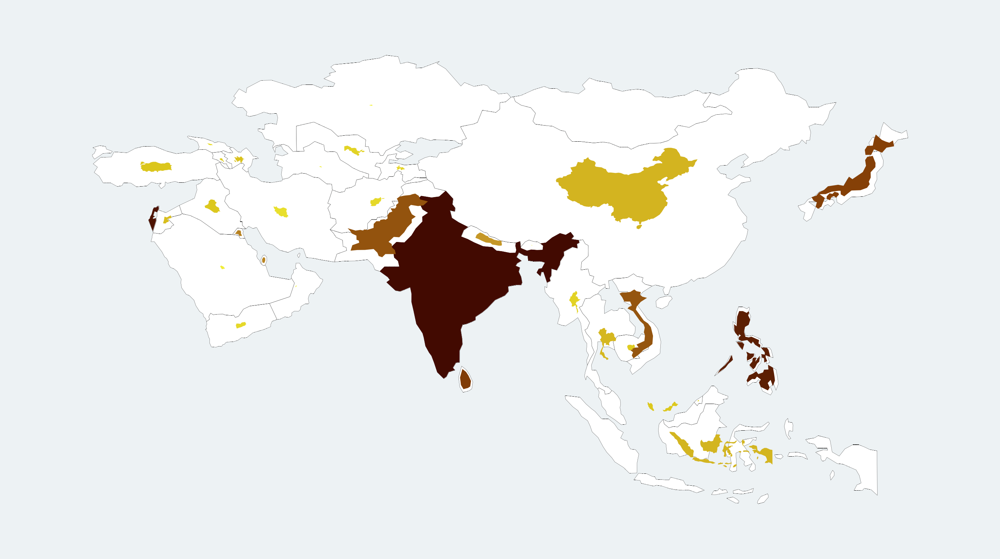
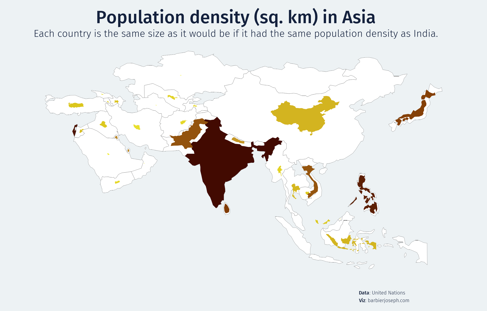
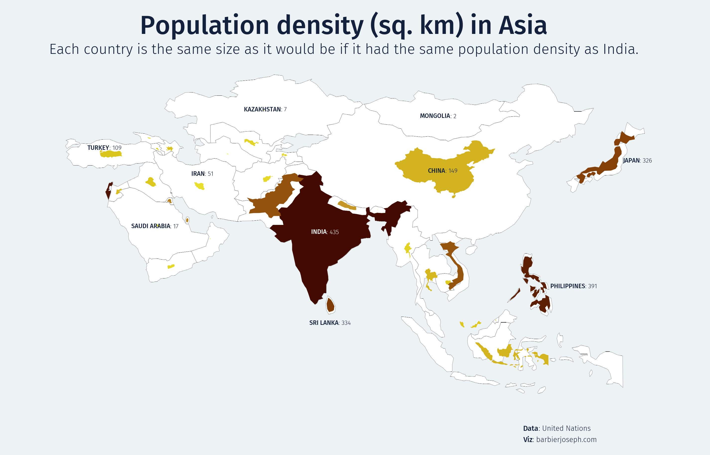

## About cartograms

To give you a visual idea, here is the cartogram we will step-by-step create in this post:


## Libraries & Data

For creating this chart, we will need to load the following libraries:

- [matplotlib](/matplotlib) for plotting the chart
- `geopandas` and `geoplot`: for spatial data plotting
- [pandas](/pandas) for loading the data
- [pypalettes](/color-palette-finder): for the color palette
- [highlight_text](/advanced-custom-annotations-matplotlib) for the annotations

```python
# matplotlib tools
import matplotlib.pyplot as plt
from matplotlib.font_manager import FontProperties

# map libraries
import geopandas as gpd
import geoplot as gplt
import geoplot.crs as gcrs

# colors
from pypalettes import load_cmap

# annotations
from highlight_text import fig_text, ax_text

# data manipulation
import pandas as pd

# increase resolution
plt.rcParams['figure.dpi'] = 300
plt.rcParams['savefig.dpi'] = 300
```

## Dataset

Let's start by loading shape data:

```python
world = gpd.read_file('https://raw.githubusercontent.com/holtzy/The-Python-Graph-Gallery/master/static/data/all_world.geojson')
world.head()
```

:::output
::output-html{src="./output-1.html"}
:::

Then we **load data** about the Asian population and surfaces

```python
# get asian population dataset
url = 'https://raw.githubusercontent.com/holtzy/The-Python-Graph-Gallery/master/static/data/asia.csv'
asia = pd.read_csv(url)
asia.head()
```

:::output
::output-html{src="./output-2.html"}
:::

Once we have our 2 datasets, we can **merge** them and create `pop_norm_surface` column as a measure of population density:

```python
# merge the datasets together
data = world.merge(asia, how='right', left_on='name', right_on='Country')

# filter the data
data = data[['Country', 'geometry', 'Total Population', 'Surface Area (sq. km)']]
data = data[~data['Country'].isin(['Russia', 'Bangladesh', 'Lebanon'])]
data.dropna(inplace=True)
data['pop_norm_surface'] = data['Total Population'] / data['Surface Area (sq. km)']

# display first rows
data.columns = ['Country', 'geometry', 'pop', 'surfaces', 'pop_norm_surface']
data.head()
```

:::output
::output-html{src="./output-3.html"}
:::

## Simple map of Asia

Let's start by a creating a simple version of our chart:

- create a figure and axe using the `figure()` and `add_subplot()` functions
- create the cartogram with the `cartogram()` function from **geoplot**. We specify that we want the size and the color of each country to be mapped with the `pop_norm_surface` column of our dataset (aka density population)
- create the background map with the `popyplot()` function from **geoplot**

And that's it!

```python
fig = plt.figure(figsize=(12, 7))
ax = fig.add_subplot(111, projection=gcrs.PlateCarree())

gplt.cartogram(
   data, projection=gcrs.PlateCarree(),
   scale='pop_norm_surface', hue='pop_norm_surface', limits=(0,1),
   ax=ax
)
gplt.polyplot(data, ax=ax)
plt.show()
```

:::output

:::

## Custom colors

Now we can add a bit of customization:

- load a color map using [pypalettes](/color-palette-finder)
- use the `set_facecolor()` function to change the **background color** of the graph
- change the color of the **background map**
- reduce the `linewidth` argument from 1 to 0.1

```python
# colors
cmap = load_cmap("Antennarius_multiocellatus", cmap_type='continuous', reverse=True)
background_color = '#edf2f4'
text_color = '#14213d'
map_color = 'white'

fig = plt.figure(figsize=(12, 7))
ax = fig.add_subplot(111, projection=gcrs.PlateCarree())
fig.set_facecolor(background_color)
ax.set_facecolor(background_color)

gplt.cartogram(
   data, projection=gcrs.PlateCarree(), cmap=cmap,
   scale='pop_norm_surface', hue='pop_norm_surface', limits=(0,1),
   ax=ax
)
gplt.polyplot(data, facecolor=map_color, edgecolor='black', linewidth=0.1, ax=ax)
plt.show()
```

:::output

:::

## Title, subtitle and source

Now we need to add a bit of explanation about the chart:

- we load **custom fonts**. Learn more about it [this post](/custom-fonts-in-matplotlib)
- we use the `fig_text()` function from [highlight_text](/advanced-custom-annotations-matplotlib) to add the title, subtitle and source

```python
# load the fonts
personal_path = '/Users/josephbarbier/Library/Fonts/' # change this to your own path
other_font = FontProperties(fname=personal_path + 'FiraSans-Light.ttf')
other_bold_font = FontProperties(fname=personal_path + 'FiraSans-Medium.ttf')

# colors
cmap = load_cmap("Antennarius_multiocellatus", cmap_type='continuous', reverse=True)
background_color = '#edf2f4'
text_color = '#14213d'
map_color = 'white'

# initiate figure and axes
fig = plt.figure(figsize=(12, 7))
ax = fig.add_subplot(111, projection=gcrs.PlateCarree())
fig.set_facecolor(background_color)
ax.set_facecolor(background_color)

# create the cartogram and background map
gplt.cartogram(
   data, projection=gcrs.PlateCarree(), cmap=cmap,
   scale='pop_norm_surface', hue='pop_norm_surface', limits=(0,1),
   ax=ax
)
gplt.polyplot(data, facecolor=map_color, edgecolor='black', linewidth=0.12, ax=ax)

fig_text( # title
   x=0.5, y=0.92, s="Population density (sq. km) in Asia",
   fontsize=25, ha='center', font=other_bold_font, color=text_color
)
fig_text( # subtitle
   x=0.5, y=0.86, s="Each country is the same size as it would be if it had the same population density as India.",
   fontsize=14, ha='center', font=other_font, color=text_color
)
fig_text( # credit and source
   x=0.7, y=0.13, s="<Data>: United Nations\n<Viz>: barbierjoseph.com",
   font=other_font, fontsize=7, color=text_color,
   highlight_textprops=[{'font': other_bold_font}, {'font': other_bold_font}]
)

plt.show()
```

:::output

:::

## Annotations of countries

- `data_projected = data.to_crs(epsg=4326)`: This line is converting the geospatial data to a **common coordinate system** (WGS84, used by GPS) for easier manipulation.

- `data_projected['centroid'] = data_projected.geometry.centroid`: This line is calculating the **centroid** (geometric center) of each geometry in the data and storing it in a new column `centroid`.

- `data['centroid'] = data_projected['centroid'].to_crs(data.crs)`: This line is converting the centroids back to the original coordinate system of the data.

- The `countries` list contains the names of countries to be annotated.

- The for loop **iterates over each country** in the `countries` list. For each country, it finds the centroid, adjusts its position if necessary, retrieves a value associated with the country, and then **adds a text annotation** at the adjusted centroid position on a map (not shown in the code).

```python
# adjustement mapping for label positions
adjustments = {
   'Japan': (6, 0),
   'Philippines': (8, 0),
   'Sri Lanka': (0, -3.5),
   'Turkey': (-1, 1.2),
   'China': (0, -1),
   'Iran': (0, 2.4)
}

# load the fonts
personal_path = '/Users/josephbarbier/Library/Fonts/' # change this to your own path
other_font = FontProperties(fname=personal_path + 'FiraSans-Light.ttf')
other_bold_font = FontProperties(fname=personal_path + 'FiraSans-Medium.ttf')

# colors
cmap = load_cmap("Antennarius_multiocellatus", cmap_type='continuous', reverse=True)
background_color = '#edf2f4'
text_color = '#14213d'
map_color = 'white'

# create a figure object
fig = plt.figure(figsize=(12, 7))
ax = fig.add_subplot(111, projection=gcrs.PlateCarree())
fig.set_facecolor(background_color)
ax.set_facecolor(background_color)

# Generate the cartogram
gplt.cartogram(
   data, projection=gcrs.PlateCarree(), cmap=cmap,
   scale='pop_norm_surface', hue='pop_norm_surface', limits=(0,1),
   ax=ax
)
gplt.polyplot(data, facecolor=map_color, edgecolor='black', linewidth=0.1, ax=ax)

# get the centroids
import warnings ; warnings.filterwarnings("ignore") # mask warning about geometry attribute
data_projected = data.to_crs(epsg=4326)
data_projected['centroid'] = data_projected.geometry.centroid
data['centroid'] = data_projected['centroid'].to_crs(data.crs)
countries = ['China', 'India', 'Japan', 'Mongolia', 'Kazakhstan', 'Turkey', 'Philippines', 'Sri Lanka', 'Saudi Arabia', 'Iran']

# annotate each country
for country in countries:   
   centroid = data.loc[data['Country'] == country, 'centroid'].values[0]
   x, y = centroid.coords[0]
   x, y = (x + adjustments[country][0], y + adjustments[country][1]) if country in adjustments else (x, y)
   value = data.loc[data['Country'] == country, 'pop_norm_surface'].values[0]
   color = 'white' if country=='India' else text_color
   ax_text(
      x=x, y=y, s=f"<{country.upper()}>: {value:.0f}", fontsize=6, font=other_font, color=color,
      ha='center', va='center', ax=ax, highlight_textprops=[{'font': other_bold_font}]
   )

fig_text( # title
   x=0.5, y=0.92, s="Population density (sq. km) in Asia",
   fontsize=25, ha='center', font=other_bold_font, color=text_color
)
fig_text( # subtitle
   x=0.5, y=0.86, s="Each country is the same size as it would be if it had the same population density as India.",
   fontsize=14, ha='center', font=other_font, color=text_color
)
fig_text( # credit and source
   x=0.7, y=0.13, s="<Data>: United Nations\n<Viz>: barbierjoseph.com",
   font=other_font, fontsize=7, color=text_color,
   highlight_textprops=[{'font': other_bold_font}, {'font': other_bold_font}]
)

# save and show the plot
plt.savefig('../../static/graph/592-non-contiguous-cartogram-in-python.png', dpi=300)
plt.show()
```

:::output

:::

## Going further

You might be interested in:

- [multiple choropleth maps on the same figure](/web-multiple-maps)
- how to create a [tile map with matplotlib](/web-stacked-area-charts-on-a-map)
- the [cartogram section](/cartogram)
