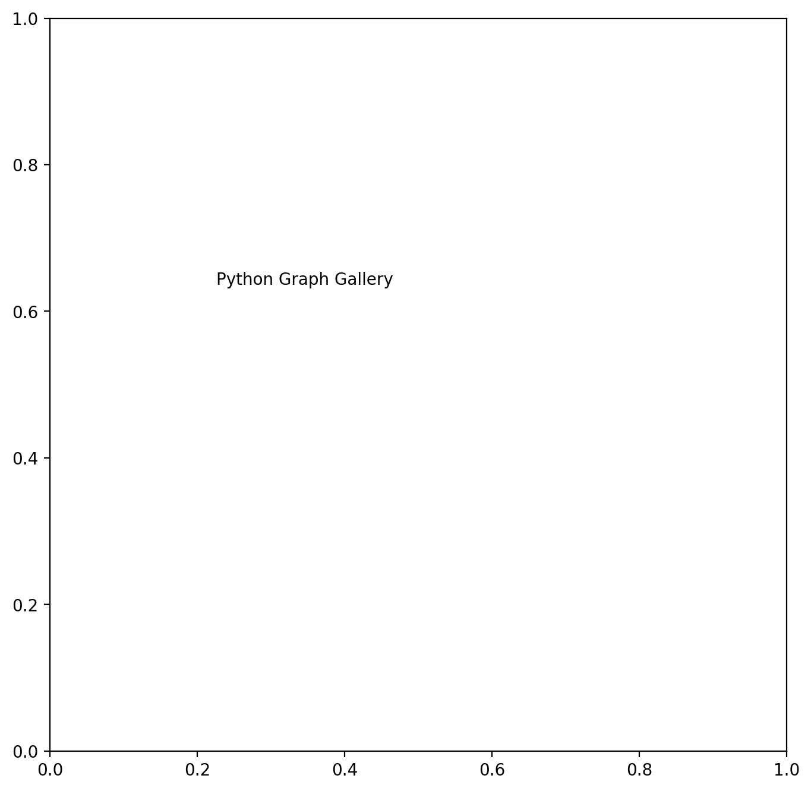
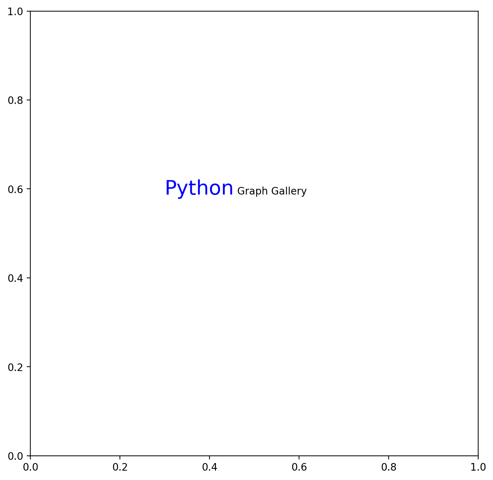
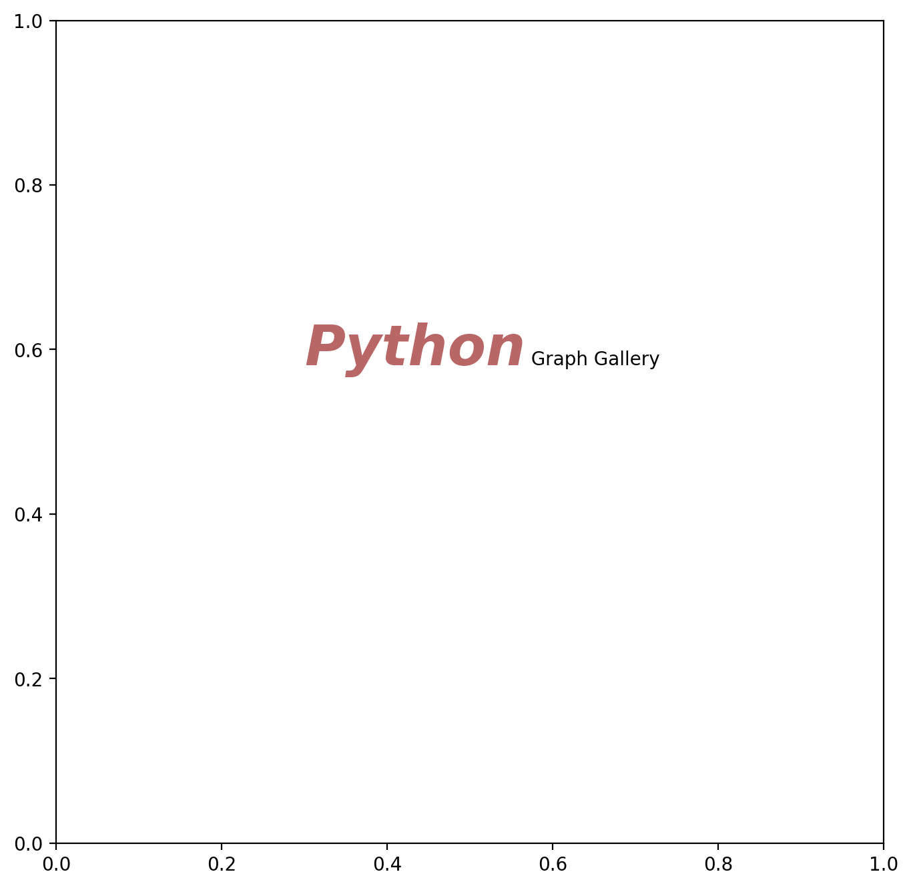
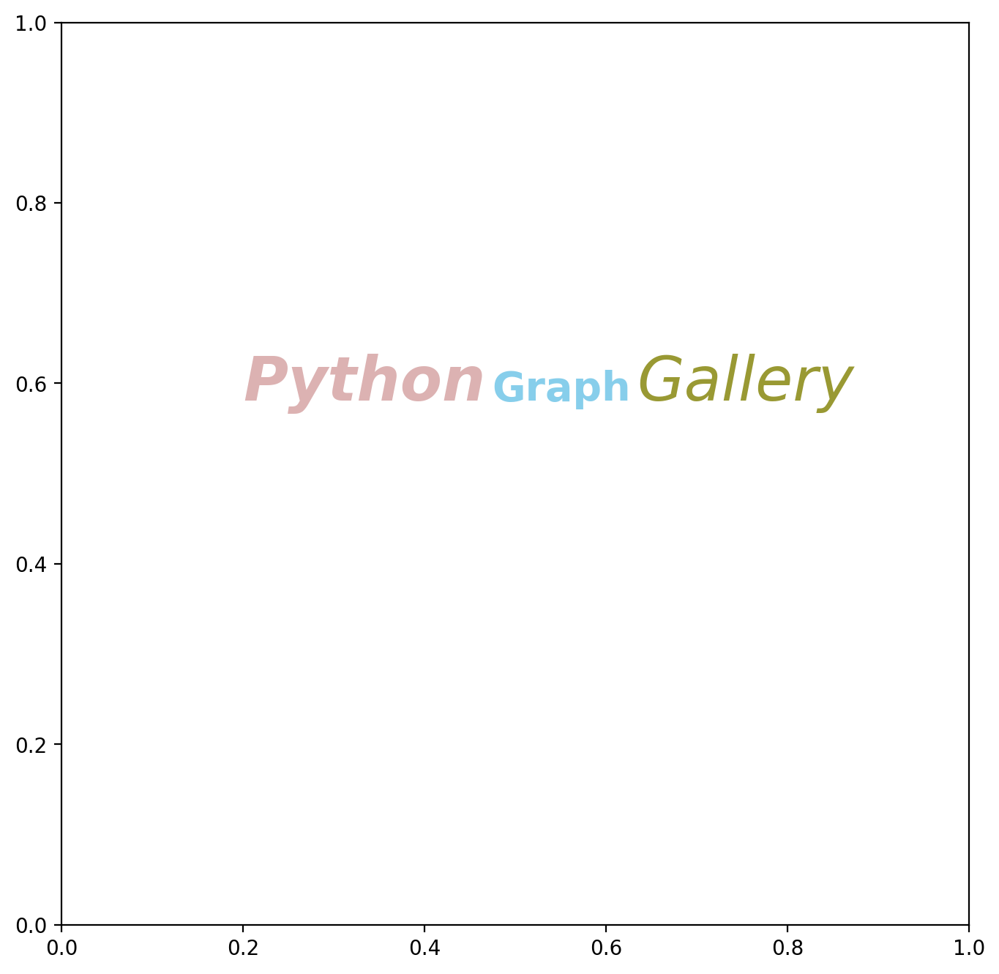
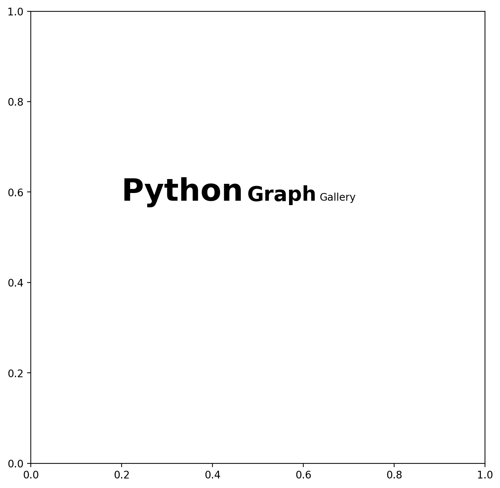

## Libraries

First, you need to **install** `flexitext` with the following command: `pip install flexitext`.

`Flexitext` is one of 2 python libraries that make **text formatting for matplotlib** easy, along with [highlight_text](/advanced-custom-annotations-matplotlib). It was created by [Tomás Capretto](https://tomicapretto.com/) and is inspired by the R package `ggtext`.

We'll also need to load [matplotlib](/matplotlib) to create the figure.

```python
import matplotlib.pyplot as plt
from flexitext import flexitext
```

## Simple matplotlib annotation

In [matplotlib](/matplotlib), we generally use the `text()` function that have 3 main arguments:

- `x`: the position of the annotation on the x-axis
- `y`: the position of the annotation on the y-axis
- `s`: the text to display

_Note: it's possible to change the coordinate system when using the `x` and `y` arguments (e.g relative to the data or absolute). Check the [dedicated post](/589-how-to-change-coordinate-system)._

A minimalist example using the `text()` function would like so:

```python
# Init a figure
fig, ax = plt.subplots(figsize=(8, 8), dpi=200)

text = "Python Graph Gallery"
fig.text(x=0.3, y=0.6, s=text)

# Other ways of using the text() function:
# ax.text(...)
# plt.text(...)

# Display the output
plt.show()
```

:::output

:::

## Stylizing text

The syntax of `flexitext` is somewhat similar to `HTML` in that you enclose the text whose properties you want to change in `<>`.

If you want to **change the properties of the first word** in the `Python Graph Gallery` text, you change `Python` to `<>Python</>`. Then you set the style properties of `Python` inside the first `<>`. So, if we want `Python` to be **larger and blue**, it becomes :

`<color:blue, size:20>Python</> Graph Gallery`

_Note: properties must be **coma separated**._

Finally, instead of using the `text()` function from [matplotlib](/matplotlib), we use the `flexitext()` function, which uses the **same arguments**!

```python
# Init a figure
fig, ax = plt.subplots(figsize=(8, 8), dpi=200)

text = "<color:blue, size:20>Python</> Graph Gallery"
flexitext(x=0.3, y=0.6, s=text)

# Display the output
plt.show()
```

:::output

:::

## Which properties can I change?

`flexitext` supports a fixed number of params at the moment:

- `alpha`: text transparency
- `backgroundcolor`: color in the background of the text
- `color`: text color
- `family`: font family of the text
- `name`: font name of the text
- `size`: size of the text
- `style`: style of the text (italic, oblique...)
- `weight`: weight of the text (bold, thin...)

If we go back to the previous example and **use other parameters**, we get the following result:

```python
# Init a figure
fig, ax = plt.subplots(figsize=(8, 8), dpi=200)

text = "<color:darkred, size:30, alpha:0.6, style:italic, weight:bold>Python</>"
text += " Graph Gallery"
flexitext(x=0.3, y=0.6, s=text)

# Display the output
plt.show()
```

:::output

:::

## Combine styles

Once we understand the basics of `flexitext`, it becomes easy to **create text with various styles**!

```python
# Init a figure
fig, ax = plt.subplots(figsize=(8, 8), dpi=200)

text = "<color:darkred, size:30, alpha:0.3, style:italic, weight:bold>Python</>"
text += " <color:skyblue, size:20, weight:bold>Graph</>"
text += " <color:olive, size:30, alpha:0.8, style:italic>Gallery</>"
flexitext(x=0.2, y=0.6, s=text)

# Display the output
plt.show()
```

:::output

:::

## Crossed properties

You may want to apply a given property to the first 2 words of a text (bold), but **have different properties** between these 2 words (different size).

The following example puts the first 2 words in bold, even though these words have a \*_different_ `size` property.

```python
# Init a figure
fig, ax = plt.subplots(figsize=(8, 8), dpi=200)

text = "<weight:bold><size:30>Python</> "
text += "<size:20>Graph</></> "
text += "<size:10>Gallery</>"
flexitext(x=0.2, y=0.6, s=text)

# Display the output
plt.show()
```

:::output

:::

## Going further

You might be interested in:

- advanced features of `flexitext` such as [automatically increase size/opacity/color of each letter in a word](/595-advanced-flexitext-features)
- how to use the [highlight_text package](/advanced-custom-annotations-matplotlib)
