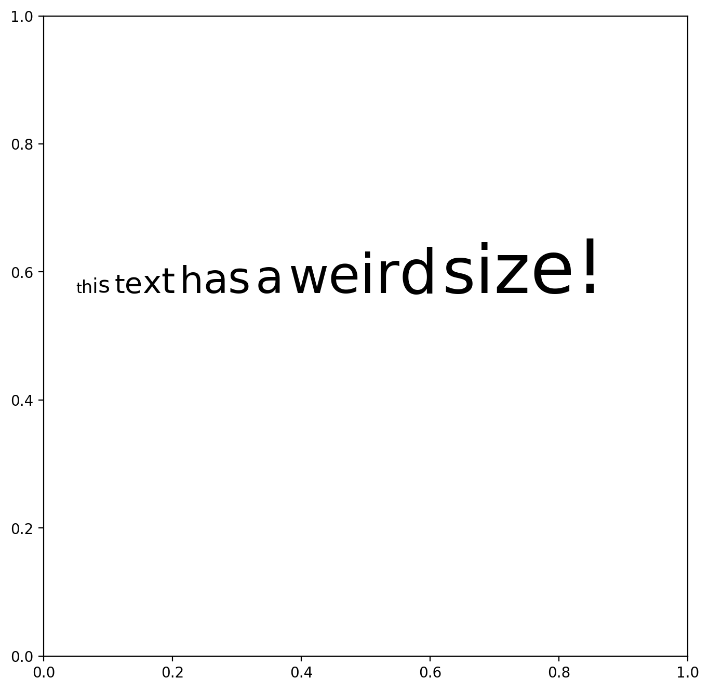
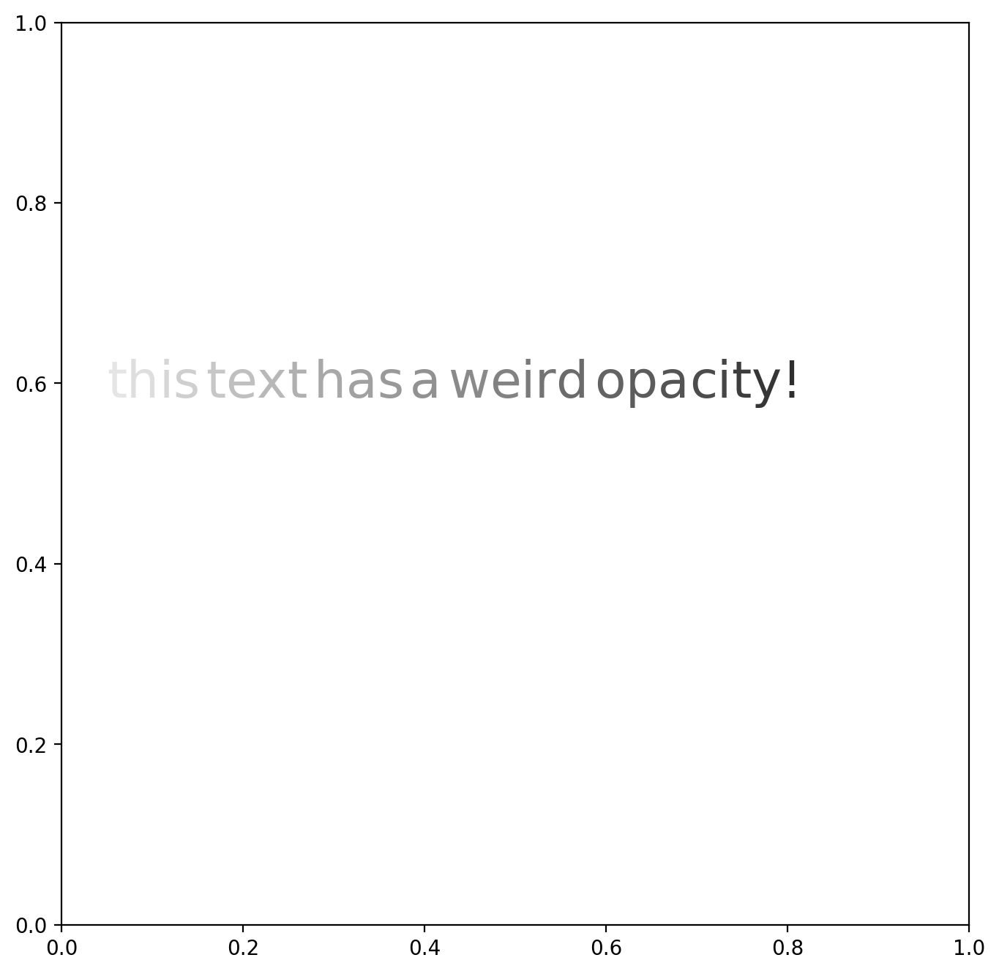

## Libraries

First, you need to **install** `flexitext` with the following command: `pip install flexitext`.

`Flexitext` is one of 2 python libraries that make **text formatting for matplotlib** easy, along with [highlight_text](/advanced-custom-annotations-matplotlib). It was created by [Tomás Capretto](https://tomicapretto.com/) and is inspired by the R package `ggtext`.

We'll also need to load [matplotlib](/matplotlib) to create the figure.

```python
import matplotlib.pyplot as plt
from flexitext import flexitext
```

## Dynamically size

There is no built-in method in `flexitext` to dynamically increase the size of the text, but we can build it ourselved!

The `dynamic_text_prop()` func:

- takes a string and applies a property (like size or opacity) to each letter.
- the property's value **starts** at `initial_value` and **increases** by `increment` for each letter.
- it **skips spaces**, keeping them as-is.
- it can optionally **add an extra property** to each letter thanks to the `prop_to_add` argument

```python
def dynamic_text_prop(string, prop_name, initial_value, increment, prop_to_add=None):
    text = ""
    value = initial_value
    for letter in string:
        if letter != " ":
            if prop_to_add is not None:
                text += f"<{prop_name}:{value}, {prop_to_add}>{letter}</>"
            else:
                text += f"<{prop_name}:{value}>{letter}</>"
            value += increment
        else:
            text += " "
    return text
```

-

Let's see how to use it in practice:

```python
# Init a figure
fig, ax = plt.subplots(figsize=(8, 8), dpi=200)

text = "this text has a weird size!"
text = dynamic_text_prop(text, prop_name='size', initial_value=10, increment=2)
flexitext(x=0.05, y=0.6, s=text)

# Display the output
plt.show()
```

:::output

:::

## Dynamic opacity

And we can imagine exactly the same thing for dynamically changing opacity:

```python
# Init a figure
fig, ax = plt.subplots(figsize=(8, 8), dpi=200)

text = "this text has a weird opacity!"
text = dynamic_text_prop(text, prop_name='alpha',
                         initial_value=0.1, increment=0.03, prop_to_add='size:25')
flexitext(x=0.05, y=0.6, s=text)

# Display the output
plt.show()
```

:::output

:::

## Going further

You might be interested in:

- how to use the [highlight_text package](/advanced-custom-annotations-matplotlib), a tool similar to `flexitext`
- how to draw [arrows with an inflection point](/591-arrows-with-inflexion-point)
- how to draw [curved arrows](/how-to-create-and-custom-arrows-matplotlib)
