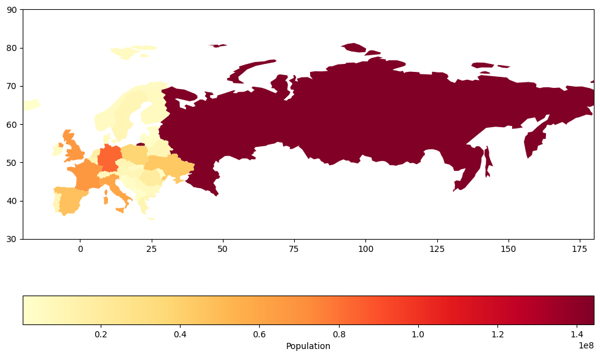
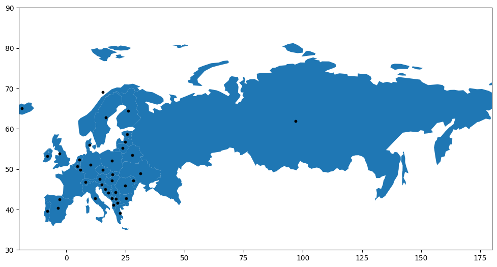

## What is GeoPandas?

GeoPandas is a powerful Python library that extends [pandas](/pandas) to handle **geographic data**. It combines:

- Data manipulation tools of pandas
- Geospatial functionality of libraries like `shapely` and `fiona`

Key benefits:

- Efficient handling of geospatial data
- Useful for data science and visualization projects

You can it with

`pip install geopandas`

And import it with:

```python
import geopandas as gpd
```

## Reading Geospatial Data

GeoPandas excels at reading various geospatial file formats:

- Shapefiles
- GeoJSON
- GeoPackage

Let's read a GeoJSON file of world country boundaries:

**Main functions used:**

- `gpd.read_file()`: Reads geospatial data from a file
- `gpd.datasets.get_path()`: Provides path to built-in datasets

```python
world = gpd.read_file(gpd.datasets.get_path('naturalearth_lowres'))
world.head()
```

:::output
::output-html{src="./output-1.html"}
:::

## Basic Data Manipulation

GeoPandas allows you to manipulate geometric data using familiar pandas operations:

- Filtering
- Grouping
- Aggregating

Example: Filter to show only European countries:

```python
europe = world[world['continent'] == 'Europe']
europe.head()
```

:::output
::output-html{src="./output-2.html"}
:::

**Key concept:** GeoDataFrames behave like regular pandas DataFrames but preserve geometric data.

## Visualizing Geospatial Data

GeoPandas leverages [matplotlib](/matplotlib) for **quick and easy map creation**:

- `.plot()`: Creates a plot of the GeoDataFrame
- `column`: Specifies which data to use for coloring
- `cmap`: Sets the color scheme
- `legend`: Adds a color bar
- `figsize`: Sets the figure size

```python
ax = europe.plot(column='pop_est', cmap='YlOrRd', legend=True,
            legend_kwds={'label': 'Population', 'orientation': 'horizontal'},
            figsize=(12, 8))

ax.set_xlim(-20, 180)
ax.set_ylim(30, 90)
```

:::output

:::

## Geospatial Operations

GeoPandas enables various geospatial operations, crucial for advanced analysis and visualizations:

- `.geometry.centroid`: Calculates the geometric center of each shape
- `.plot()`: Can be used multiple times on the same axis (`ax`) to overlay different geometries

```python
# Calculate centroids
europe['centroid'] = europe.geometry.centroid

# Plot countries and centroids
ax = europe.plot(figsize=(12, 8))
europe.centroid.plot(ax=ax, color='black', markersize=10)

ax.set_xlim(-20, 180)
ax.set_ylim(30, 90)
```

:::output

:::

## Going further

**TLDR: geopandas allows to**

- Perform spatial analysis
- Create multi-layered visualizations

Remember, GeoPandas integrates well with other Python geospatial libraries:

- `cartopy` for advanced mapping
- [folium](/288-map-background-with-folium) for interactive web maps

These examples provide a foundation, but GeoPandas offers much more:

- Spatial joins
- Coordinate reference system operations
- Complex geospatial analyses

As you explore further, you'll discover its full potential for geospatial data visualization and analysis.
