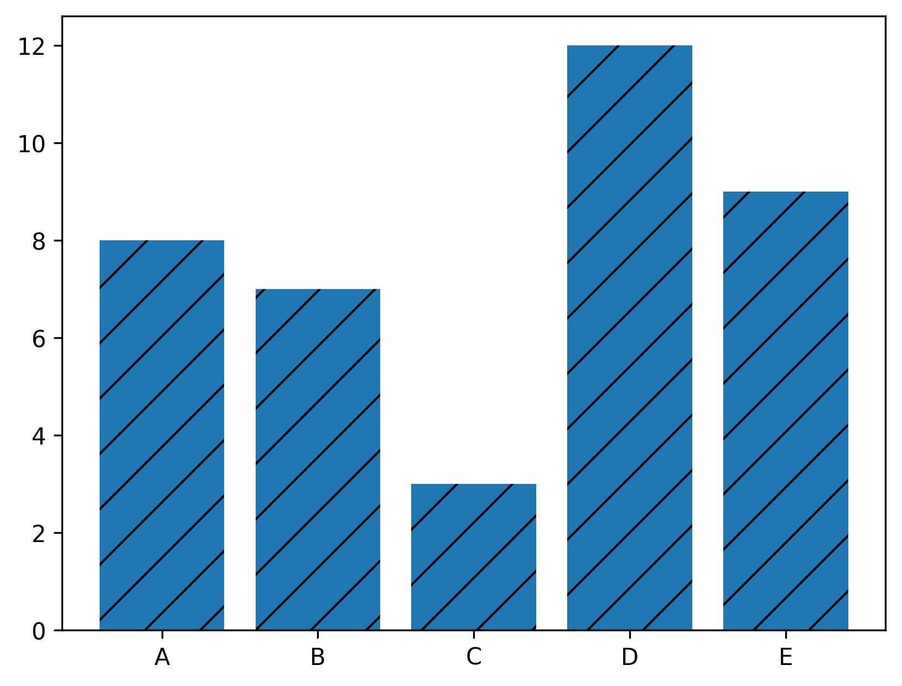
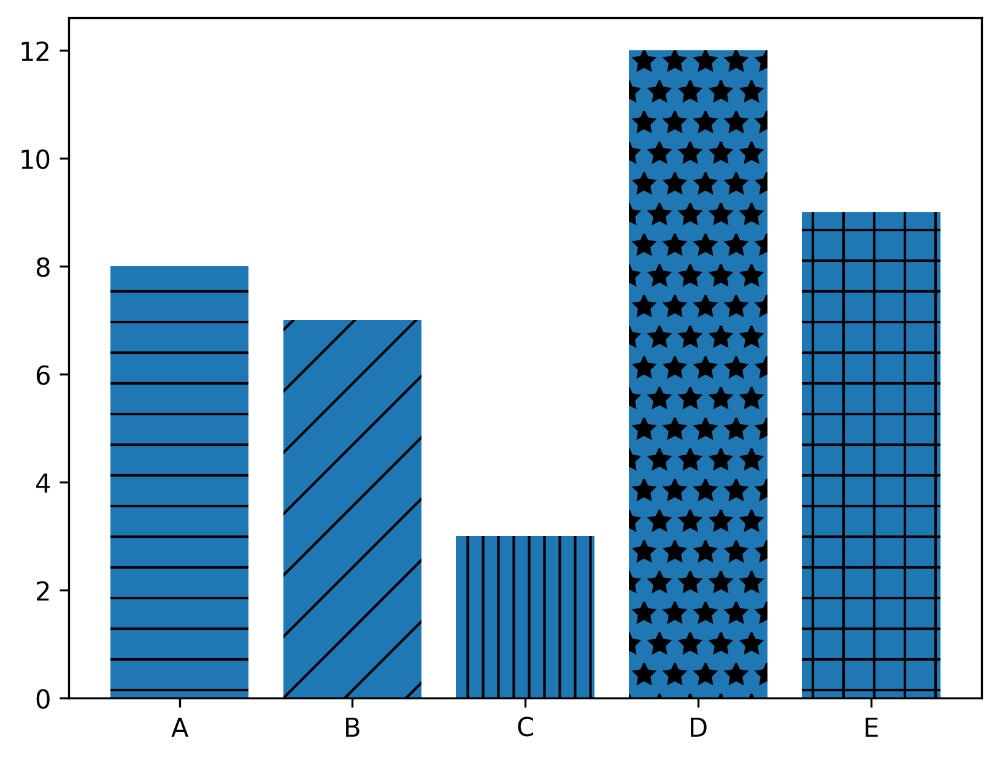

## Libraries

First, you need to import the following libraries:

- [matplotlib](https://python-graph-gallery.com/matplotlib/) for creating the chart and customize it
- [pandas](https://python-graph-gallery.com/pandas/) for storing the data used

```python
import matplotlib.pyplot as plt
import pandas as pd
```

## Dataset

In this post, we'll use a very simple dataset, that you can create as follow

```python
height = [8, 7, 3, 12, 9]
bars = ('A', 'B', 'C', 'D', 'E')

df = pd.DataFrame({'height': height,
                   'bars': bars})
```

## Define the Hatch

This example provides a reproducible code in which you can change the texture of the bars using the `set_hatch()` function of [matplotlib](http://python-graph-gallery.com/matplotlib/).

It **must be** in the following list: `'/'`, `'\\'`, `'|'`, `'-'`, `'+'`, `'x'`, `'o'`, `'O'`, `'.'`, `'*'`

```python
# Create a figure and axis
fig, ax = plt.subplots()

# Create bars
ax.bar(df['bars'], df['height'],
       hatch='/')

# Show the graphic
plt.show()
```

:::output

:::

## Multiple hatchs

If you want to have a different hatch for each bar, we need to make some modifications in the initial code:

- **define a list** of hatches (with the same length as the number of bars)
- **iterate** over each bar and set the wanted hatch

```python
# Create a figure and axis
fig, ax = plt.subplots()

# Create bars
bars = ax.bar(df['bars'], df['height'])

# Define some hatches
hatches = ['-', '/', '||', '*', '+']
for bar, hatch in zip(bars, hatches):
    bar.set_hatch(hatch)

# Show the graphic
plt.show()
```

:::output

:::

## Going further

This post explains how to **change texture** of a [barplot](https://python-graph-gallery.com/barplot/) with matplotlib.

You might want to check [how to custom width of bars](https://python-graph-gallery.com/5-control-width-and-space-in-barplots/) and [how to change colors of the bars](https://python-graph-gallery.com/3-control-color-of-barplots/).
