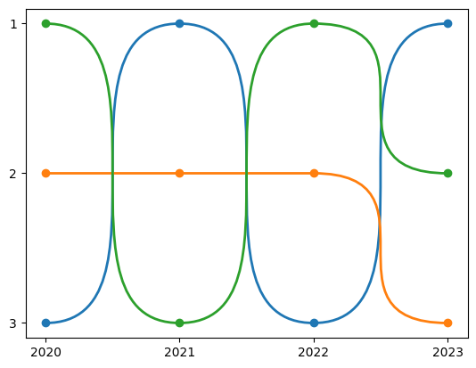
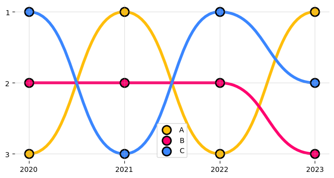

## Packages

The easiest way to create bump charts is to use the `bumplot` package that you can install with:

```bash
pip install bumplot
```

```python
import pandas as pd
import matplotlib.pyplot as plt

from bumplot import bumplot
```

## Basic bump chart

```python
from bumplot import bumplot

data = pd.DataFrame(
    {
        "x": [2020, 2021, 2022, 2023],
        "A": [10, 50, 20, 80],
        "B": [40, 30, 60, 10],
        "C": [90, 20, 70, 40],
    }
)

bumplot(x="x", y_columns=["A", "B", "C"], data=data)
```

:::output

:::

## Customization

```python
import pandas as pd
import matplotlib.pyplot as plt
from bumplot import bumplot

data = pd.DataFrame(
    {
        "x": [2020, 2021, 2022, 2023],
        "A": [10, 50, 20, 80],
        "B": [40, 30, 60, 10],
        "C": [90, 20, 70, 40],
    }
)

fig, ax = plt.subplots(figsize=(8, 4))
bumplot(
    x="x",
    y_columns=["A", "B", "C"],
    data=data,
    curve_force=0.5,
    plot_kwargs={"lw": 4},
    scatter_kwargs={"s": 150, "ec": "black", "lw": 2},
    colors=["#ffbe0b", "#ff006e", "#3a86ff"],
)
ax.legend()
ax.spines[["top", "right", "left", "bottom"]].set_visible(False)
ax.grid(alpha=0.4)
```

:::output

:::

## Going further

You might be interested in [different ways to represent time series](/timeseries)
