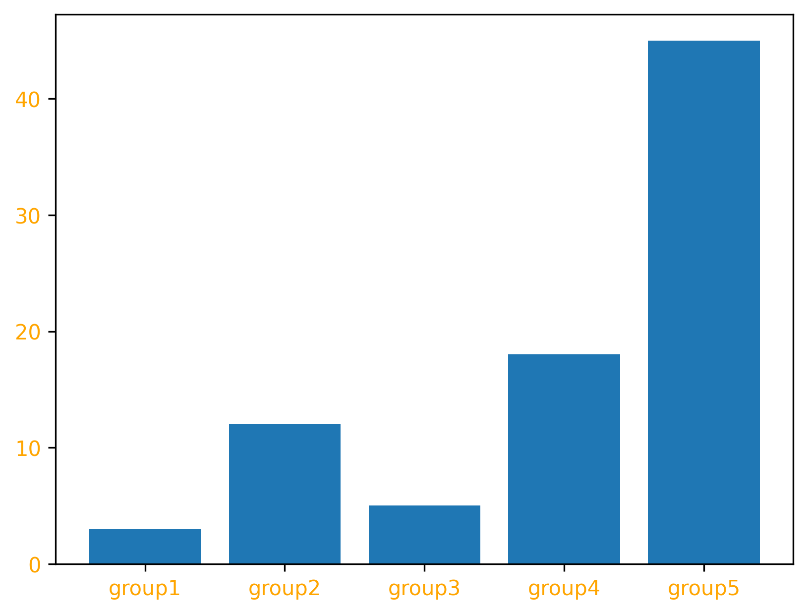
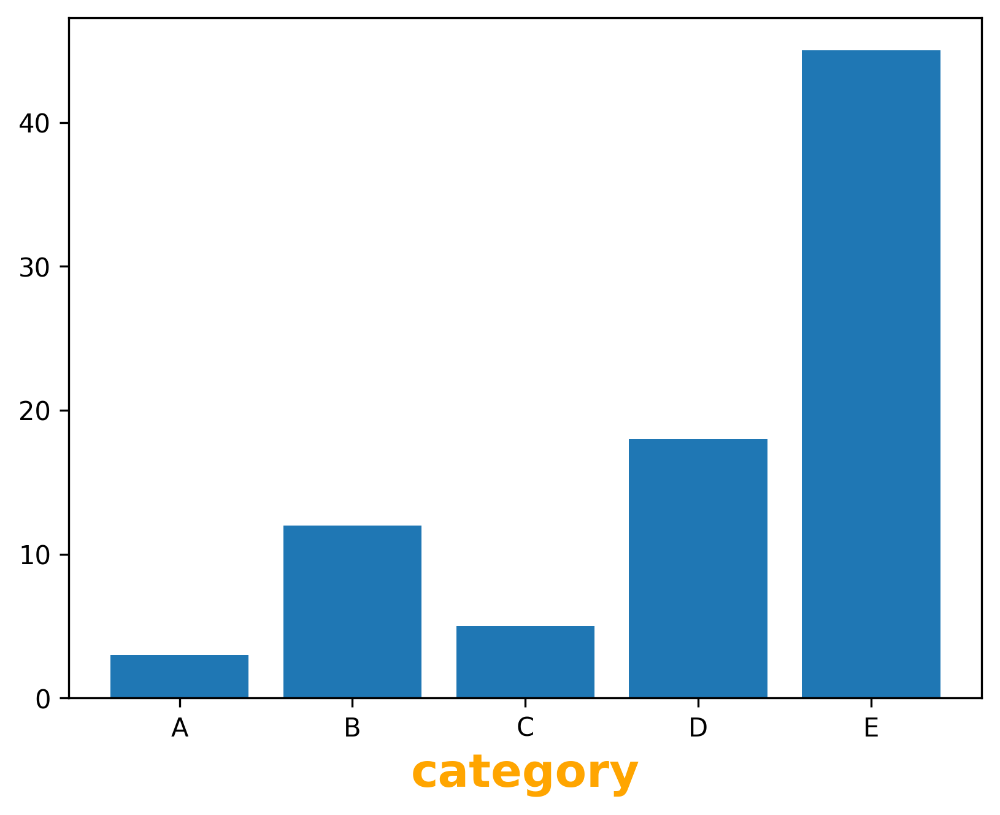
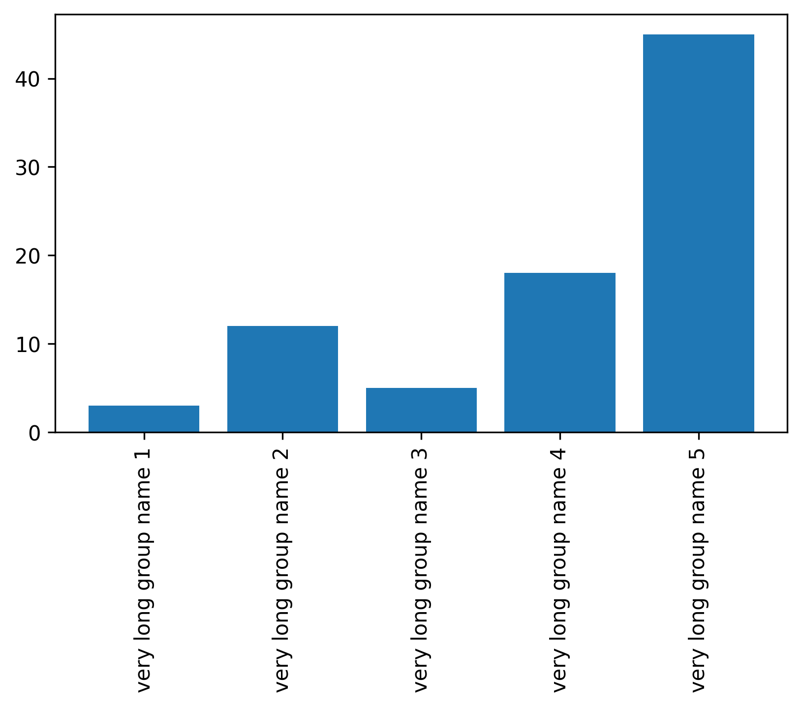

## Labels

You can change the color of x and y axis labels using `color` argument in the `xticks()` and `yticks()` functions. The parameters in the `xticks()` function in the following example are:

- `x_pos` : A list of positions at which ticks should be placed.
- `bars` : A list of explicit labels to place.
- `color` : Color of the labels.

```python
# libraries
import numpy as np
import matplotlib.pyplot as plt

# Choose the height of the bars
height = [3, 12, 5, 18, 45]

# Choose the names of the bars
bars = ('group1', 'group2', 'group3', 'group4', 'group5')
x_pos = np.arange(len(bars))

# Create bars
plt.bar(x_pos, height)

# Create names on the x-axis
plt.xticks(x_pos, bars, color='orange')
plt.yticks(color='orange')

# Show graphic
plt.show()
```

:::output

:::

## Axis Title

You can add a title(label) to the x axis and y axis of the plot using `xlabel()` and `ylabel()` functions.

```python
# libraries
import numpy as np
import matplotlib.pyplot as plt
 
# Create data
height = [3, 12, 5, 18, 45]
bars = ('A','B','C','D','E')
x_pos = np.arange(len(bars))
 
# Create bars
plt.bar(x_pos, height)
 
# Create names on the x-axis
plt.xticks(x_pos, bars)

# 
plt.xlabel('category', fontweight='bold', color = 'orange', fontsize='18')
 
# Show graphic
plt.show()
```

:::output

:::

## Label Rotation and Figure Margins

It is possible to rotate x and y tick labels using `rotation` argument in the `xticks()` and `yticks()` functions. You can also change the margins of your plot area by `subplots_adjust()` function.

```python
# libraries
import numpy as np
import matplotlib.pyplot as plt
 
# Create data
height = [3, 12, 5, 18, 45]
bars = ("very long group name 1","very long group name 2","very long group name 3","very long group name 4","very long group name 5")
x_pos = np.arange(len(bars))
 
# Create bars
plt.bar(x_pos, height)
 
# Rotation of the bar names
plt.xticks(x_pos, bars, rotation=90)
 
# Custom the subplot layout
plt.subplots_adjust(bottom=0.4, top=0.99)
 
# Show graphic
plt.show()
```

:::output

:::
