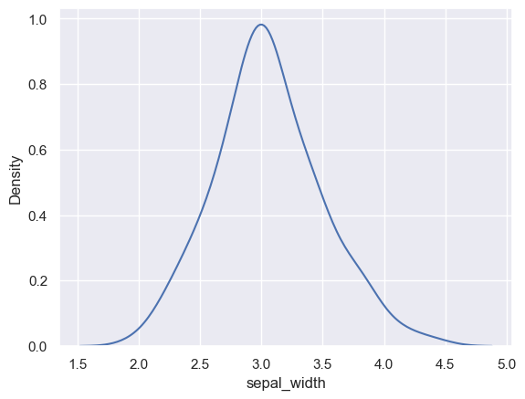
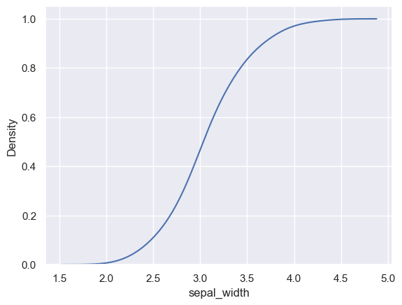

How to build a basic density chart with `Python` and `Seaborn`.

```python
# libraries & dataset
import seaborn as sns
import matplotlib.pyplot as plt
  
sns.set_theme(style="darkgrid")
df = sns.load_dataset('iris')
 
# Make default density plot
sns.kdeplot(df['sepal_width'])
plt.show()
```

:::output

:::

## Cumulative density plot

```python
# libraries & dataset
import seaborn as sns
import matplotlib.pyplot as plt
  
sns.set_theme(style="darkgrid")
df = sns.load_dataset('iris')
 
# Make default density plot
sns.kdeplot(df['sepal_width'], cumulative=True)
plt.show()
```

:::output

:::
