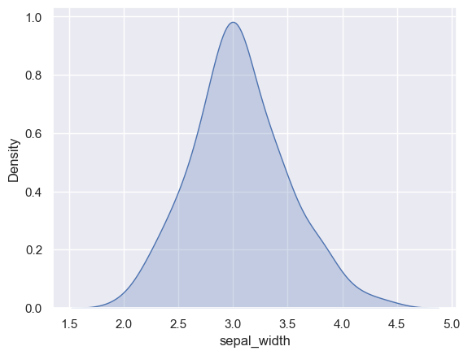

## Libraries

First, we need to import a few libraries:

- [matplotlib](https://python-graph-gallery.com/matplotlib/): for plotting
- [seaborn](https://python-graph-gallery.com/seaborn/): for making the plots prettier

```python
import matplotlib.pyplot as plt
import seaborn as sns
```

## Dataset

The dataset that we will use is the `iris` dataset that we can load using [seaborn](https://python-graph-gallery.com/seaborn/).

```python
df = sns.load_dataset('iris')
```

## Shade

Adding a shade to the area under the curve is as simple as setting the 'shade' parameter to True.

```python
sns.set_theme(style="darkgrid")
sns.kdeplot(df['sepal_width'], fill=True)
plt.show()
```

:::output

:::

## Going further

This post explains **how to create** a density plot with [seaborn](https://python-graph-gallery.com/seaborn/). 

You might be interested in [how to flip a density plot](https://python-graph-gallery.com/72-horizontal-density-plot/) and [creating a mirrored density plot](https://python-graph-gallery.com/density-mirror/).
