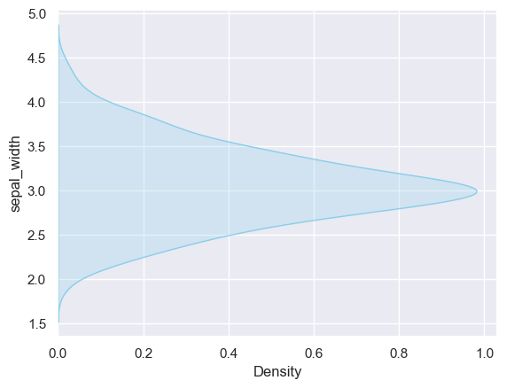

## Libraries

First, we need to import a few libraries:

- [matplotlib](https://python-graph-gallery.com/matplotlib/): for plotting
- [seaborn](https://python-graph-gallery.com/seaborn/): for making the plots prettier

```python
import matplotlib.pyplot as plt
import seaborn as sns
```

## Dataset

The dataset that we will use is the `iris` dataset that we can load using [seaborn](https://python-graph-gallery.com/seaborn/).

```python
df = sns.load_dataset('iris')
```

## Flip the plot

It is quite straightforward to build a density plot with a **90 degrees orientation** thanks to the `y` argument.  

By default, seaborn uses the `x` argument to plot your graph, but if you **explicitly specify** that you want it on the y-axis, it will turn 90 degrees.

```python
sns.set_theme(style="darkgrid")
sns.kdeplot(y=df['sepal_width'], fill=True, color="skyblue")
plt.show()
```

:::output

:::

## Going further

This post explains **how to flip** a density plot with [seaborn](https://python-graph-gallery.com/seaborn/). 

You might be interested in [displaying distribution of multiple variables](https://python-graph-gallery.com/74-density-plot-of-several-variables/) and [creating a mirrored density plot](https://python-graph-gallery.com/density-mirror/).
