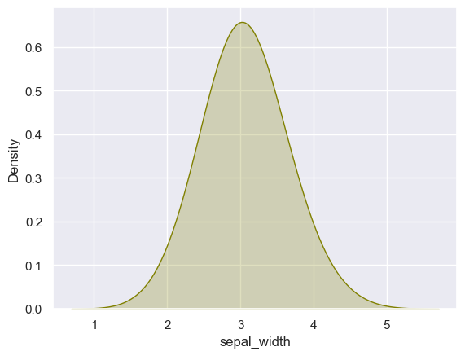
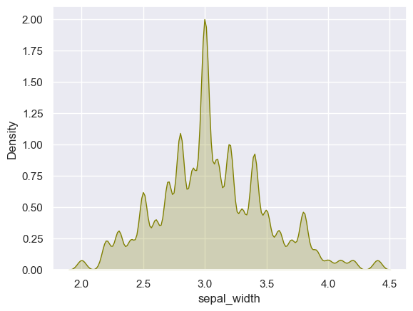

## Libraries

First, we need to import a few libraries:

- [matplotlib](https://python-graph-gallery.com/matplotlib/): for plotting
- [seaborn](https://python-graph-gallery.com/seaborn/): for making the plots prettier

```python
import matplotlib.pyplot as plt
import seaborn as sns
```

## Dataset

The dataset that we will use is the `iris` dataset that we can load using [seaborn](https://python-graph-gallery.com/seaborn/).

```python
df = sns.load_dataset('iris')
```

## Defaut density plot

[Density plot](https://python-graph-gallery.com/density-plot/) differ from histogram in that they are **smoothed versions** of the [histogram](https://python-graph-gallery.com/histogram/).

However, in order to be smoothed, we need to define a **bandwidth**, which is a parameter that **controls the smoothness** of the density plot. Varying the bandwidth will give different density plots, and different information too!

In `seaborn`, it's the `bw_method` argument that controls it. Here is what the default bandwidth looks like in [seaborn](https://python-graph-gallery.com/seaborn/):

```python
sns.set_theme(style="darkgrid")
sns.kdeplot(df['sepal_width'], fill=True, color="olive", bw_method=1)
plt.show()
```

:::output

:::

## Custom bandwidth

The following [density plots](https://python-graph-gallery.com/density-plot/) have been made using the same data. Only the bandwidth value changes from 1 in the first graph to 0.2 on the right.

This parameter can be of particular interest when a **finer understanding** of the distribution is needed. It could highlight bimodal distributions more easily and help us in **observing patterns** that the Gaussian kernel over-smoothed.

***Deprecation***:

Note that in older version of seaborn (< 0.11.0), the `bw` parameter was used but is deprecated since and `bw_method` and `bw_adjust` have replaced it.

See `scipy.stats.gaussian_kde` in `scipy.org` for further details on `bw_method` and `bw_value`.

In seaborn 0.11.0 and before versions, you would use `sns.kdeplot(df\['sepal_width'\], shade=True, bw=0.05, color='olive')`

Now, `shade` and `bw` arguments are deprecated.

```python
sns.set_theme(style="darkgrid")
sns.kdeplot(df['sepal_width'], fill=True, color='olive', bw_method=0.08)
plt.show()
```

:::output

:::

## Going further

This post explains **how to control smoothing** in a density plot with [seaborn](https://python-graph-gallery.com/seaborn/). 

You might be interested in [displaying distribution of multiple variables](https://python-graph-gallery.com/74-density-plot-of-several-variables/) and [creating a mirrored density plot](https://python-graph-gallery.com/density-mirror/).
