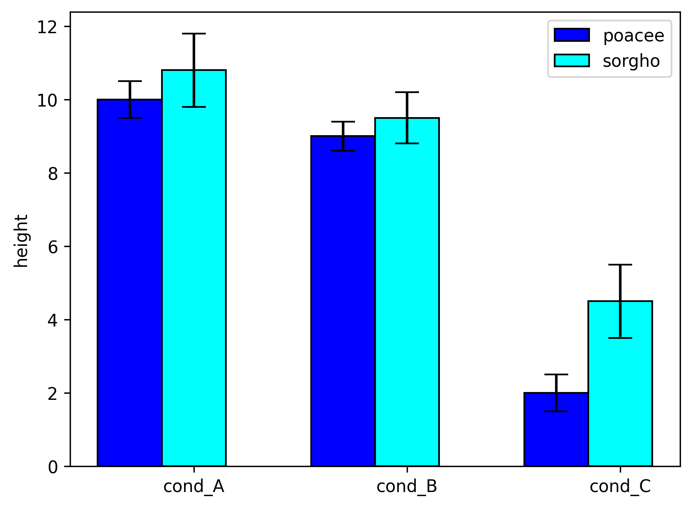

Consider that you have several groups, and a set of numerical values for each group. A [barplot](http://python-graph-gallery.com/barplot/) can be used to represent the **average value** of each group. However, this kind of figure must be accompanied by **error bars** showing the **confidence interval** of each group. This example shows how to draw the confidence interval, but not how to calcultate them. Note that you might loose an information: the **distribution** of the values is not available in this chart. I strongly advise you to use a [boxplot](http://python-graph-gallery.com/boxplot/) or a [violin plot](http://python-graph-gallery.com/violin-plot/) instead.

```python
# libraries
import numpy as np
import matplotlib.pyplot as plt
 
# width of the bars
barWidth = 0.3
 
# Choose the height of the blue bars
bars1 = [10, 9, 2]
 
# Choose the height of the cyan bars
bars2 = [10.8, 9.5, 4.5]
 
# Choose the height of the error bars (bars1)
yer1 = [0.5, 0.4, 0.5]
 
# Choose the height of the error bars (bars2)
yer2 = [1, 0.7, 1]
 
# The x position of bars
r1 = np.arange(len(bars1))
r2 = [x + barWidth for x in r1]
 
# Create blue bars
plt.bar(r1, bars1, width = barWidth, color = 'blue', edgecolor = 'black', yerr=yer1, capsize=7, label='poacee')
 
# Create cyan bars
plt.bar(r2, bars2, width = barWidth, color = 'cyan', edgecolor = 'black', yerr=yer2, capsize=7, label='sorgho')
 
# general layout
plt.xticks([r + barWidth for r in range(len(bars1))], ['cond_A', 'cond_B', 'cond_C'])
plt.ylabel('height')
plt.legend()
 
# Show graphic
plt.show()
```

:::output

:::
