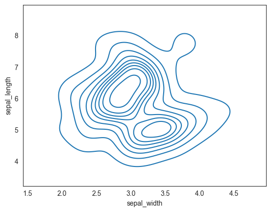
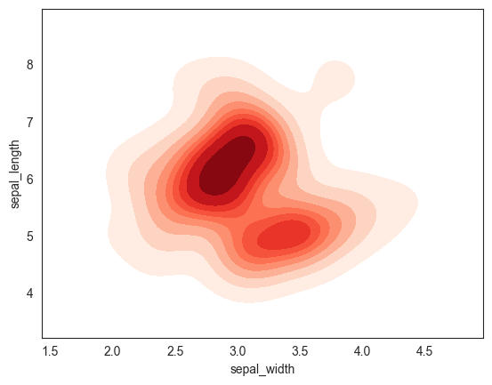
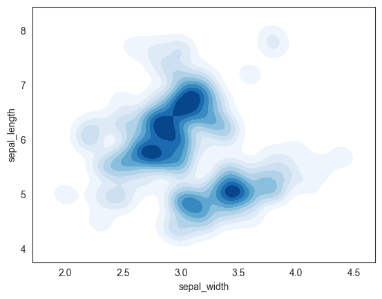

## Libraries

First, we need to import a few libraries:

- [matplotlib](https://python-graph-gallery.com/matplotlib/): for plotting
- [seaborn](https://python-graph-gallery.com/seaborn/): for making the plots prettier

```python
import matplotlib.pyplot as plt
import seaborn as sns
```

## Dataset

The dataset that we will use is the `iris` dataset that we can load using [seaborn](https://python-graph-gallery.com/seaborn/).

```python
df = sns.load_dataset('iris')
```

## Most simple density plot

The following code produces 3 **contour plots** using [seaborn](http://python-graph-gallery.com/seaborn/) python library. You have to provide **2 numerical variables** as input (one for each axis). The function will calculate the **kernel density estimate** and represent it as a contour plot or **density plot**.

The aguments of the function `kdeplot()` are:

- `x, y` : Variables that specify positions on the x and y axes.
- `shade` : Controls the presence of a shade.
- `cmap` : Colormap.
- `bw_adjust` : Bandwidth, smoothing parameter.
- `thresh` : number in [0, 1], Lowest iso-proportion level at which to draw a contour line.

Here is how we can create the default 2D density plot:

```python
sns.set_style("white")
sns.kdeplot(x=df.sepal_width, y=df.sepal_length)
plt.show()
```

:::output

:::

## Change colors

In order to make the chart **more readable**, we can add colormap to the plot:

```python
sns.set_style("white")
sns.kdeplot(x=df.sepal_width, y=df.sepal_length, cmap="Reds", fill=True)
plt.show()
```

:::output

:::

## Change smoothing parameter

The `bw_adjust` argument controls the **bandwidth** of the kernel density estimate. The higher the value, the **smoother** the plot will be. Here is an example with a `bw_adjust` value of 0.5:

```python
sns.set_style("white")
sns.kdeplot(x=df.sepal_width, y=df.sepal_length,
            cmap="Blues", fill=True, bw_adjust=0.5)
plt.show()
```

:::output

:::

## Going further

This post explains **how to create** a 2D density plot with [seaborn](https://python-graph-gallery.com/seaborn/).

You might be interested in [how to create a hexbin plot](https://python-graph-gallery.com/82-marginal-plot-with-seaborn/) and [how to create a 2D histogram](https://python-graph-gallery.com/83-basic-2d-histograms-with-matplotlib/).
