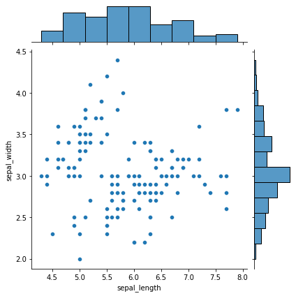
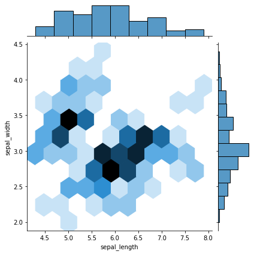
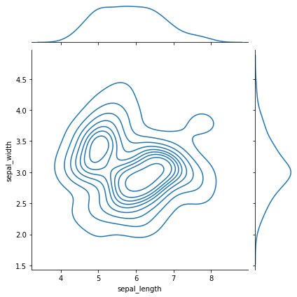
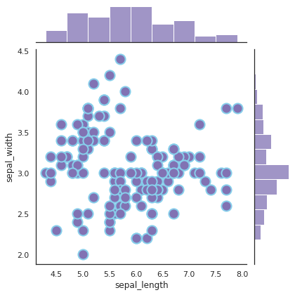
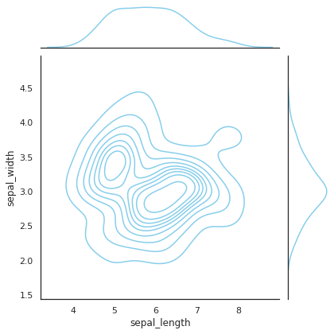
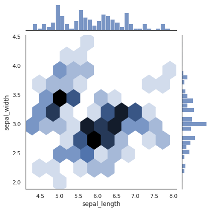
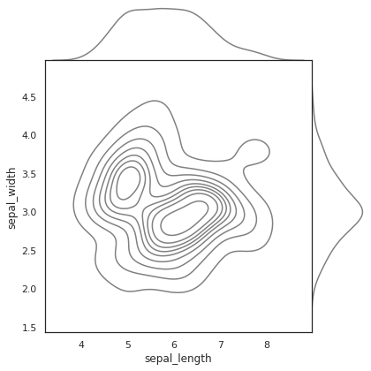
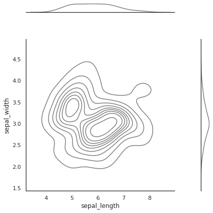
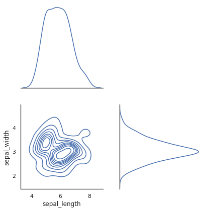

A **marginal plot** allows to study the relationship between 2 numeric variables. The central chart displays their **correlation**. It is usually a [scatterplot](https://python-graph-gallery.com/scatter-plot/), a [hexbin](https://python-graph-gallery.com/2d-density-plot/) plot, a [2D histogram](https://python-graph-gallery.com/2d-density-plot/) or a [2D density](https://python-graph-gallery.com/2d-density-plot/) plot. The marginal charts, usually on the top and right, show the **distribution** of 2 variables using [histogram](https://python-graph-gallery.com/histogram/) or [density](https://python-graph-gallery.com/density-plot/) plot.

The [seaborn](https://python-graph-gallery.com/seaborn/) library provides a joint plot function that is really handy to make this type of graphics. The top graph shows its default behaviour, and here are few possible customizations. Seaborn has a [nice documentation](https://seaborn.pydata.org/generated/seaborn.jointplot.html) and some of these examples taken from there.

## Central Plot

Seaborn library have `jointplot()` function to draw a marginal plot. The kind of the central plot can be given as a parameter in `jointplot()` function:
* `kind` : the possible options are “scatter” | “kde” | “hist” | “hex” | “reg” | “resid” 

In this example three marginal plots built with different central plots; scatterplot, hexbin and density.

```python
# library & dataset
import seaborn as sns
import matplotlib.pyplot as plt
df = sns.load_dataset('iris')
 
# Custom the inside plot: options are: “scatter” | “reg” | “resid” | “kde” | “hex”
sns.jointplot(x=df["sepal_length"], y=df["sepal_width"], kind='scatter')
sns.jointplot(x=df["sepal_length"], y=df["sepal_width"], kind='hex')
sns.jointplot(x=df["sepal_length"], y=df["sepal_width"], kind='kde')

plt.show()
```

:::output





:::

```python
# Then you can pass arguments to each type:
sns.jointplot(x=df["sepal_length"], y=df["sepal_width"], kind='scatter', s=200, color='m', edgecolor="skyblue", linewidth=2)
 
# Custom the color
sns.set_theme(style="white", color_codes=True)
sns.jointplot(x=df["sepal_length"], y=df["sepal_width"], kind='kde', color="skyblue")

plt.show()
```

:::output



:::

## Marginal

You can customize the marginal plots with `marginal_kws` parameter.

```python
# library & dataset
import seaborn as sns
import matplotlib.pyplot as plt
df = sns.load_dataset('iris')
 
# Custom the histogram:
sns.jointplot(x=df["sepal_length"], y=df["sepal_width"], kind='hex', marginal_kws=dict(bins=30, fill=True))

plt.show()
```

:::output

:::

## Ratio

It is also possible to change the central plot-margin plats ratio and the space between the joint and marginal axes.
* `space` : space between the joint and marginal axes
* `ratio` : ratio of joint axes height to marginal axes height

```python
# library & dataset
import seaborn as sns
import matplotlib.pyplot as plt
df = sns.load_dataset('iris')
 
# No space
sns.jointplot(x=df["sepal_length"], y=df["sepal_width"], kind='kde', color="grey", space=0)
 
# Huge space
sns.jointplot(x=df["sepal_length"], y=df["sepal_width"], kind='kde', color="grey", space=3)
 
# Make marginal bigger:
sns.jointplot(x=df["sepal_length"], y=df["sepal_width"], kind='kde',ratio=1)

plt.show()
```

:::output





:::
