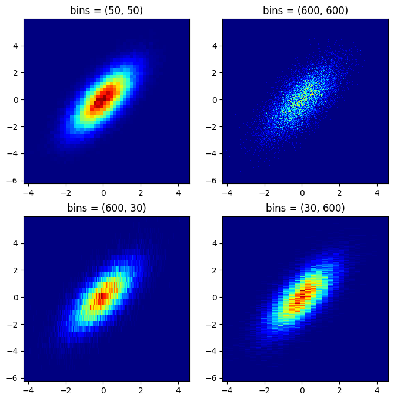
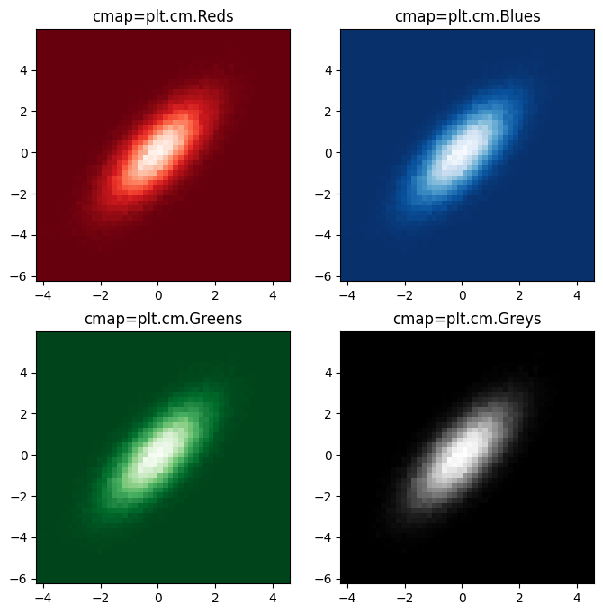
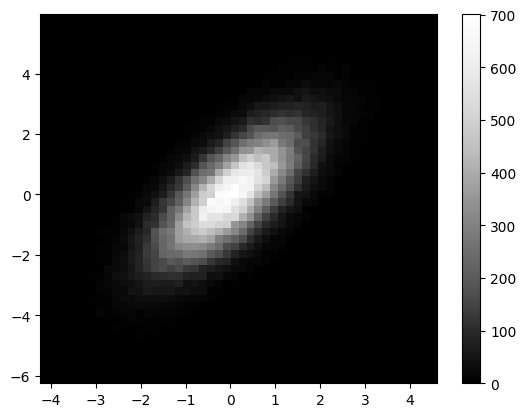

## Libraries & Dataset

Let's start by import a few libraries and create a dataset:

```python
# libraries
import matplotlib.pyplot as plt
import numpy as np
import pandas as pd
 
# create data
size = 100000
df = pd.DataFrame({
   'x': np.random.normal(size=size),
   'y': np.random.normal(size=size)
})
df.head()
```

:::output
::output-html{src="./output-1.html"}
:::

## 2D histograms

2D histograms are useful when you need to analyse the relationship between 2 numerical variables that have a **huge number of values**. It is useful for avoiding the over-plotted [scatterplots](/scatter-plot).

The following example illustrates the **importance of the bins** argument. You can explicitly tell how many bins you want for the X and the Y axis.

The parameters of `hist2d()` function used in the example are:

- `x, y`: input values
- `bins`: the number of bins in each dimension
- `cmap` : colormap

```python
fig, axs = plt.subplots(nrows=2, ncols=2, figsize=(8,8))

# Big bins
axs[0,0].hist2d(x, y, bins=(50, 50), cmap=plt.cm.jet)
axs[0, 0].set_title('bins = (50, 50)')
 
# Small bins
axs[0,1].hist2d(x, y, bins=(600, 600), cmap=plt.cm.jet)
axs[0, 1].set_title('bins = (600, 600)')
 
# If you do not set the same values for X and Y, the bins won't be a square!
axs[1,0].hist2d(x, y, bins=(600, 30), cmap=plt.cm.jet)
axs[1, 0].set_title('bins = (600, 30)')

# If you do not set the same values for X and Y, the bins won't be a square!
axs[1,1].hist2d(x, y, bins=(30, 600), cmap=plt.cm.jet)
axs[1, 1].set_title('bins = (30, 600)')

plt.show()
```

:::output

:::

## Colors

Once you decide the bin size, it is possible to **change the colour palette**. [Matplolib](/matplotlib) provides a whole bunch of pre-defined color map (also know as `cmap`).

Here you can find how to use them in a 2d histogram:

```python
fig, axs = plt.subplots(nrows=2, ncols=2, figsize=(8,8))

# Big bins
axs[0,0].hist2d(x, y, bins=(50, 50), cmap=plt.cm.Reds_r)
axs[0, 0].set_title('cmap=plt.cm.Reds')
 
# Small bins
axs[0,1].hist2d(x, y, bins=(50, 50), cmap=plt.cm.Blues_r)
axs[0, 1].set_title('cmap=plt.cm.Blues')
 
# If you do not set the same values for X and Y, the bins won't be a square!
axs[1,0].hist2d(x, y, bins=(50, 50), cmap=plt.cm.Greens_r)
axs[1, 0].set_title('cmap=plt.cm.Greens')

# If you do not set the same values for X and Y, the bins won't be a square!
axs[1,1].hist2d(x, y, bins=(50, 50), cmap=plt.cm.Greys_r)
axs[1, 1].set_title('cmap=plt.cm.Greys')

plt.show()
```

:::output

:::

## Colorbar

Finally, it might be useful to add a **color bar** on the side as a **legend**. You can add a color bar using `colorbar()` function.

```python
plt.hist2d(x, y, bins=(50, 50), cmap=plt.cm.Greys_r)
plt.colorbar()
plt.show()
```

:::output

:::

## Going further

You might be interested:

- how to create a [contour plot](/80-contour-plot-with-seaborn), which is a smoothed version of the 2d histogram

- how to combine a [2d density/histogram plot with marginal plot](/82-marginal-plot-with-seaborn)
