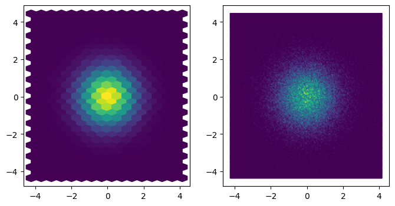
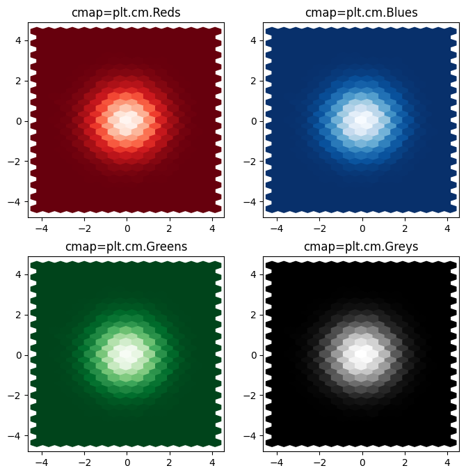
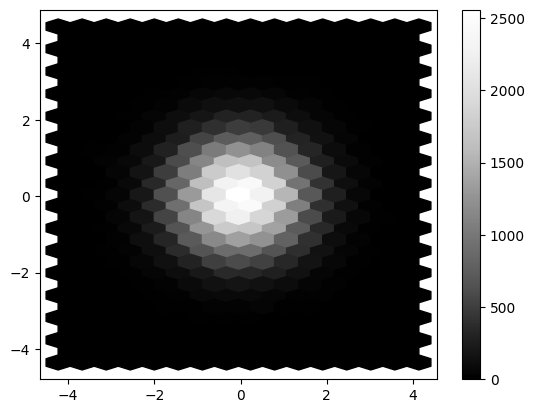

## Hexbin

A [hexbin plot](https://python-graph-gallery.com/2d-density-plot/) is useful to represent the relationship of **2 numerical variables** when you have a lot of data points. Without **overlapping** of the points, the plotting window is split into several **hexbins**. The color of each hexbin denotes the number of points in it. This can be easily done using the `hexbin()` function of matplotlib. Note that you can change the size of the bins using the `gridsize` argument. The parameters of `hexbin()` function used in the example are:

- `x, y`: The data positions
- `gridsize`: the number of hexagons in the x-direction and the y-direction

## Libraries & Dataset

Let's start by import a few libraries and create a dataset:

```python
# libraries
import pandas as pd
import matplotlib.pyplot as plt
import numpy as np
 
# create data
df = pd.DataFrame({
   'x': np.random.normal(size=100000),
   'y': np.random.normal(size=100000)
})
df.head()
```

:::output
::output-html{src="./output-1.html"}
:::

## Make the plot

Making an `hexbin` plot is quite straightforward with the `hexbin()` function from [matplotlib](/matplotlib)

```python
fig, axs = plt.subplots(ncols=2, figsize=(8,4))
 
# Make the plot
axs[0].hexbin(df['x'], df['y'], gridsize=(15,15))
 
# We can control the size of the bins:
axs[1].hexbin(df['x'], df['y'], gridsize=(150,150))

plt.show()
```

:::output

:::

## Color

It is possible to change the **color palette** applied to the plot with the `cmap` argument. Read [this page](/197-available-color-palettes-with-matplotlib) to learn more about color palette with [matplotlib](/matplotlib) and pick up the right one.

```python
fig, axs = plt.subplots(ncols=2, nrows=2, figsize=(8,8))
 
# red colormap
axs[0,0].hexbin(df['x'], df['y'], gridsize=(15,15), cmap=plt.cm.Reds_r)
axs[0,0].set_title('cmap=plt.cm.Reds')

# blue colormap
axs[0,1].hexbin(df['x'], df['y'], gridsize=(15,15), cmap=plt.cm.Blues_r)
axs[0,1].set_title('cmap=plt.cm.Blues')

# green colormap
axs[1,0].hexbin(df['x'], df['y'], gridsize=(15,15), cmap=plt.cm.Greens_r)
axs[1,0].set_title('cmap=plt.cm.Greens')

# grey colormap
axs[1,1].hexbin(df['x'], df['y'], gridsize=(15,15), cmap=plt.cm.Greys_r)
axs[1,1].set_title('cmap=plt.cm.Greys')

plt.show()
```

:::output

:::

## Colorbar and legend

Note that you can easily add a **color bar** beside the plot using `colorbar()` function.

```python
plt.hexbin(df['x'], df['y'], gridsize=(15,15), cmap=plt.cm.Greys_r)
plt.colorbar()
plt.show()
```

:::output

:::

## Going further

You might be interested:

- how to create a [contour plot](/80-contour-plot-with-seaborn), which is a smoothed version of the 2d histogram

- how to combine a [2d density/histogram plot with marginal plot](/82-marginal-plot-with-seaborn)
